# 月次報告システム システム運用マニュアル（システム管理者・補佐向け）

最終更新: 2026-11-27

システム管理者・補佐（補佐（開発担当）を含む）が行う、システムの運用の操作をまとめたものです。
**この冊は、システム管理者・補佐だけで扱ってください。** 一般の利用者には配りません（よくある質問の記録や、心の不調に関わる質問の扱いなど、運用側だけが知っておくことを含みます）。

操作マニュアルは 3 冊に分かれています。節の番号（「4.6」「9.4」など）は 3 冊で共通です。番号の節がこの冊に無いときは、ほかの冊を見てください。

| 冊 | 読む人 | 章 |
|---|---|---|
| 操作マニュアル（`operation_manual.md`） | 全員 | 0〜4、6.3、7.1、7.3、10〜14 |
| 課長・課長代理・主任向けマニュアル（`manager_manual.md`） | 課長・課長代理・主任 | 5、6（6.3 のほか）、7.2、8 |
| システム運用マニュアル（`admin_manual.md`） | システム管理者・補佐 | 9 |

HTML（画像付き）は、それぞれ `manual/` の同じ名前の `.html` です。

---

## 9. システム管理者・補佐の仕事

補佐は管理の仕事を代行できますが、個々の情報（報告の中身・コメント、人ごとの提出状況、閲覧・出力の記録、削除データの中身）は見られません（よくある質問の記録の、聞いた人は見られます。心の不調・退職に関わる質問は見られません）。補佐の操作は「補佐として」記録され、管理者が管理のトップで確かめます。

補佐のうち 1 名（このシステムの設計・製造・保守の担当者）には、管理者が「補佐（開発担当）」の印を付けます。補佐（開発担当）は管理者と同じことができます（個々の情報も見られます）。ただし、心の不調・退職に関わる質問は見られません（管理者だけ）。

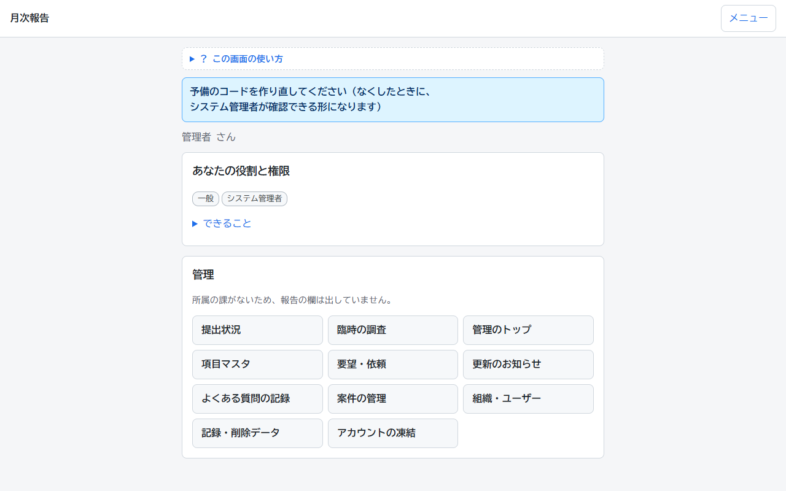

所属の課がない管理者のホームには、報告の欄の代わりに管理の画面への入口が並びます。

### 9.1 管理のトップ

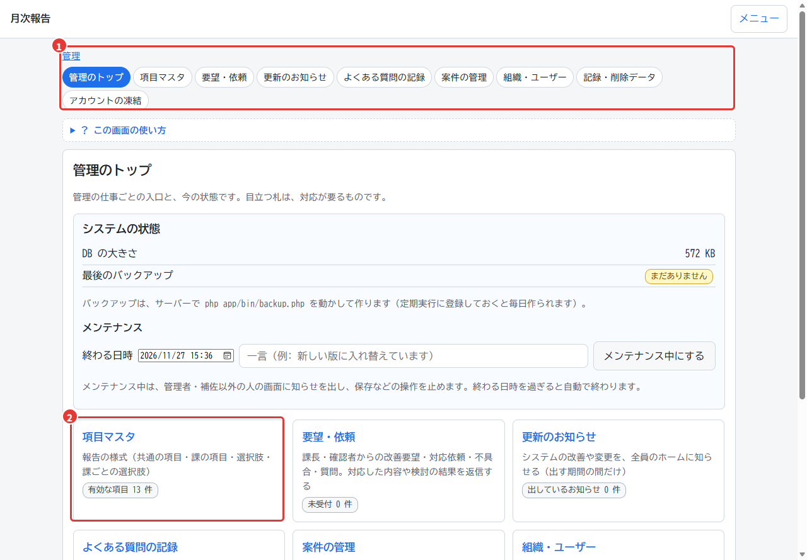

管理の仕事ごとの入口と、今の状態が並びます。目立つ札は、対応が要るものです。

- 上の並び（図の 1）で、管理の画面を切り替えられます。どの管理の画面にも出ます。
- カード（図の 2）を押すと、その仕事の画面に移ります。カードには件数などの状態が出ます。
- バックアップの状態（最後のバックアップの日時。7 日より古いと知らせが出る）
- メンテナンスの切り替え（メンテナンス中は、管理者・補佐のほかはログインできず、ログインしている人も追い出されます）
- 課長がいない課があるときの知らせ（その課は確認を完了にできない）

### 9.2 項目マスタ

共通の項目と課の項目を追加・編集・並べ替えます。変更は、これから作る報告に反映されます。操作は 8.2 と同じです。

### 9.3 案件の管理

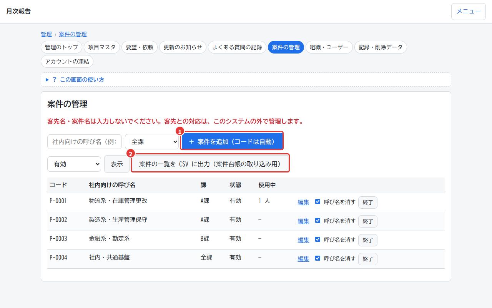

案件コードと社内向けの呼び名を管理します。客先名は入れないでください。

- 案件を足すときは、呼び名などを入れて「＋ 案件を追加（コードは自動）」（図の 1）を押します。終わった案件は「終了」を押します。
- 案件台帳との突き合わせには「案件の一覧を CSV に出力」（図の 2）を使います。

### 9.4 組織・ユーザー

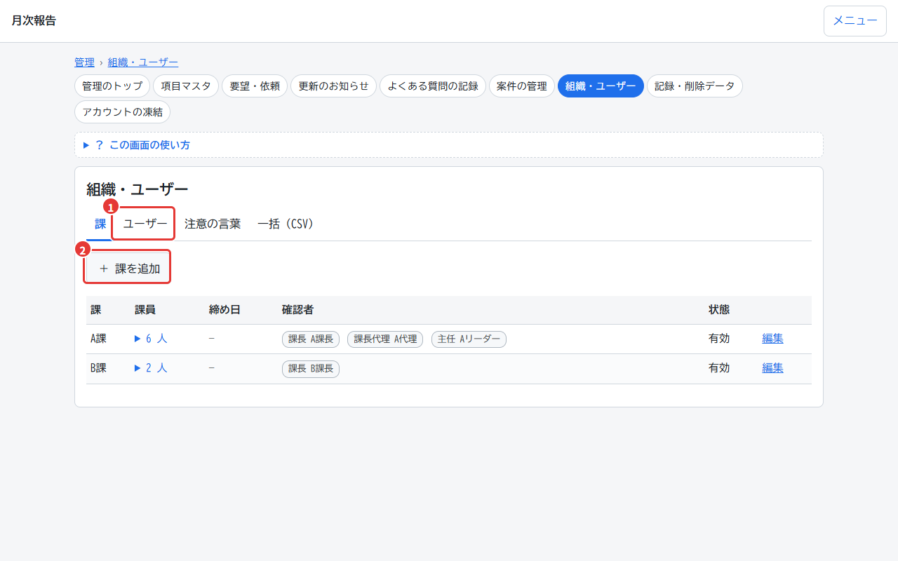

「組織・ユーザー」は、課・ユーザー・注意の言葉・一括（CSV）のタブに分かれています。課を足すときは「＋ 課を追加」（図の 2）、ユーザーの仕事は「ユーザー」のタブ（図の 1）です。課の一覧の「課員」の「n 人」を押すと、その課に所属している人と兼務の人の名前が開きます。課の「編集」の「課員」の節でも、所属の人全員（ライン・役割つき）を見られます。

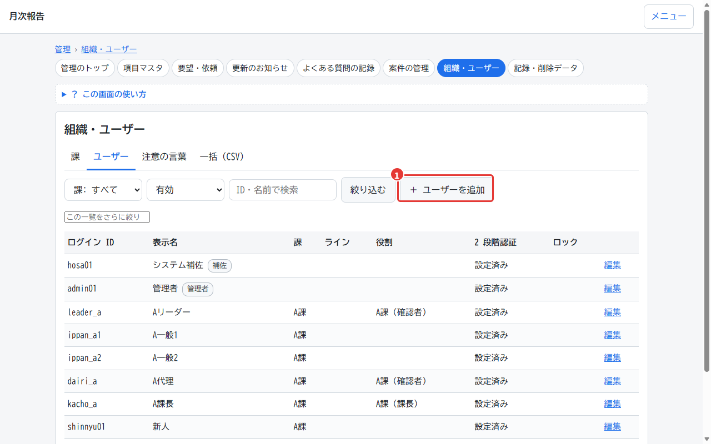

ユーザーを足すときは「＋ ユーザーを追加」（図の 1）を押します。一覧の行の「編集」を押すと、そのユーザーの編集の画面が開きます。

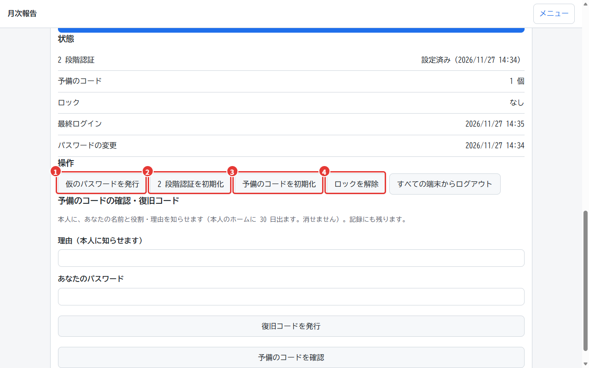

ユーザーの編集の画面の下の「操作」に、パスワードや 2 段階認証のボタン（図の 1〜4）が並びます。押して確認が出たら、内容を読んで「OK」を押します。

| 仕事 | 内容 |
| --- | --- |
| 課 | 課の追加・名前・並び・有効／無効、課長を決める |
| ユーザー | 追加、表示名・役職・所属の課・有効の変更 |
| 仮のパスワード | 発行する（図の 1）。一度だけ表示されるので、本人に伝える。はじめての人には、先にスマートフォンに認証アプリを入れ、はじめてのログインはスマートフォンで行うよう伝える |
| 2 段階認証の初期化 | 本人が認証アプリも予備のコードも使えなくなったとき（図の 2） |
| 予備のコードの初期化 | 本人が予備のコードをメールやチャットに貼った、なくした、などのとき（図の 3）。今のコードがすべて使えなくなる（認証アプリはそのまま使える）。本人のホームに作り直しの知らせが出るので、アカウント設定の「予備のコード」で作り直すよう伝える。補佐も行える（管理者・補佐の利用者は、管理者と補佐（開発担当）だけ） |
| ロックの解除 | ログインの失敗でロックされた人（図の 4） |
| 部長以上 | ユーザーの編集の「部長以上」に印を付けると、全課共通の臨時の調査の結果（集計だけ）をすべて見られる（9.9）。管理の権限は付かない |
| 人財管理者 | ユーザーの編集の「人財管理者」に印を付けると、全課共通の臨時の調査を作り、結果（集計だけ）を見られる（9.9）。ほかの管理の権限は付かない |
| 専門職 | ユーザーの編集の「専門職」で、技師・担当課長・担当部長を選ぶ（ラインを管理しない技術職）。課長・確認者・項目管理者にはなれず（今の役割は外れます）、ほかの人の報告は見られない。報告を見るのは課長だけ（担当部長の報告は、課長も見られない） |
| 注意の言葉 | 客先名らしい言葉の一覧 |
| 組織の一括の入れ替え | 毎年の組織改訂を CSV で入れる。事前に予告がある改訂は、反映する日を予約できる |

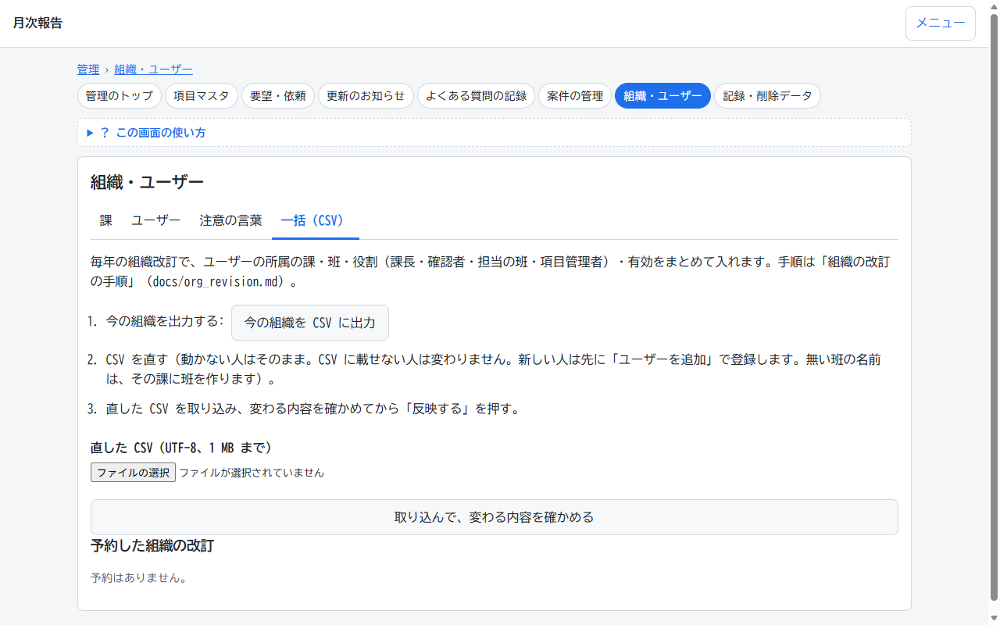

一括の入れ替えの CSV は UTF-8 で作ってください（12.3）。先に「今の組織を CSV に出力」で今の組織を出し、それを直して取り込むと間違いが少なくなります。取り込むと、変わる内容が先に表示されるので、確かめてから反映します。CSV から行を消した人は変わりません（課から外れません）。載っていない人がいるときは、その人数と一覧が出ます。課を移す・無効にするときは、行を残して「所属の課」や「有効」を直してください。ほかの課の課長・確認者を兼ねる人（課のない部長が課長の課を含む）は、「兼務」の列に「課の名前:課長」か「課の名前:確認者:担当のライン」（担当のラインは省けます）を「; 」でつないで書きます（例「B課:課長; C課:確認者:山田ライン」）。兼務を外すときは消します。

### 9.5 記録・削除データ

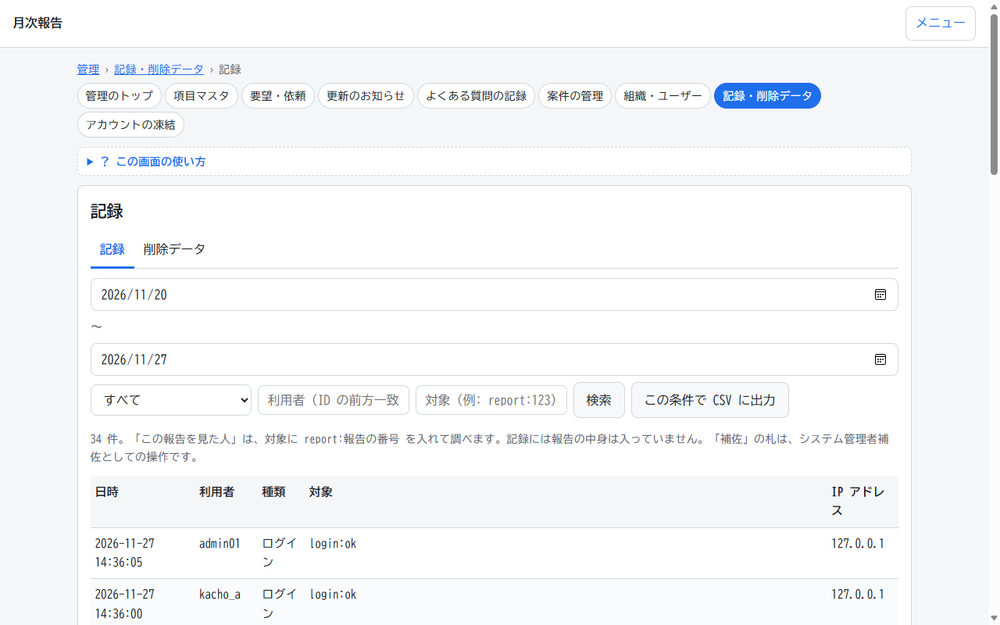

- 閲覧・出力・管理の操作・ログインの記録を探せます。「ログインの失敗」で、不正なアクセスの疑いを確かめられます。記録に報告の中身は入っていません。
- **無い ID でのログイン**: 存在しない ID でログインしようとした記録があると、システム管理者・補佐のホームに知らせが出ます。種類「無い ID でのログイン」で、入れた ID と IP アドレスを見て、打ち間違いか、なりすまし・総当たりのおそれがないか確かめ、「確かめた」を押してください。
- **ID・パスワードを求める質問**: よくある質問のチャットで、ほかの人の ID・パスワードを求める質問があると、システム管理者・補佐のホームに知らせが出ます。「よくある質問の記録」の「知らせる質問」の欄で聞いた人を確かめ、「対応した」を押してください。パスワードは教えないでください。
- **システム・データを壊すと書いた文**: よくある質問のチャットで「DBを消してやる」「システムをぶっ壊す」のように、システムやデータを壊す・消す・持ち出すつもりの文があると、チャットは答えずに断り、システム管理者・補佐のホームに知らせが出ます。「よくある質問の記録」の「知らせる質問」の欄で聞いた人を確かめ、必要なら課長と相談して対応し、「対応した」を押してください。「DBを消したい」のような、ふつうの言い方は知らせません（消す機能が無いことを答えます）。

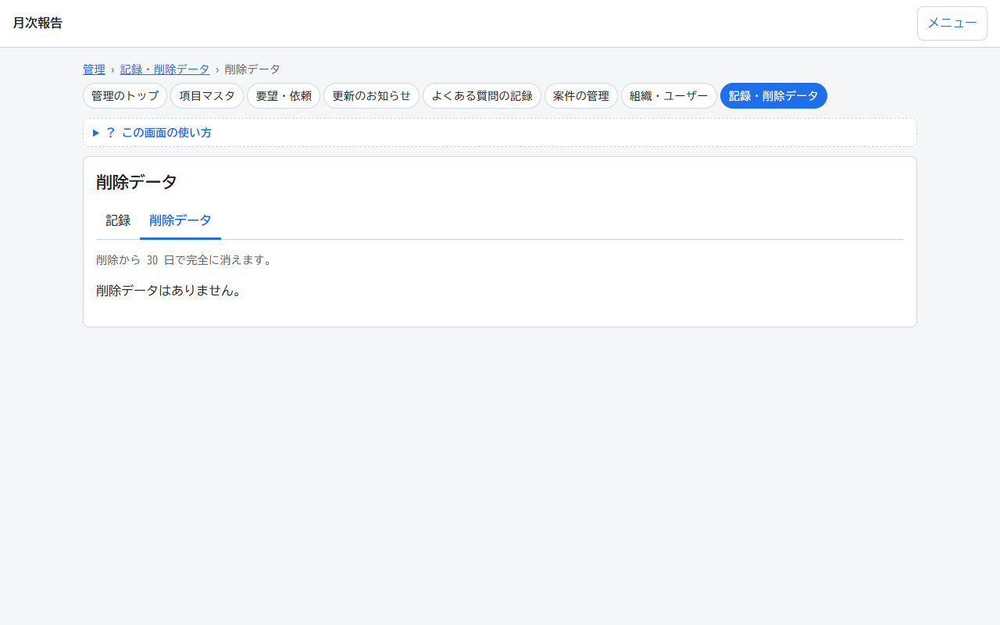

- 削除した報告・コメント・臨時の調査は、削除から一定の日数の間は戻せます。

### 9.6 更新のお知らせ

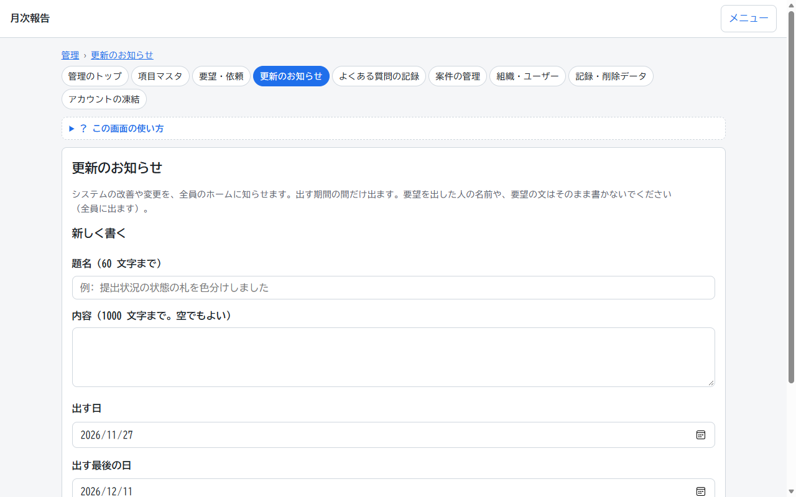

システムの改善や変更を、出す期間の間、全員のホームに知らせます。要望を出した人の名前や要望の文は、そのまま書かないでください。

### 9.7 要望・依頼への返信

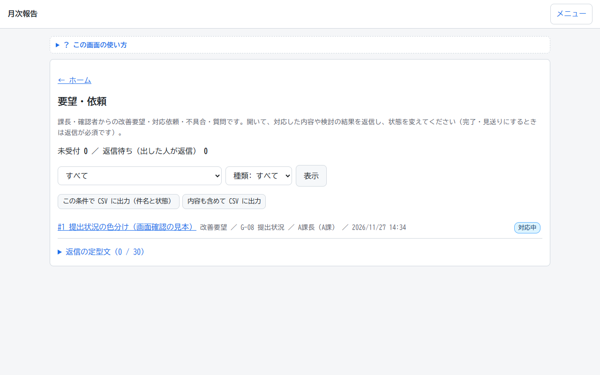

1. メニューの「要望・依頼」で一覧を開く。件名を押すと詳細が開きます。

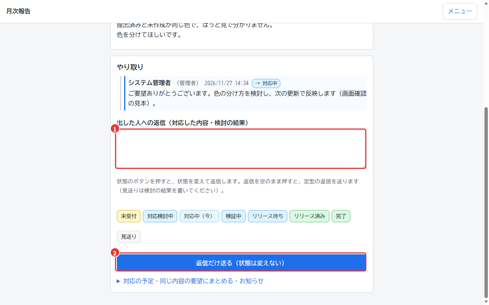

2. 詳細を開き、返信の文（図の 1）を書いて、状態のボタンで状態を変えて返信する（返信が空なら定型の返信になる）。状態を変えずに返信だけするときは「返信だけ送る（状態は変えない）」（図の 2）を押します。

種類が「質問」で閉じた要望・依頼は、「よくある質問に載せる」でよくある質問にできます。質問と答えは書き直して載せ、出した人の文や名前は出しません。

### 9.8 よくある質問の管理

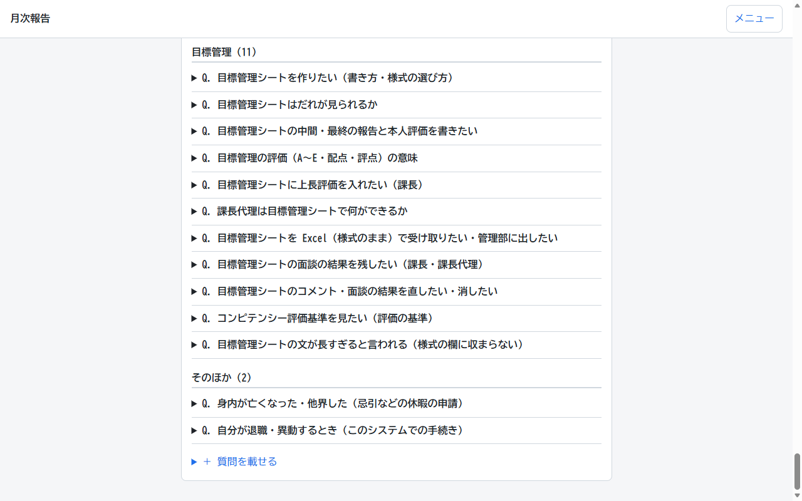

よくある質問の画面で、分野・質問（200 文字まで）・答え（2,000 文字まで）を載せる・直す・消す・並べ替えることができます。500 件まで載せられます。「↑」「↓」は同じ分野の中で並べ替えます。
**載せる文の注意**: よくある質問はだれでも読めます（「システムの管理」の分野は管理者・補佐だけ）。コマンド・ファイルの場所・鍵やパスワードの置き場所など、システムの内部の情報は書かないでください。

**標準のよくある質問**: この操作マニュアルの全章とシステムの概要から想定される質問（192 件）を、システムに用意してあります。「すべての質問」の下の「標準のよくある質問を取り込む」を押すと、まだ載っていない質問だけを分野つきで足します（同じ質問の文があるものは足しません）。新しい版で標準の質問が増えたとき・答えが新しくなったときも、もう一度押せば、増えた分を足し、答えを新しくします（ここで直した答えは変えません）。取り込んだあとは、自由に直す・消すことができます。
探すときは、質問と答えの文の中の言葉で探します（質問に当たるほうを先に出します）。利用者が使いそうな言い方（「スマホ」「締切」など）を質問か答えに入れておくと、見つかりやすくなります。

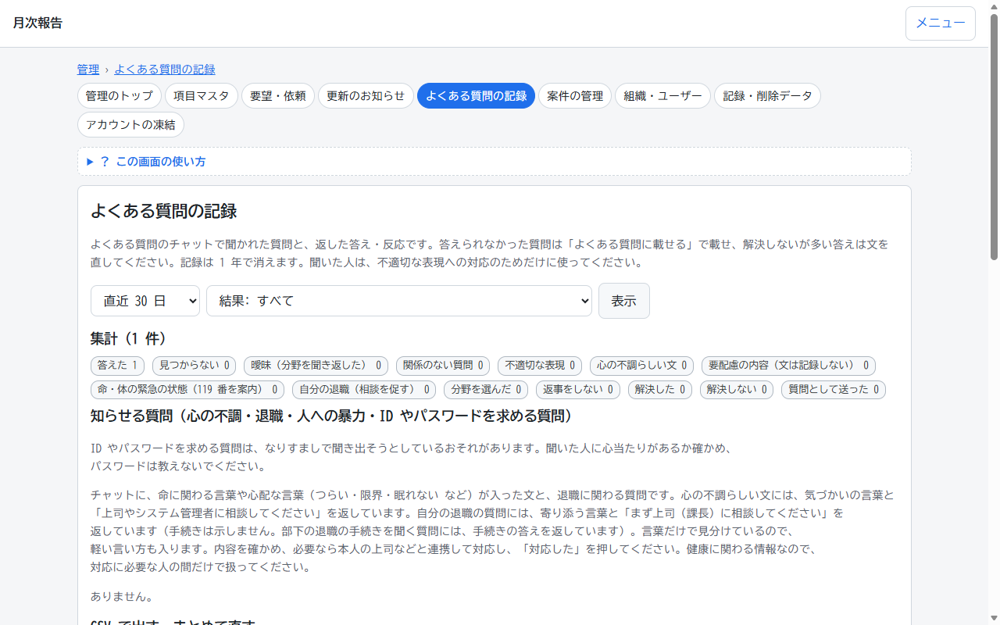

**よくある質問の記録**: メニューの「よくある質問の記録」で、チャットで聞かれた質問と返した答え・反応を見られます。
- 「答えられなかった質問」（見つからなかった・「解決しない」・質問として送ったもの）を多い順に出します。「よくある質問に載せる」を押すと、その文が入った状態で載せる欄が開きます。
- 「「解決しない」が多い答え」は、答えの文を直す候補です。
- 「関係のない質問とした文」にシステムの質問が出ていたら、開発担当に伝えてください（言葉の表に足します）。
- 「不適切な表現」に、乱暴な言葉の文と聞いた人が出ます。聞いた人の名前は、システム管理者と補佐が見られます。対応のためだけに使ってください。管理のトップのカードにも、7 日の件数が出ます。
- 「心の不調・退職に関わる質問」に、心の不調に関わる言葉が入った文と、退職に関わる質問、聞いた人が出ます（命に関わる言葉を先に）。ホームと管理のトップにも、未対応の件数が目立つ札で出ます。この欄と知らせは、システム管理者だけに出ます（補佐には出ません）。内容を確かめ、必要なら本人の上司などと連携して対応し、「対応した」を押してください。言葉だけで見分けているので、軽い言い方も入ります。健康に関わる情報なので、対応に必要な人の間だけで扱ってください。
- 記録は 1 年で消えます。記録の画面を見たことは、操作の記録に残ります。
- **CSV で出す・まとめて直す**: 「記録を CSV で出す」で、期間の中の記録を 1 回の質問ごとに出せます（聞いた人の名前と、知らせる質問は入りません）。「メンテナンス用の CSV を出す」で、載っている質問・まだ載っていない標準の質問・答えられなかった質問（多い順）を 1 つのファイルに出せます。Excel などで直し（載っている質問は分野・質問・答えを直すか「消す」に 1、番号の無い行は答えを書いた行だけ足されます。番号と直した日時は変えないでください）、「CSV UTF-8」で保存して取り込むと、足す・直す・消すの内容が出ます。確かめて「反映する」を押すと、まとめて変わります。CSV から消した行の質問は、そのまま残ります。CSV を出したあとに画面で直された質問は、上書きしません（もう一度 CSV を出して直してください）。

よくある質問で見つからずに送られた質問は、「要望・依頼」に種類「質問」で届きます（7.3）。答えたら、閉じた詳細の「よくある質問に載せる」で載せると、次から探して見つかるようになります。

---

### 9.9 全課共通の臨時の調査

すべての課に同じ質問で聞く調査です。結果を見るのは依頼元と部長以上です。作るのは人財管理者と、システム管理者・補佐（代わりに行います）です。

1. メニューの「臨時の調査」→「＋ 新しく作る」で、「課」に「全課共通（すべての課の全員）」を選ぶ。対象はすべての課の全員、結果は集計だけになります。答え方は選択式とチェックだけです。
2. 質問を足して「公開する」。
3. 編集の画面の「結果を見られる人」で、依頼元の担当者などに印を付けて保存する（公開の後でも変えられます）。

結果を見られるのは、人財管理者、システム管理者・補佐、「部長以上」の印の人（9.4。すべての全課共通の調査）、「結果を見られる人」に選んだ人です。見られる人のメニューには「調査の結果」が出ます。結果の画面では、全課の集計・課ごとの回答の状況・課ごとの内訳を見て、印刷（PDF）・Excel・CSV に出力できます。個人の回答と、答えていない人の名前は、だれにも出ません。

**部長以上のアカウントを作る**

1. 「組織・ユーザー」の「ユーザー」のタブで「＋ ユーザーを追加」。ログイン ID・表示名を入れ、役職は「部長」、所属の課は「（なし）」（課に所属する人なら、その課）にし、「部長以上」に印を付けて「追加して仮のパスワードを発行」。
2. 表示された仮のパスワードを本人に伝える（一度だけ表示されます）。本人ははじめてのログインで、パスワードを変え、2 段階認証を設定します。
3. すでにアカウントがある人は、ユーザーの編集で「部長以上」に印を付けて「保存」するだけです。

役職の「部長」は表示のためのもので、結果を見られるかどうかは「部長以上」の印で決まります。

### 9.10 予備のコードの確認・復旧コード・アカウントの凍結

システム管理者と補佐（開発担当）だけが使えます。**操作すると、相手のホームに、あなたの名前と役割・理由が 30 日出ます（消せません）。** 操作の前に、電話などで本人と確かめてください。

| 困りごと | すること |
| --- | --- |
| 予備のコードをなくした・分からない（認証アプリは使える） | 本人に、アカウント設定の「予備のコード」で作り直してもらう |
| 認証アプリも予備のコードも使えない | ユーザーの編集の「復旧コードを発行」。30 分以内・1 回限り。本人はログインの「コード」の欄に入れ、2 段階認証の設定からやり直す |
| 本人の予備のコードを確かめたい | ユーザーの編集の「予備のコードを確認」。確認したコードは、本人に作り直してもらう |

どちらも、理由とあなたのパスワードを入れます。作り直す前の古い予備のコードは確認できません。

**「心当たりがない」と知らせがあったとき**

1. 本人が知らせの「心当たりがない（知らせて凍結する）」を押すと、本人のアカウントが一時凍結し、システム管理者と補佐（開発担当）のホームに赤で出ます。
2. 電話などで本人に確かめ、メニューの「アカウントの凍結」で、理由とあなたのパスワードを入れて「再初期化して凍結を解く」を押します。もとの操作をした人は行えません。
3. 出てきた仮のパスワードを本人に伝えます。本人は 2 段階認証の初期設定からやり直し、新しいパスワードを決めます。凍結前のパスワードは使えません（似たものも避けてもらってください）。同じパスワードをほかのサービスで使っていれば、そちらも変えてもらいます。

**補佐（開発担当）がログインできなくなったとき**

管理者だけでは、開発担当（前に開発担当だった人を含む）のパスワードや 2 段階認証を初期化できません。「アカウントの凍結」で管理者が復旧を申請し、別の補佐が 24 時間以内に承認します（直前 7 日に、仮のパスワードの発行などを受けた補佐・新しく補佐になった人は承認できません）。仮のパスワードの前半は管理者、後半は補佐にだけ出るので、それぞれが本人に直接伝えてください。

**全員の総入れ替え**

同じ人の 2 回目の凍結か、30 日に 2 人以上の凍結があると、「アカウントの凍結」に欄が出ます。先に、本人の端末を調べ、操作した人の記録を確かめてください。実施するときは、**システム管理者と補佐（開発担当）が連絡を取り合い、1 人が申請し、もう 1 人が 24 時間以内に承認します。** 1 人では実施できません。開発担当がいない・凍結中のときは、別の補佐が代わりになります。そのため、システム管理者 1 名以上と、開発担当のほかに補佐 1 名以上を、必ず置いてください（補佐を交代するときは、先に次の人を補佐にします）。全員がログアウトし、次のログインでパスワードの変更と 2 段階認証の設定し直しを求められます。

### 9.11 サーバーのコマンドで行うこと（システム管理者）

画面にはなく、サーバーに SSH でつないで、サイトのフォルダー（例: `~/www/report-system_onion`）で実行します。書いてあるとおりにならないときは、そこで止めて開発担当に連絡してください。開発担当には件数とメッセージだけを送り、名前や報告の文、鍵は送らないでください。

| すること | コマンド | いつ |
| --- | --- | --- |
| バックアップを作る | `php app/bin/backup.php` | 毎日（定期実行に登録できるとき）と、更新の前 |
| DB の形を新しくする | `php app/bin/migrate.php` | 更新のとき（開発担当の手順書に書いてあるときだけ） |
| 移行の前後を突き合わせる | `php migration_check.php snapshot` と `compare` | 実データが入った DB を移行するとき（手順書に従う） |
| 暗号化の鍵を入れ替える | `php app/bin/rotate_key.php` | 鍵が漏れたおそれがあるとき |

更新や鍵の入れ替えのあとは、全員がログインし直しになることがあります。先に、入力中のものを保存してログアウトしてもらうよう案内してください。

**暗号化の鍵を入れ替える手順**

1. 管理のトップの「メンテナンス」を始めます（始めていないと、入れ替えは断られます）。終わりの時刻は余裕を持たせます。
2. `php app/bin/rotate_key.php --dry-run` で、全件を今の鍵で読めるかを確かめます（何も変わりません）。「復号できない値」が出たら、先に進まず開発担当に連絡します。
3. `php app/bin/rotate_key.php` を実行します。先に控え（`app/backups/before_key_rotation_…`）を作り、「入れ替えました」と件数が出れば終わりです。途中で失敗したときは、DB は元のままです。
4. ログインし直し、報告を 2〜3 件開いて読めることを確かめ、メンテナンスを終えます。
5. 新しい鍵（`app/keys/field_v2.key` など）の控えを、DB と別の安全な場所に取ります。
6. 古い鍵と、入れ替える前のバックアップは、www の外の安全な場所に、別々に移します（前のバックアップを読むのに要ります。いつまで残すかは会社の決まりに従います）。

**鍵の入れ替えで守れるのは、これからのデータだけです。** 抜かれた DB と古い鍵の組は、読めるままです。2 段階認証の設定も変わらないので、抜かれたおそれがあるときは、全員の総入れ替え（9.10）も行います。総入れ替えの欄は、凍結の条件がそろったときだけ出ます。出ていないときは、開発担当に連絡してください（サーバーから抜かれたおそれだけで総入れ替えを始める操作は、まだありません）。
