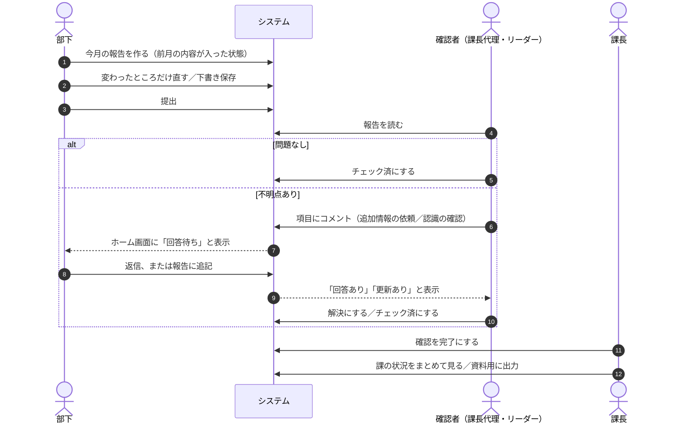
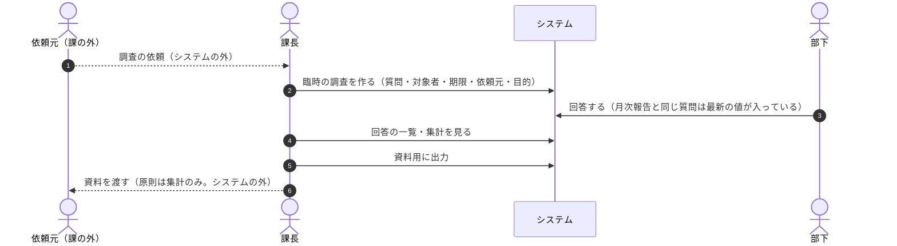
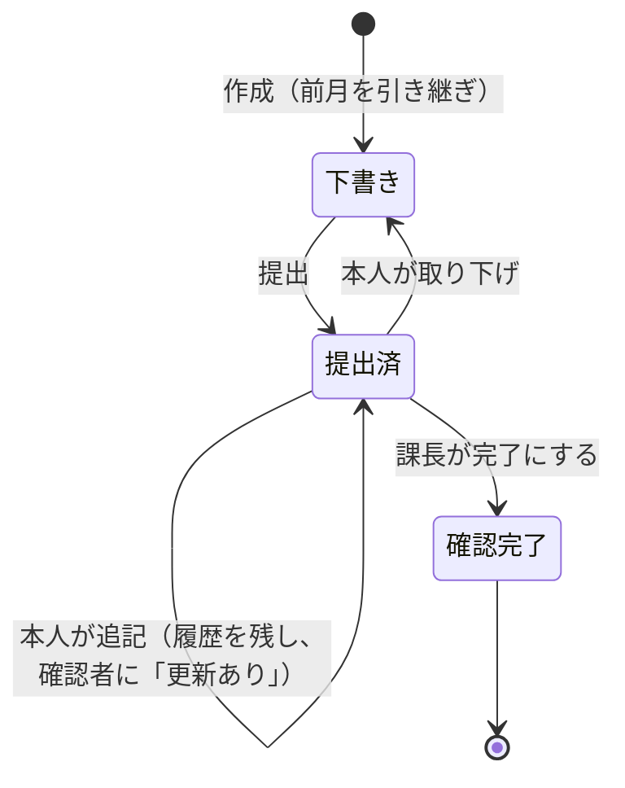
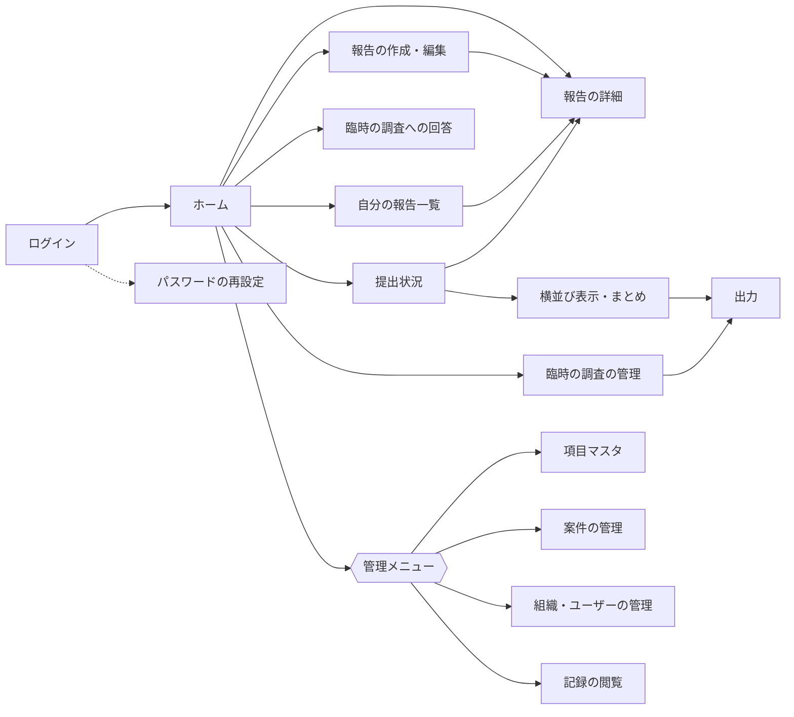
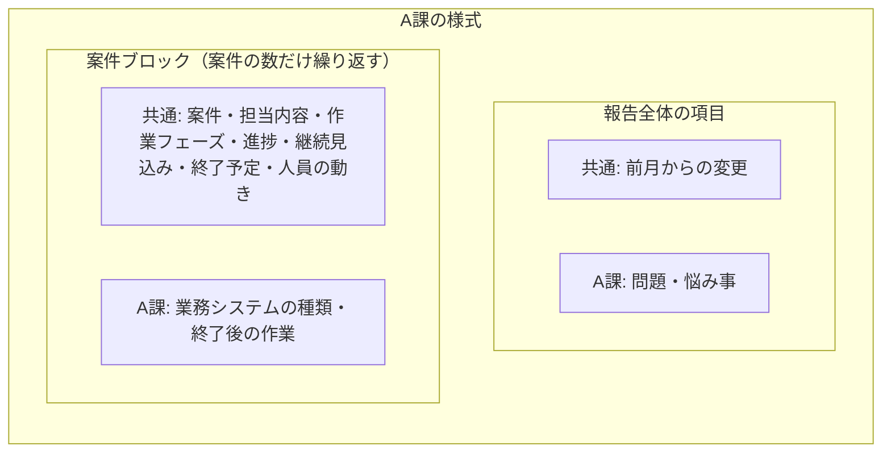
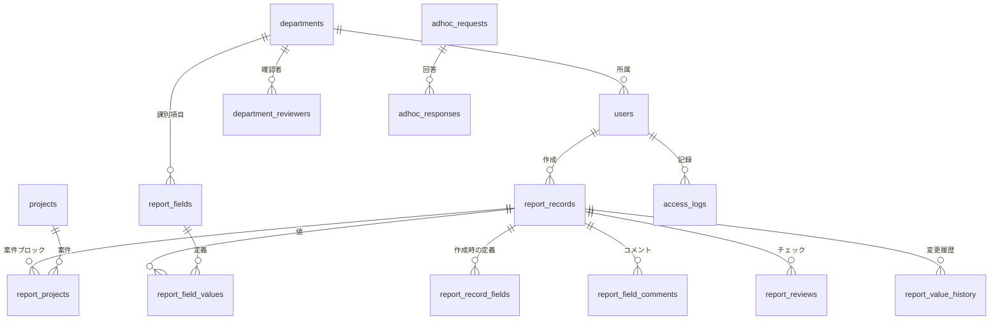

# 基本設計書

月次報告システム（見直し版）

| 項目 | 内容 |
|---|---|
| 版 | 0.1（たたき台） |
| 作成日 | 2026-11-12 |
| 対象の読者 | このシステムを初めて知る人（課長、確認者、管理者、開発を引き継ぐ人） |
| 関連文書 | [見直し計画](redesign_plan.md)、[システム構成図](system_architecture.md) |

---

## 1. この文書について

この文書は、**このシステムが何のためにあり、何ができて、どのような考え方で作られているか**を説明する。プログラムの知識がなくても読めるように書く。

テーブルの列や処理の細かい動きは、詳細設計書（今後作成）で扱う。検討の過程と未決事項は[見直し計画](redesign_plan.md)にある。

---

## 2. システムの概要

### 2.1 背景

社員の大半は客先に常駐している。課長は、課の社員から**毎月の現場の状況**（参画している案件、作業の進み具合、案件がいつまで続くか、人員が増えそうか減りそうか）を集め、課より上への報告に使っている。

この集め方は課ごとに異なり、Excel などで個別に行われている。既存の Web 版（`main`）は項目が 6 つで固定され、毎月白紙から入力する作りのため、部下の手間が Excel より増えるおそれがある。

### 2.2 目的

| 目的 | 内容 |
|---|---|
| 部下の手間を減らす | 前月の内容を引き継ぎ、変わったところだけ直す。変化がなければ数回の操作で終わる |
| 課ごとの集め方に合わせる | 全課で同じ「共通項目」に、課ごとの「課別項目」を足せる。項目は管理画面で自由に増減できる |
| 課長の確認と資料づくりを楽にする | 提出状況、確認者ごとのチェック状況、課の横並び表示、資料用の出力 |
| 客先の情報を守る | 漏えいは起きる前提で、漏れたときの影響が最小になるように作る |

### 2.3 システムの範囲

- このシステムは、**課の中の情報（元ネタ）を集め、課長が報告しやすくする**ためのもの。
- 報告の流れは**課長で完結する**。課長より上（部長・役員など）への報告書は、課長がこのシステムの出力をもとに別に作る。部長・役員はこのシステムを使わない。
- 課の外からの臨時の調査依頼も、課長が受けてこのシステムで集め、結果を出力して渡す。
- 社内のほかのシステムとは統合せず、独立したツールとして開発する。客先名などを持つシステムと結び付けないことで、漏えいしたときの影響を小さくする（§4.2）。

### 2.4 利用者

| 利用者 | 人数（1 課あたりの目安） | 主に使う端末 | 主な使い方 |
|---|---|---|---|
| 部下（課の社員） | 課による | **私物のスマートフォン** | 月に 1 回、報告を作って提出する。臨時の調査に答える。コメントに返信する |
| 確認者（課長代理・リーダー） | 課長代理 2 名、リーダー 2〜3 名 | スマートフォン・PC | 報告を確認してチェックする。不明点をコメントで聞く |
| 課長（最終確認者） | 1 名 | PC・スマートフォン | 確認を完了にする。臨時の調査を作る。資料用に出力する。課別項目を管理する |
| 管理者 | 若干名 | PC | 共通項目、課、ユーザー、確認者、案件の管理 |

### 2.5 前提と制約

| 項目 | 内容 |
|---|---|
| 稼働環境 | さくらのレンタルサーバー（インターネットに公開） |
| 言語・DB | PHP（7.4 以上で動く書き方）、SQLite（PDO 経由） |
| 外部の部品 | フレームワーク・Composer・npm・ビルド工程を使わない。JavaScript は最小限 |
| 利用場所 | 社員の大半は社外（客先）から使う。社内の IP アドレスでの接続制限はできない |
| 利用頻度 | **月に 1 回**が基本。例外として月の途中に臨時の調査がある |
| 既存データ | 既存の Web 版のユーザー・報告・コメントを移行する |

---

## 3. 用語集

| 用語 | 意味 |
|---|---|
| 課 | 報告を集める単位の組織。課ごとに様式が異なる |
| 共通項目 | 全課で同じ項目 |
| 課別項目 | 課ごとに追加する項目（その課だけで集める補足情報） |
| 様式 | ある課の入力画面。共通項目＋その課の課別項目 |
| 項目マスタ | 項目の定義（表示名、入力部品、必須、選択肢など）を管理する仕組み |
| 入力部品（コントロール） | 1 行テキスト、プルダウンなど、項目の入力の形 |
| 月次報告 | 1 人・1 か月につき 1 件の報告 |
| 案件ブロック | 月次報告の中で、参画している案件ごとに繰り返して入力するまとまり |
| 案件コード | 社内で案件に付ける記号。客先名・案件名の代わりに使う |
| 確認者 | 課の報告を確認する人（課長代理・リーダー）。課長は最終確認者 |
| チェック | 確認者が報告を確認したしるし |
| 臨時の調査 | 月の途中で、課長が質問・対象者・期限を決めて集める調査 |
| 機密区分 | 項目ごとの情報の重さ。通常・社外秘・限定の 3 段階 |

---

## 4. 設計の原則

すべての機能は、次の 4 つの原則に従う。新しい機能を足すときも、この 4 つで確かめる。

### 4.1 部下の作業を増やさない

報告づくりは、本来の業務の外の作業になりやすい。部下の手戻りを生む仕組みは入れない。

- **差戻しをしない。** 報告全体を突き返して出し直させる機能は作らない。不明点はコメントで聞く。
- **回答を強制しない。** 回答待ちのコメントがあっても、課長は確認を完了にできる。
- **出し直しの操作をなくす。** 提出後に追記しても、変更の履歴が残り、確認者に「更新あり」と表示されるだけ。
- 前月の内容を引き継ぐ。「前月から変更なし」で提出できる。
- 必須の項目は最小限にする。下書きの保存では必須のチェックをしない。

### 4.2 漏えいは起きる前提で、被害を小さくする

漏えいを完全には防げない前提で、**漏れても守秘義務の違反や謝罪の範囲が最小になる**ように作る。

| 考え方 | 内容 |
|---|---|
| 集めない | 客先名・案件名・個人名をこのシステムに入れない。自由記述より選択式にする |
| 結び付けない | 案件はコードだけで扱う。客先との対応表はシステムの外に置く |
| 読めなくする | **自由記述はすべて**と、機密区分が「限定」の項目を、暗号化して保存する。鍵は DB とは別の場所に置く |
| 早く消す | 自由記述は一定期間で消し、集計に使う選択式の値だけを残す |
| 範囲を特定できる | 誰が・いつ・何を見たか、出力したかを記録する |
| 出さない | 出力は課長だけ・PC だけにし、ファイルに出力者と日時を入れる |

### 4.3 月に 1 回しか使わない前提にする

部下は月に 1 回しかログインしないため、使い方もパスワードも忘れている前提で作る。

- 説明を読まなくても使える画面にする。「今月の報告を作る」から始まり、前月の内容が入った状態で開く。
- パスワードは、管理者に頼らず自分で再設定できる。
- 2 段階認証の「この端末を記憶する」は 1 か月より長くする（例: 90 日）。
- ログインの失敗による締め出しは、ゆるめに設定する。

### 4.4 私物のスマートフォンで使う

- 部下の入力、確認者のチェック、コメントの返信は、**スマートフォンだけで終わる**画面にする。
- PC は、管理と集計・出力に使う。
- アプリのインストールは不要（ブラウザーだけ）。端末に画面の内容やファイルを残さない。

---

## 5. 業務の流れ

### 5.1 月次報告



### 5.2 臨時の調査



### 5.3 報告の状態



- 差戻しの状態はない（§4.1）。
- 確認者ごとのチェック状況は、報告の状態とは別に持つ（未チェック／チェック済／更新あり）。

### 5.4 コメントの状態

| 種類 | 状態の流れ | 返答 |
|---|---|---|
| 追加情報の依頼 | 回答待ち → 回答あり → 解決 | 求める（強制はしない） |
| 認識の確認 | 回答待ち → 回答あり → 解決 | 求める（強制はしない） |
| 連絡 | 状態なし | 不要 |

---

## 6. 機能一覧

| No | 機能 | 内容 | 段階 |
|---|---|---|---|
| F-01 | ログイン・ログアウト | ログイン ID とパスワード。パスワードの自己再設定 | 1 |
| F-02 | 2 段階認証・端末の管理 | スマートフォンの認証アプリ（TOTP）、端末の記憶、予備のコード、すべての端末からログアウト | 1 |
| F-03 | 組織（課）の管理 | 課の登録、ユーザーの所属、確認者と最終確認者、課別項目を管理できる人 | 1 |
| F-04 | 項目マスタ | 共通項目（管理者）と課別項目（課長）の追加・編集・並べ替え・有効/無効、プレビュー | 1 |
| F-05 | 月次報告の作成・編集 | 様式に従って入力画面を自動で作る。案件ブロックの繰り返し。氏名・対象月は自動 | 1 |
| F-06 | 月次報告の表示 | 作成当時の項目の定義で表示する | 1 |
| F-07 | コメント | 項目ごと・報告全体へのコメント。種類、返信、回答待ち→解決 | 1 |
| F-08 | 既存データの移行 | 既存の Web 版の報告とコメントを移す | 1 |
| F-09 | 案件の管理 | 案件コードと社内向けの呼び名（客先名は持たない） | 1 |
| F-10 | 前月からの引き継ぎ・変更なし | 前月の内容を入れて作成。「前月から変更なし」で提出 | 2 |
| F-11 | 提出・確認完了 | 報告の状態、提出後の追記と変更履歴 | 2 |
| F-12 | 確認者ごとのチェック | チェック済／未チェック／更新ありの表示 | 2 |
| F-13 | 提出状況 | 対象月×課の一覧。提出状況、チェック済の数、回答待ちの数。自分が未チェックのものに絞る | 2 |
| F-14 | 臨時の調査 | 課長が作成。月次の項目の再利用＋独自の質問、ひな形、集計のみの公開 | 2 |
| F-15 | 検索 | 対象月・課・選択式の値・キーワード（検索の対象は項目マスタで指定。自由記述は暗号化しているため、権限のある範囲をアプリの中で復号して探す） | 2 |
| F-16 | 横並び表示 | 同じ課・同じ月の報告を項目ごとに並べる。前月との差分 | 3 |
| F-17 | 状況のまとめ | 終了が近い案件、人員の動きがある現場、遅延・問題がある現場の一覧 | 3 |
| F-18 | 資料用の出力 | 印刷用画面（PDF 保存）、Excel 形式、CSV | 3 |
| F-19 | 記録 | 閲覧・出力・管理操作の記録 | 1 |
| F-20 | 保管期限による削除 | 自由記述と古い報告の削除 | 3 |
| F-21 | 削除の取り消し | 削除した報告・コメント・臨時の調査を一定期間戻せる（§15.4） | 2 |
| F-22 | データチェック・稼働の確認 | 登録済みのデータの確認、稼働の確認用の入り口（§15.7） | 1 |
| F-23 | 二重登録の防止 | 送信の番号、通信が切れたときの案内、下書きの自動保存（§15.3） | 1 |

段階 1 で「項目を自由に設定でき、安全に使える土台」を作り、段階 2 で部下と確認者の手間を減らし、段階 3 で課長の資料づくりを助ける。

---

## 7. 画面

### 7.1 画面一覧

| No | 画面 | 利用者 | 主な端末 | 内容 |
|---|---|---|---|---|
| G-01 | ログイン | 全員 | スマホ | ログイン ID・パスワード、2 段階認証のコード |
| G-02 | パスワードの再設定 | 全員 | スマホ | ログイン ID と 2 段階認証のコードで本人確認 |
| G-03 | ホーム | 全員 | スマホ | 今月の報告の状態、締め日、回答待ちのコメント、臨時の調査。（確認者）未チェックの報告、回答あり |
| G-04 | 報告の作成・編集 | 部下 | スマホ | 様式に従った入力。案件ブロックの追加・削除。下書き保存・提出・変更なし |
| G-05 | 報告の詳細 | 部下・確認者・課長 | スマホ | 項目の表示、コメントのやり取り、確認者ごとのチェック状況、変更履歴、チェック・完了の操作 |
| G-06 | 自分の報告一覧 | 部下 | スマホ | 月ごとの報告と状態 |
| G-07 | 臨時の調査への回答 | 部下 | スマホ | 依頼元・目的・期限の表示と回答 |
| G-08 | 提出状況 | 確認者・課長 | スマホ・PC | 対象月×課の一覧、絞り込み |
| G-09 | 横並び表示・状況のまとめ | 確認者・課長 | PC | 課の報告の比較、終了が近い案件などの一覧 |
| G-10 | 出力 | 課長 | PC | 対象と形式を選んで出力 |
| G-11 | 臨時の調査の管理 | 課長 | PC | 作成・複製・締め切り、回答の一覧・集計 |
| G-12 | 項目マスタ | 課長（課別）・管理者（共通） | PC | 項目の一覧・編集・並べ替え・プレビュー |
| G-13 | 案件の管理 | 管理者 | PC | 案件コードと社内向けの呼び名 |
| G-14 | 組織・ユーザーの管理 | 管理者 | PC | 課、ユーザー、所属、確認者、2 段階認証の初期化 |
| G-15 | 記録の閲覧 | 管理者 | PC | 閲覧・出力・管理操作の記録 |

### 7.2 画面遷移（主な流れ）



ホーム画面に出るボタンは、利用者の役割によって変わる（部下には管理メニューなどは出ない）。

### 7.3 画面の方針

- スマートフォンの幅で使いやすいことを最優先にする（1 列、大きめのボタン、横スクロールなし）。
- 入力欄の下に説明文を出す。自由記述の欄には「客先名・固有名詞・個人名を書かない」と出す。
- 自由記述に客先名らしい言葉が入ると、その場で注意を出す（§11.1.1）。
- 機密区分が社外秘・限定の項目には、しるしを付ける。
- 画面の内容をブラウザーに保存させない。

---

## 8. 権限

| 操作 | 部下（本人） | 確認者 | 課長 | 管理者 |
|---|---|---|---|---|
| 自分の報告の作成・編集・提出 | ○ | ○ | ○ | － |
| 課の報告の閲覧 | 自分の分 | ○ | ○ | ○ |
| コメント | 返信 | ○ | ○ | ○ |
| コメントを解決にする | × | 自分が出したもの | ○ | ○ |
| チェック済にする | × | ○ | ○ | － |
| 確認を完了にする | × | × | ○ | ○ |
| 提出状況・横並び・まとめ | × | ○ | ○ | ○ |
| 臨時の調査の作成・結果の閲覧 | × | × | ○ | ○ |
| 資料用の出力 | × | × | ○（PC のみ） | ○ |
| 課別項目の管理 | × | × | ○（自分の課） | ○ |
| 共通項目・案件・組織・ユーザーの管理 | × | × | × | ○ |
| 記録の閲覧 | × | × | × | ○ |

- 権限はすべてサーバー側で確かめる。ボタンを隠すだけにしない。
- 確認者と課長は、課ごとに設定する。

### 8.1 機密区分による制限

| 機密区分 | 見られる人 | 出力 | 保存 |
|---|---|---|---|
| 通常 | 本人・確認者・課長・管理者 | ○ | 選択式・数値・日付・コードはそのまま。**自由記述は暗号化** |
| 社外秘 | 本人・確認者・課長・管理者 | ○（「社外秘」と表示） | 同上 |
| 限定 | 本人・課長・管理者 | ×（管理者のみ可） | **すべて暗号化** |

- **自由記述（1 行テキスト・複数行テキスト・繰り返し行の文字）は、機密区分にかかわらず暗号化する。** 平文で持つのは、選択式の値・数値・日付・案件コードだけにする。DB が漏れても、読めるのは選択肢とコードだけになる。
- 自由記述の検索は DB の機能では行わず、権限のある範囲をアプリの中で復号して探す。利用者は数十名・月 1 件なので、件数は少なく足りる。

---

## 9. 項目と様式

### 9.1 様式の組み立て



- 様式は「共通項目＋その課の課別項目」でできる。
- 項目は「報告全体」と「案件ブロック」のどちらかに属する。

### 9.2 入力部品の種類

| 種類 | 画面 | 例 |
|---|---|---|
| 1 行テキスト | 1 行の入力欄 | — |
| 複数行テキスト | 複数行の入力欄 | 担当内容、問題・悩み事 |
| 日付 | 日付の選択 | — |
| 年月 | 年月の選択 | 終了予定 |
| 数値 | 数字の入力 | — |
| プルダウン | 1 つ選ぶ | 作業フェーズ、業務システムの種類 |
| ラジオボタン | 1 つ選ぶ（選択肢が少ないとき） | 進捗、継続見込み |
| チェック 1 つ | はい／いいえ | 前月から変更なし |
| チェックボックス | 複数選ぶ | — |
| 繰り返し行 | 表の形で行を足す | — |

### 9.3 項目ごとの設定

表示名、入力部品、報告全体／案件ブロック、並び順、必須、説明文、入力例、選択肢、入力の制限（文字数・数値の範囲）、前月から引き継ぐか、機密区分、一覧に出すか、検索の対象か、出力するか、有効／無効。

### 9.4 項目を変えるときの決まり

| 操作 | 決まり | 理由 |
|---|---|---|
| 削除 | できない。無効にする | 過去の報告とコメントを残すため |
| 表示名・並び順の変更 | できる | 過去の報告は作成当時の定義で表示する |
| 入力部品の変更 | データがあれば、互換のある変更だけ（1 行→複数行、プルダウン⇔ラジオ） | 保存済みのデータを壊さないため |
| 選択肢の削除 | データがあれば、できない。無効にする | 同上 |

### 9.5 初期の様式（案）

**共通項目**

| 区分 | 項目 | 入力部品 | 前月から引き継ぐ | 必須 | 機密区分 |
|---|---|---|---|---|---|
| 報告全体 | 前月からの変更 | チェック「変更なし」 | — | | 通常 |
| 案件ブロック | 案件 | 案件コードを選ぶ | ○ | ○ | 通常 |
| 案件ブロック | 担当内容 | 複数行テキスト | ○ | | 社外秘 |
| 案件ブロック | 作業フェーズ | プルダウン（要件定義／基本設計／詳細設計／製造・単体／結合テスト／総合テスト／運用・保守／その他） | ○ | | 通常 |
| 案件ブロック | 進捗 | ラジオ（問題なく進行／遅延あり／その他） | ○ | ○ | 通常 |
| 案件ブロック | 進捗の補足 | 複数行テキスト | | | 社外秘 |
| 案件ブロック | 案件の継続見込み | ラジオ（当分継続／終了の話あり／未定） | ○ | ○ | 社外秘 |
| 案件ブロック | 終了予定 | 年月 | ○ | | 社外秘 |
| 案件ブロック | 人員の動き | ラジオ（増員の話あり／減員の話あり／特になし／不明） | ○ | | 社外秘 |
| 案件ブロック | 人員の動きの詳細 | 複数行テキスト | | | 限定 |

**課別項目**

| 課 | 区分 | 項目 | 入力部品 | 前月から引き継ぐ | 機密区分 |
|---|---|---|---|---|---|
| A課 | 報告全体 | 問題・悩み事 | 複数行テキスト | | 社外秘 |
| A課 | 案件ブロック | 業務システムの種類 | プルダウン（在庫管理／販売管理／生産管理／会計／人事・給与／その他） | ○ | 通常 |
| A課 | 案件ブロック | 終了後の作業 | ラジオ（あり／なし／不明） | ○ | 社外秘 |
| B課 | 案件ブロック | 客先の追加要員の募集 | ラジオ（聞いている／聞いていない） | | 限定 |

選択肢と機密区分は、課長と相談して決める。項目マスタで変更できる。

---

## 10. データの構成

### 10.1 主なデータのつながり



### 10.2 テーブルの一覧

| テーブル | 内容 |
|---|---|
| `users` | ユーザー（既存に所属課・2 段階認証の情報を追加） |
| `departments` | 課 |
| `department_reviewers` | 課ごとの確認者と最終確認者 |
| `department_admins` | 課別項目を管理できる人 |
| `projects` | 案件コードと社内向けの呼び名（客先名は持たない） |
| `report_fields` | 項目マスタ |
| `report_records` | 月次報告（対象月、状態、更新の回数） |
| `report_projects` | 報告の中の案件ブロック |
| `report_field_values` | 項目ごとの値（自由記述と「限定」の項目は暗号化して保存） |
| `report_record_fields` | 報告の作成時の項目の定義 |
| `report_field_comments` | コメント（種類、返信、状態） |
| `report_reviews` | 確認者ごとのチェック |
| `report_value_history` | 提出後の変更履歴 |
| `report_status_history` | 報告の状態の履歴 |
| `adhoc_requests` ほか | 臨時の調査（質問、対象者、回答） |
| `access_logs` | 閲覧・出力・管理操作の記録（中身は入れない） |

列の案は[見直し計画](redesign_plan.md)の「データベース設計（案）」にある。テーブル名と列名は、依頼元の課長が開発中の項目マスタ（`feature/dynamic-report-fields`）と合わせ、統合しやすくする。

---

## 11. 情報管理とセキュリティ

### 11.1 客先の情報の扱い

| 対策 | 内容 |
|---|---|
| 客先名・案件名を入れない | 報告では案件コードを選ぶ。客先との対応表はシステムの外で管理する |
| 自由記述への注意 | 入力欄に「客先名・固有名詞・個人名を書かない」と表示する。客先名らしい言葉には注意を出す（§11.1.1） |
| 機密区分 | 項目ごとに通常・社外秘・限定を設定する（§8.1） |
| 暗号化 | **自由記述はすべて**と、「限定」の項目を暗号化して保存する。鍵は公開ディレクトリと DB の外に置く |
| 記録 | 閲覧・出力・管理操作を記録する。記録には中身を入れない |
| 保管期限 | 自由記述は短い期間で消し、選択式の値は残す。報告そのものも期限で消す |

### 11.1.1 客先名らしい言葉への注意

説明文を出しても、自由記述に客先名を書く人は出る。入力の時点で気付けるようにする。

| 対策 | 内容 |
|---|---|
| 入力中の注意 | 自由記述に「株式会社」「（株）」「㈱」「有限会社」「様」「御中」「Inc.」「Co., Ltd.」など、会社名や敬称に使う言葉が入ると、欄の下に「客先名や個人名が含まれていませんか」と出す |
| 提出の前の確認 | 注意が出ている欄があるまま提出するときは、その欄を示して確認を出す |
| 止めはしない | 注意は出すが、提出は止めない（言葉が一致しても客先名とは限らないため。§4.1 部下の作業を増やさない） |
| 確認者への印 | 注意が出たまま提出された欄には、確認者の画面で印を付ける。確認者が見て、必要なら本人に直してもらう |
| 言葉の一覧 | 一覧は管理者が画面で追加・変更できる。**一覧には一般的な言葉だけを入れ、実際の客先名は入れない**（一覧が漏れても客先が分からないように） |

### 11.1.2 DB をリポジトリに入れない

既存の Web 版では、DB ファイル（`data/reports.sqlite`）がリポジトリにコミットされている。今はテストデータだけだが、実データの DB がコミットされると、GitHub の履歴に残り続け、消すのが難しい。

- DB ファイル・バックアップ・暗号化の鍵・ログは、`.gitignore` でリポジトリの管理対象から外す。
- リポジトリには DB の代わりに、**テーブルを作る SQL と、テスト用のデータを作る仕組み**を置く。
- 既にリポジトリに入っている DB は、管理対象から外すときに中身がテストデータだけであることを確かめる。
- 検証の道具に、DB・鍵・ログがリポジトリに入っていないかの確認を入れる（§15.8）。

### 11.2 ログインと端末

| 対策 | 内容 |
|---|---|
| 2 段階認証 | パスワード＋スマートフォンの認証アプリのコード |
| 端末の記憶 | 記憶した端末では、90 日間コードを求めない |
| 予備のコード | 機種変更に備えて、最初の設定時に発行する |
| 試行の制限 | 失敗が続いたら一定時間ロックする（月 1 回の利用者を締め出さない程度） |
| 自動ログアウト | 一定時間操作がなければログアウト |
| すべての端末からログアウト | スマートフォンをなくしたときに、本人か管理者が行う |
| 画面を残さない | ブラウザーに画面の内容を保存させない |
| ログイン ID | メールアドレスを使わず、社内の ID にする |

### 11.3 アプリの守り

- すべての更新の操作に CSRF 対策をする。
- SQL はすべてプリペアドステートメントで組み立てる。
- 画面に出す値はすべてエスケープする（項目マスタの表示名・説明文・選択肢も）。
- 入力の確認はサーバー側で、項目マスタの設定に従って行う。
- DB の外部キーを有効にする。
- DB・設定・鍵・ライブラリは、Web から見えない場所に置く（[システム構成図](system_architecture.md)）。

### 11.4 実データを入れる前に必ず行うこと

1. DB を Web から取得できない配置にする（既存の Web 版では取得できる状態になっている）
2. **DB をリポジトリの管理対象から外す**（§11.1.2）
3. HTTPS を強制し、Cookie に Secure・HttpOnly・SameSite を付ける
4. テストユーザーを削除する
5. 2 段階認証を有効にする
6. バックアップの場所と守り方を決める

### 11.5 漏えいが起きたときの手順

1. サイト（またはログイン）を止める
2. 記録から、影響を受けた報告・案件・ユーザーを特定する
3. 案件コードから、社内の対応表で影響を受けた客先を特定する（システムの外で行う）
4. パスワードの変更、暗号化の鍵の入れ替え
5. 会社の手順に従って報告・連絡する

---

## 12. 資料用の出力

| 形式 | 作り方 | 使い方 |
|---|---|---|
| 印刷用画面 → PDF | 印刷向けの画面を出し、ブラウザーの「PDF として保存」で保存する | そのまま見せる・添付する |
| Excel 形式（.xlsx） | PHP で組み立てる | 課長が表を加工して資料にする |
| CSV | UTF-8（BOM 付き） | ほかのツールに取り込む |

- PDF と xlsx は、Ubuntu（LibreOffice・ブラウザー）でも Windows（Excel・ブラウザー）でも扱える。
- 出力できるのは課長と管理者だけで、PC の画面からだけ。
- 出力物の上部に「社外秘」「出力者」「出力日時」を入れる。
- 「限定」の項目は出力しない（管理者のみ例外）。臨時の調査で「集計のみ」にしたものは、集計だけを出す。
- 出力したことを記録する。

---

## 13. 既存データの移行

| 移行元（既存の Web 版） | 移行先 | 方法 |
|---|---|---|
| ユーザー | `users` | そのまま移し、所属課と 2 段階認証の情報を足す |
| 報告の 6 項目 | `report_records`・`report_field_values` | 6 項目を初期の共通項目として登録し、値を移す。対象月は日付の年月 |
| コメント | `report_field_comments` | 項目名を項目マスタで引き当てる。種類は「連絡」とする |

- 既存のデータには、同じ人・同じ月に 2 件ある報告がある。移行したデータには「移行データ」の印を付け、「1 人 1 か月 1 件」の決まりは新しい報告だけに当てる。
- 移行は必ず DB のコピーで試してから行う。元のテーブルは、移行を確かめ終わるまで残す。

---

## 14. 非機能の要件

| 項目 | 内容 |
|---|---|
| 利用者数 | 数課・数十名程度。SQLite で足りる |
| 応答 | スマートフォンの回線で、画面の表示が数秒以内 |
| 利用の集中 | 月末・月初に集中する。同時に書き込む人数は少ない |
| 可用性 | レンタルサーバーの稼働に従う。停止しても業務は止まらない（月 1 回の作業のため） |
| バックアップ | DB を定期的にバックアップする。バックアップも保管期限で消す。暗号化の鍵は別に保管する |
| 対応ブラウザー | スマートフォン（iPhone の Safari、Android の Chrome）、PC（Chrome・Edge・Firefox） |
| 保守 | 依頼元の課長が GitHub Copilot を使って改修できるよう、設計書と Copilot 向けの指示書を保つ |

---

## 15. 堅牢性

壊れない・壊れても戻せる・壊れたことに気付ける仕組みを、作りと検証の両方に入れる。ここでは考え方を定め、具体的な方式は詳細設計書で決める。

### 15.1 すべての要求で行う確認の順番

```text
要求が届く
  ↓
ログインしているか？ ──────── いいえ → ログイン画面へ
  ↓ はい
CSRF のトークンは正しいか？ ── いいえ → 拒否（更新の操作のみ）
  ↓ はい
役割・課・機密区分で許される操作か？ ── いいえ → 権限なし
  ↓ はい
入力の形式は正しいか？（項目マスタの設定に従う） ── いいえ → 入力エラー
  ↓ はい
重複・使用中・状態の食い違いはないか？ ── あり → 入力エラー
  ↓ なし
1 つのトランザクションで処理し、操作の記録を残す（中身は記録しない）
```

- 画面ごとに確認を書かず、共通の処理として必ず通す（[システム構成図](system_architecture.md) §3）。
- 権限の判定は、ボタンを隠すかどうかに関係なく、サーバーで毎回行う。

### 15.2 入力の確認は 3 段階

| 段階 | 場所 | 確認すること | 例 |
|---|---|---|---|
| 1 | 画面 | 未入力、形式、範囲 | 文字数の上限、年月の形式 |
| 2 | サーバー | 画面と同じ内容を、画面に頼らずに確認し直す | 選択肢にない値、無効にした項目への入力 |
| 3 | サーバー（DB を見る） | 重複、存在しない指定、状態の食い違い | 同じ月の報告がもうある、確認完了の報告への追記 |

DB の制約（外部キー、CHECK、一意）は最後の保険として残す。

### 15.3 通信が切れても二重に登録しない

私物のスマートフォンで客先や移動中から使うため、通信が途中で切れることを前提にする。

| 対策 | 内容 |
|---|---|
| 送信の番号 | 画面は保存のたびに番号を付けて送る。サーバーは番号と結果を一定時間控え、同じ番号の 2 回目は処理せずに 1 回目の結果を返す（二重の提出・二重のコメントを防ぐ） |
| 切れたときの案内 | 「保存できたか確かめられませんでした。一覧を読み直したので確かめてください。保存されていなければ、もう一度押してください（二重には登録されません）」と出す |
| 入力を消さない | 通信の失敗や入力エラーのときも、入力した内容を画面に残す |
| 下書きの自動保存 | 入力中の内容を一定間隔で下書きとして保存し、途中で切れても失わない（端末には保存しない。§4.4） |
| 待ち時間の上限 | 応答が一定時間ないときは、切れたものとして案内する |

### 15.4 誤操作を防ぎ、戻せるようにする

| 対策 | 内容 |
|---|---|
| 確認の表示 | 提出・削除・確認完了・項目の無効化の前に「はい／いいえ」を出す。「いいえ」なら何も送らず、入力もそのまま |
| 削除の取り消し | 削除した報告・コメント・臨時の調査は、一定期間（例: 30 日）は戻せる。期間を過ぎたら自動で完全に消す（§11.1 の保管期限と矛盾しない） |
| 項目は消さない | 項目・選択肢は削除せず無効化する（§9.4） |
| 使用中のものは消せない | 報告があるユーザー、回答がある臨時の調査、確認者に設定されている人などは、そのままでは削除できない |
| 番号を使い回さない | 案件コードなどの業務用の番号は、削除したあとも再利用しない（別のデータに紐付く事故を防ぐ） |
| 権限が上がる操作を防ぐ | 紐付けの変更（所属課・確認者の解除など）で、意図せず見られる範囲が広がらないようにする |

### 15.5 エラーの見せ方

| 種類 | 表示の例 |
|---|---|
| 入力の誤り | 入力エラー: 終了予定は今月以降にしてください |
| 使用中のデータ | 削除エラー: 回答がある調査は削除できません |
| 権限がない | この操作を行う権限がありません |
| 通信が切れた | §15.3 の案内 |
| サーバー・DB の障害 | ただいま利用できません。時間をおいてもう一度お試しください |

- 英語のエラーや内部の情報（SQL、ファイルの場所）を画面に出さない。詳細はサーバーのログに残す。
- ログイン ID がないときも、パスワードが違うときと同じ表示にする（ID があるかどうかを分からないようにする）。
- メッセージは画面の上に重ねて出し、入力の位置を見失わないようにする。

### 15.6 データの一括処理と出力

- 既存データの移行や一括の登録は、**全件を先に確認し、1 件でも誤りがあれば何も登録しない**。誤りは行番号と理由で返す。誤りがなければ 1 つのトランザクションで書き込む。
- DB の形を変える処理（移行）は、**何度流しても同じ結果になる**ように作る。
- CSV・xlsx の出力で、値が `=` `+` `-` `@` で始まるときは、表計算ソフトで数式として動かないようにする。

### 15.7 状態の見張り

| 仕組み | 内容 |
|---|---|
| データチェック | 登録済みのデータを読むだけで確かめる。「エラー」（仕様に反する。例: 無効な選択肢の値、確認者のいない課）と「確認」（人の判断が要る。例: 終了予定を過ぎた案件が続いている）に分ける |
| 稼働の確認 | アプリと DB が動いているかを返す確認用の入り口を用意する（中身の情報は返さない） |
| ログ | エラーは日時付きでサーバーのログに残す。画面には出さない |

### 15.8 検証の考え方

| 考え方 | 内容 |
|---|---|
| 環境を分ける | 検証はローカル検証環境だけで行う。本番には向けない（本番に向けるのは、時期を決めた読み取りだけの監査） |
| 手で入力しない | テストデータを自動で作り、自動のテストで確かめる。月次報告・コメント・臨時の調査を何か月分も作る |
| 権限の総当たり | すべての画面・操作を、未ログインとすべての役割（部下・確認者・課長・管理者、別の課の人）で呼び、断られるべきものが断られるかを確かめる |
| 操作の総当たり | 操作を機械的に組み合わせて流し、操作のたびにデータが壊れていないことを確かめる（例: 提出→追記→チェック→項目の無効化→表示） |
| 境目のデータ | 案件ブロックが 0 件・多数、項目がすべて無効、課別項目なし、前月の報告なし、文字数の上限ちょうど、などで作成・表示・出力ができるか |
| 一度見つけた問題を二度と入れない | 見つけた種類の問題ごとに確認を足し、毎回の検証で流す。まだ直していない問題は「既知の課題」として分けて出す |
| 確認の確認 | わざと不具合を入れた版に検証を流し、検証が失敗を出せるかを確かめる（重要な処理を変えたとき） |
| 結果を残す | 検証のたびに、日時・成功と失敗の件数・失敗の内容を記録に残す |

- 検証の道具は、依頼元の課長の Ubuntu でも動くように Python 3 の標準ライブラリだけで作る（既存の監査ツールと同じ方針）。
- 検証の対象（画面・操作）を足したら、権限の総当たりの一覧にも足す。足し忘れたら検証が失敗するようにする。
- 情報の守りも検証で確かめる: DB に平文の自由記述が残っていないか、出力に「限定」の項目が入っていないか、リポジトリに DB・鍵・ログが入っていないか。

---

## 16. 未決事項

| No | 内容 |
|---|---|
| 1 | 客先との契約上、何を記録してよいか。閲覧の範囲。保管期限（会社としての判断） |
| 2 | 客先の PC・ネットワークから使わない運用でよいか |
| 3 | 締め日 |
| 4 | 課の一覧と、各ユーザーの所属課 |
| 5 | A課・B課以外の課の報告内容と、選択肢の中身 |
| 6 | リーダーは課の全員の報告を見るか、自分のチームの分だけか |
| 7 | チェック済は確認者全員に求めるか、課長だけか |
| 8 | 月初・締め日前のお知らせの方法（システムの外で行うか） |
| 9 | 案件コードの付け方と、案件を管理する人 |
| 10 | 本番の PHP のバージョンと、zip 機能（xlsx の出力に使う）の有無 |
| 11 | 移行したデータ（同じ月に 2 件ある報告）の扱い |
