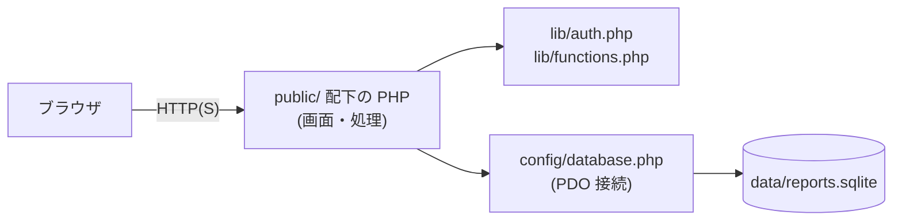
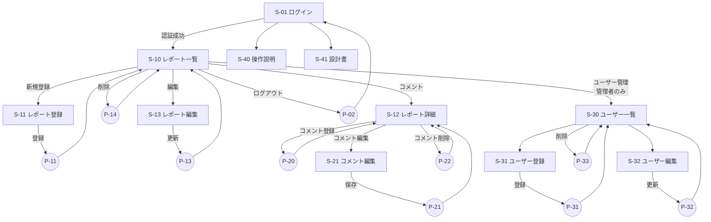
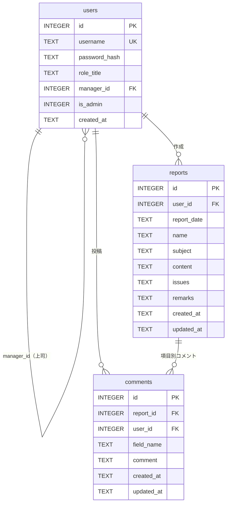
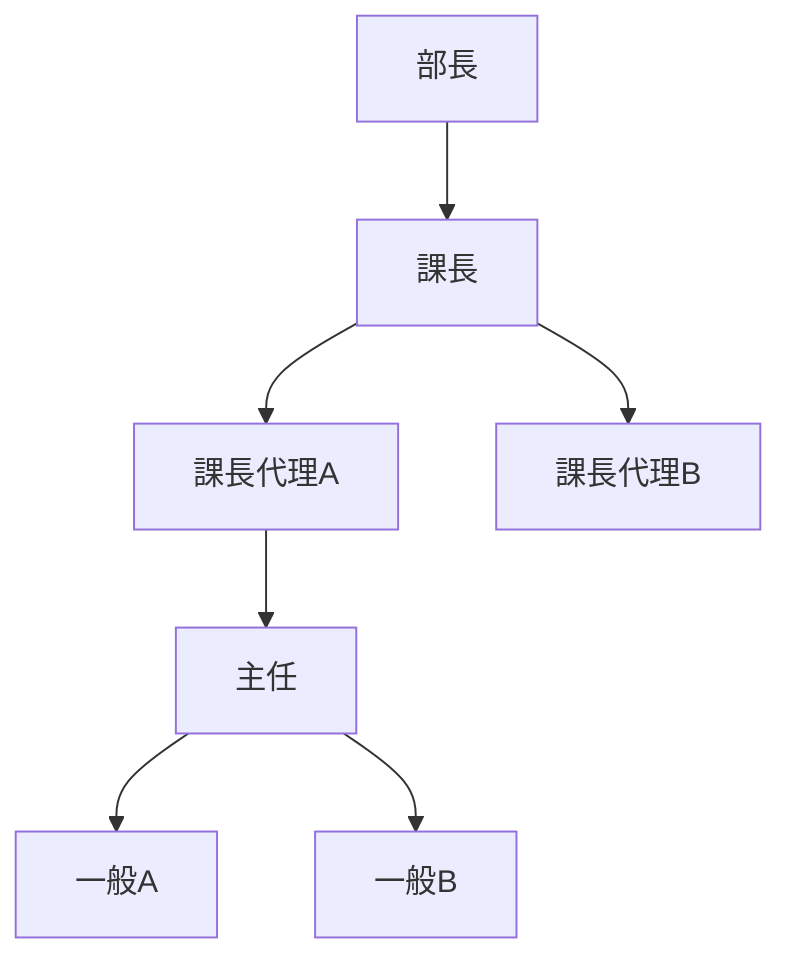

# レポート管理システム 基本設計書

| 項目 | 内容 |
|---|---|
| 対象システム | レポート管理システム（report-system） |
| 対象ブランチ / コミット | `main` / `9ffe3e5`（作業ブランチ `dev_check_report` 作成時点） |
| 作成日 | 2026-11-12 |
| 作成方法 | ソースコードおよび `data/reports.sqlite` のスキーマ定義からの現状分析（リバース） |
| 関連文書 | [詳細設計書](detailed_design.md)、`public/docs/design.php`（既存システム設計書）、`public/docs/manual.php`（画面操作説明） |

> 本書は「現在の実装がどうなっているか」を記述したものです。実装と既存設計書 (`design.php`) の記述に差異がある箇所は、本書では実装を正としています。差異・課題は「10. 現状の課題」にまとめています。

---

## 1. システム概要

### 1.1 目的

日報・業務レポートを Web 上で登録・検索・閲覧・編集・削除し、レポートの**項目単位でコメント**（確認・質問）をやり取りするためのシステム。
上司・部下の組織階層に基づいてレポートの閲覧範囲を制御する。

### 1.2 利用者

| 利用者区分 | 判定方法 | 概要 |
|---|---|---|
| 一般利用者 | `users.is_admin = 0` | 自分のレポートの登録・編集・削除、自分および配下のレポートの閲覧・コメント |
| システム管理者 | `users.is_admin = 1` | 全レポートの閲覧・編集・削除、全コメントの編集・削除、ユーザー管理 |

役職（一般／主任／課長代理／課長／部長）は組織上の肩書きであり、**権限判定には使用しない**。権限は `is_admin` フラグと `manager_id`（上司）による階層だけで決まる。

### 1.3 システム範囲

| 区分 | 機能 |
|---|---|
| 認証 | ログイン、ログアウト |
| レポート管理 | 一覧・検索、登録、詳細表示、編集、削除 |
| 項目別コメント | 登録、編集、削除（レポート詳細画面の項目ごと） |
| ユーザー管理（管理者） | 一覧、登録、編集（パスワード変更含む）、削除 |
| ドキュメント | 画面操作説明、システム設計書（ログイン不要の静的ページ） |
| セットアップ | 初期管理者登録 (`setup_admin.php`)、旧テーブル作成 (`public/setup.php`) |

---

## 2. システム構成

### 2.1 技術構成

| 区分 | 採用技術 |
|---|---|
| 言語 | PHP（`declare(strict_types=1)` を多くのファイルで使用。`DateTimeImmutable`、`random_bytes`、`password_hash` 等を利用） |
| フレームワーク | なし（ページごとの PHP スクリプト構成） |
| DB | SQLite 3（PDO 経由、`data/reports.sqlite`） |
| 画面 | サーバーサイドレンダリングの HTML / CSS。JavaScript はレポート詳細画面のコメント吹き出し制御と削除確認ダイアログのみ |
| 認証 | PHP セッション（`$_SESSION['user_id']`） |
| 稼働環境 | さくらのレンタルサーバ（`/report-system/public/` 配下を公開） |

### 2.2 構成図



### 2.3 ディレクトリ構成

```text
report-system/
├── config/database.php        DB接続（$pdo を生成）
├── data/reports.sqlite        本番DB（リポジトリに同梱）
├── data/reports.sqlite.backup DBバックアップ（リポジトリに同梱）
├── lib/auth.php               セッション・認証・管理者判定
├── lib/functions.php          HTMLエスケープ関数 h()
├── setup_admin.php            初期管理者登録（公開ディレクトリ外）
└── public/                    公開ディレクトリ
    ├── index.php              レポート一覧・検索
    ├── login.php / logout.php
    ├── setup.php              reportsテーブル作成（旧スキーマ）
    ├── css/style.css          共通CSS
    ├── reports/               レポート CRUD
    ├── comments/              コメント 登録・編集・削除
    ├── users/                 ユーザー管理（管理者）
    └── docs/                  操作説明・設計書
```

アーキテクチャ上の特徴:

- 画面表示（GET）と更新処理（POST）を別ファイルに分ける構成（例: `edit.php` → `update.php`）。
- 更新処理の完了後はリダイレクト（PRG パターン）。エラー時は **レポート・コメント系はエラーメッセージを直接出力して終了**、**ユーザー管理系は入力画面へ `?error=` 付きでリダイレクト**と、方式が異なる。
- 共通レイアウト・共通部品（テンプレート）はなく、各ページが HTML と CSS を個別に持つ。

---

## 3. 機能一覧

| ID | 機能 | 概要 | 利用者 |
|---|---|---|---|
| F-01 | ログイン | ユーザー名・パスワードで認証し、セッションを開始 | 全員 |
| F-02 | ログアウト | セッションと Cookie を破棄 | ログイン者 |
| F-10 | レポート一覧・検索 | 閲覧可能なレポートを日付降順で一覧表示。氏名・キーワードで絞り込み | ログイン者 |
| F-11 | レポート登録 | 日付・氏名・件名・内容・課題・備考を登録。作成者 = ログインユーザー | ログイン者 |
| F-12 | レポート詳細 | 6項目を表示し、項目ごとのコメントを吹き出しで表示 | 閲覧権限者 |
| F-13 | レポート編集 | レポート内容を更新 | 作成者 / 管理者 |
| F-14 | レポート削除 | レポートを削除 | 作成者 / 管理者 |
| F-20 | コメント登録 | レポートの項目に対してコメントを登録 | 閲覧権限者 |
| F-21 | コメント編集 | コメント本文を更新 | 投稿者 / 管理者 |
| F-22 | コメント削除 | コメントを削除 | 投稿者 / 管理者 |
| F-30 | ユーザー一覧 | 全ユーザーと上司・権限・レポート数・コメント数を表示 | 管理者 |
| F-31 | ユーザー登録 | ユーザー名・パスワード・役職・上司・管理者権限を登録 | 管理者 |
| F-32 | ユーザー編集 | 上記の更新。パスワードは入力時のみ変更 | 管理者 |
| F-33 | ユーザー削除 | 削除条件を満たすユーザーを削除 | 管理者 |
| F-40 | 画面操作説明 | 利用者向けマニュアル（静的） | 誰でも |
| F-41 | システム設計書 | 設計書（静的） | 誰でも |
| F-50 | 初期管理者登録 | ユーザーが0件のときだけ最初の管理者を作成 | 初期構築者 |

---

## 4. 画面一覧・画面遷移

### 4.1 画面・処理一覧

| ID | 物理名 | 種別 | 画面名 / 処理名 |
|---|---|---|---|
| S-01 | `login.php` | 画面+処理 | ログイン |
| P-02 | `logout.php` | 処理 | ログアウト |
| S-10 | `index.php` | 画面 | レポート一覧 |
| S-11 | `reports/create.php` | 画面 | レポート登録 |
| P-11 | `reports/store.php` | 処理 | レポート登録処理 |
| S-12 | `reports/detail.php` | 画面 | レポート詳細（コメント） |
| S-13 | `reports/edit.php` | 画面 | レポート編集 |
| P-13 | `reports/update.php` | 処理 | レポート更新処理 |
| P-14 | `reports/delete.php` | 処理 | レポート削除処理 |
| P-20 | `comments/comment_store.php` | 処理 | コメント登録処理 |
| S-21 | `comments/comment_edit.php` | 画面 | コメント編集 |
| P-21 | `comments/comment_update.php` | 処理 | コメント更新処理 |
| P-22 | `comments/comment_delete.php` | 処理 | コメント削除処理 |
| S-30 | `users/users.php` | 画面 | ユーザー管理（一覧） |
| S-31 | `users/user_create.php` | 画面 | ユーザー登録 |
| P-31 | `users/user_store.php` | 処理 | ユーザー登録処理 |
| S-32 | `users/user_edit.php` | 画面 | ユーザー編集 |
| P-32 | `users/user_update.php` | 処理 | ユーザー更新処理 |
| P-33 | `users/user_delete.php` | 処理 | ユーザー削除処理 |
| S-40 | `docs/manual.php` | 画面 | 画面操作説明 |
| S-41 | `docs/design.php` | 画面 | システム設計書 |
| S-50 | `setup_admin.php` | 画面+処理 | 初期管理者登録 |
| P-51 | `setup.php` | 処理 | テーブル作成（旧） |

### 4.2 画面遷移図



---

## 5. データ設計（論理）

### 5.1 エンティティ

| エンティティ | テーブル | 概要 |
|---|---|---|
| ユーザー | `users` | ログインアカウント。役職、上司（自己参照）、管理者フラグを持つ |
| レポート | `reports` | 日報。作成者、日付、氏名、件名、内容、課題、備考 |
| コメント | `comments` | レポートの**特定項目**（`field_name`）に紐づくコメント |

### 5.2 ER 図



### 5.3 「項目」の扱い（現状）

レポートの項目は **`reports` テーブルの固定カラム**であり、マスタテーブルは存在しない。
コメントの対象項目 `comments.field_name` には、次の固定値（カラム名）が入る。

| field_name | 表示名 | 入力形式 | 必須 |
|---|---|---|---|
| `report_date` | 日付 | date | ○ |
| `name` | 氏名 | text | ○ |
| `subject` | 件名 | text | ○ |
| `content` | 内容 | textarea | |
| `issues` | 課題 | textarea | |
| `remarks` | 備考 | textarea | |

この項目定義は DB ではなく **各 PHP ファイル内に個別にハードコード**されている（詳細設計書 3.3 参照）。項目の追加・変更には、DB スキーマ変更と複数ファイルの修正が必要になる。

---

## 6. 権限設計

### 6.1 閲覧範囲

- 管理者: 全レポート。
- 管理者以外: **自分**と、`users.manager_id` を再帰的にたどった**全配下ユーザー**（直属だけでなく孫以下も含む）のレポート。



上記の例では、課長は課長・課長代理A/B・主任・一般A/Bのレポートを閲覧でき、主任は主任・一般A/Bのレポートを閲覧できる（役職名ではなく上司設定で決まる）。

### 6.2 権限マトリクス

| 操作 | 本人のレポート | 配下のレポート | それ以外 | 管理者 |
|---|---|---|---|---|
| 一覧表示・詳細表示 | ○ | ○ | × | ○（全件） |
| レポート登録 | ○（作成者は常に自分） | － | － | ○ |
| レポート編集・削除 | ○ | **×** | × | ○ |
| コメント登録 | ○ | ○ | × | ○ |
| コメント編集・削除 | 自分のコメントのみ | 自分のコメントのみ | × | ○（全コメント） |
| ユーザー管理 | × | × | × | ○ |

---

## 7. 外部インターフェース

なし（外部 API 連携、メール送信、ファイル入出力はない）。

---

## 8. 非機能要件（現状）

| 区分 | 現状 |
|---|---|
| 認証 | セッション認証。ログイン成功時に `session_regenerate_id(true)` |
| パスワード | `password_hash(PASSWORD_DEFAULT)` で保存、`password_verify` で照合 |
| SQL インジェクション | 全 SQL で PDO プリペアドステートメント（IN 句も個別プレースホルダ） |
| XSS | 出力時に `h()`（`htmlspecialchars` / `ENT_QUOTES` / UTF-8）でエスケープ |
| CSRF | **ユーザー管理の POST のみ**トークン検証あり。レポート・コメント・ログイン・ログアウトはなし |
| 入力検証 | サーバー側で必須・型・日付・長さ（バイト数）・許可値を検証 |
| トランザクション | ユーザー更新・削除、初期管理者登録で使用。レポート・コメントでは未使用（単一 SQL のため） |
| エラー表示 | DB 例外の詳細はユーザー管理系では画面に出さず `error_log`。ただし DB 接続エラーは詳細を表示する |
| レスポンシブ | 一覧・詳細・ユーザー管理はスマートフォン幅向けの CSS あり |
| 文字数制限 | mbstring 非依存のためバイト数（`strlen`）で判定 |
| バックアップ | `data/reports.sqlite.backup` が存在（運用手順の定義はなし） |

---

## 9. 前提・制約

- SQLite の単一ファイル DB のため、同時更新が多い用途は想定しない。
- 本番 DB ファイル (`data/reports.sqlite`) がリポジトリに含まれている。
- `PRAGMA foreign_keys` を有効にしていないため、DB に定義された外部キー制約（CASCADE / RESTRICT / SET NULL）は**実際には動作しない**。参照整合性はアプリケーション側のチェックに依存している。

---

## 10. 現状の課題

ソースコード分析で確認した課題。重要度は「高: 不具合・セキュリティ」「中: 整合性・保守性」「低: 表記・UX」。詳細は詳細設計書「8. 課題一覧」を参照。

| No | 重要度 | 内容 |
|---|---|---|
| 1 | 高 | `requireLogin()` のリダイレクト先が相対パス `login.php` のため、`reports/` 等のサブディレクトリから未ログインでアクセスすると存在しない URL（例: `reports/login.php`）へ遷移する |
| 2 | 高 | 外部キーが無効なため、レポートを削除してもコメントが削除されず孤立データが残る |
| 3 | 高 | レポート・コメントの登録・更新・削除に CSRF 対策がない |
| 4 | 中 | 項目定義（6項目）が 6 ファイル以上にハードコードされ、項目の追加・変更が困難 |
| 5 | 中 | 登録時と更新時で入力チェックが異なる（登録時は長さチェックなし、trim の扱いも異なる） |
| 6 | 中 | `public/setup.php` が認証なしで公開され、現行と異なる旧スキーマ（`user_id` なし）の CREATE 文を持つ |
| 7 | 中 | DB 接続エラー時に例外メッセージ（ファイルパス等）を画面に出力する |
| 8 | 低 | ユーザー一覧の削除可否表示が「部下がいる」条件を考慮していない（削除処理側では拒否される） |
| 9 | 低 | レポート詳細で、権限のないコメントにも編集・削除ボタンが表示される（押すと 403） |
| 10 | 低 | 既存設計書 `design.php` の「レポート削除時にコメントも削除される」記述が実動作と異なる |
