# 月次報告システム 課長・課長代理・主任向けマニュアル

最終更新: 2026-11-27

課長・課長代理・主任（報告を確認する人）の操作をまとめたものです。全員に共通の操作（ログイン・報告を作る・アカウント設定・精算・目標管理など）は「操作マニュアル」を見てください。

操作マニュアルは 3 冊に分かれています。節の番号（「4.6」「9.4」など）は 3 冊で共通です。番号の節がこの冊に無いときは、ほかの冊を見てください。

| 冊 | 読む人 | 章 |
|---|---|---|
| 操作マニュアル（`operation_manual.md`） | 全員 | 0〜4、6.3、7.1、7.3、10〜14 |
| 課長・課長代理・主任向けマニュアル（`manager_manual.md`） | 課長・課長代理・主任 | 5、6（6.3 のほか）、7.2、8 |
| システム運用マニュアル（`admin_manual.md`） | システム管理者・補佐 | 9 |

HTML（画像付き）は、それぞれ `manual/` の同じ名前の `.html` です。

---

## 5. 報告を確認する（課長・課長代理・主任）

### 5.1 未チェックの報告を順に見る

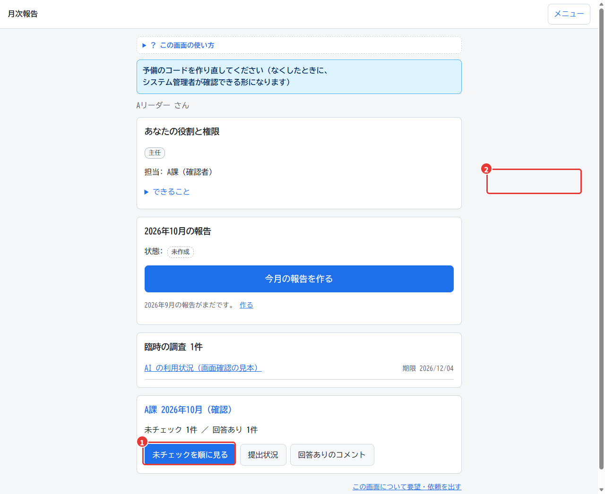

1. ホームの確認の欄にある「未チェックを順に見る」（図の 1）を押す。
2. 最初の未チェックの報告が開きます。読み終えてチェックすると、次の報告へ進めます。

課の全員の状態を見たいときは「提出状況」（図の 2。6.1）を押します。

### 5.2 報告の詳細の画面

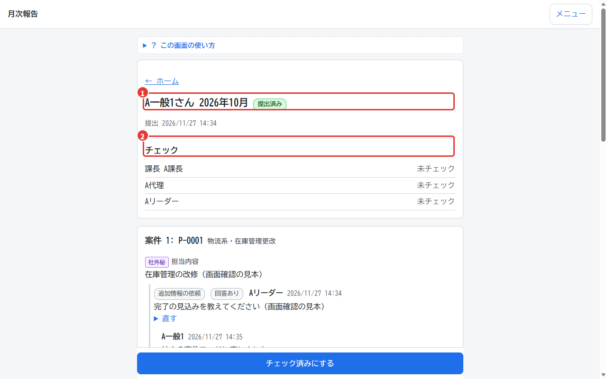

- 上に、だれの何月の報告かと状態（図の 1）が出ます。
- その下の「チェック」の欄（図の 2）に、確認者ごとに「未チェック」「チェック済」「更新あり（再確認待ち）」が出ます。
- 前回チェックしたあとに変わった値には「更新あり」の札が付きます。
- 前月の報告と違う項目には「前月から変更」の札と前月の値が出ます。前月になかった案件には「前月にない案件」と出ます。
- 客先名らしい言葉がある欄には「注意: 客先名の可能性」と出ます。
- 提出後の変更は、下の「変更履歴」を開くと見られます。
- 「限定」の項目は、本人と課長だけが見られます。確認者には「（限定のため表示しません）」と出ます。

### 5.3 コメントする

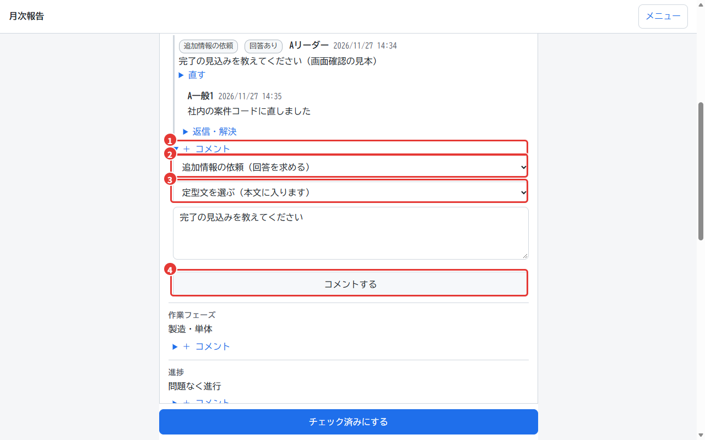

1. 聞きたい項目の下の「＋ コメント」（図の 1。報告全体へは下の欄）を押す。
2. 種類（追加情報の依頼・認識の確認・連絡）を選ぶ（図の 2）。
3. 本文を書く。よく使う文は「定型文を選ぶ」（図の 3）から選ぶと、本文に入ります（5.5）。
4. 「コメントする」（図の 4）を押す。

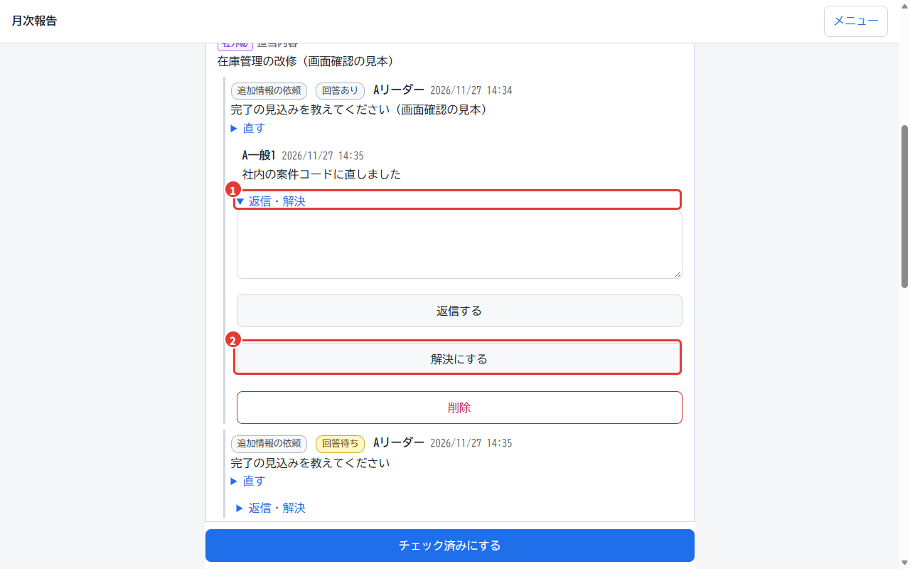

- 本人が返信すると「回答あり」になります。読んで済んだら「返信・解決」（図の 1）を開いて「解決にする」（図の 2）を押します。もう一度聞くときは、同じ欄に書いて「返信する」を押します。
- 解決にできるのは、確認者は自分が出したコメントだけ、課長はすべてです。
- 自分が書いたコメント・返信は、本文の下の「直す」で直せます。直すと「（日時 に直しました）」と出ます。

### 5.4 チェックする・確認を完了にする

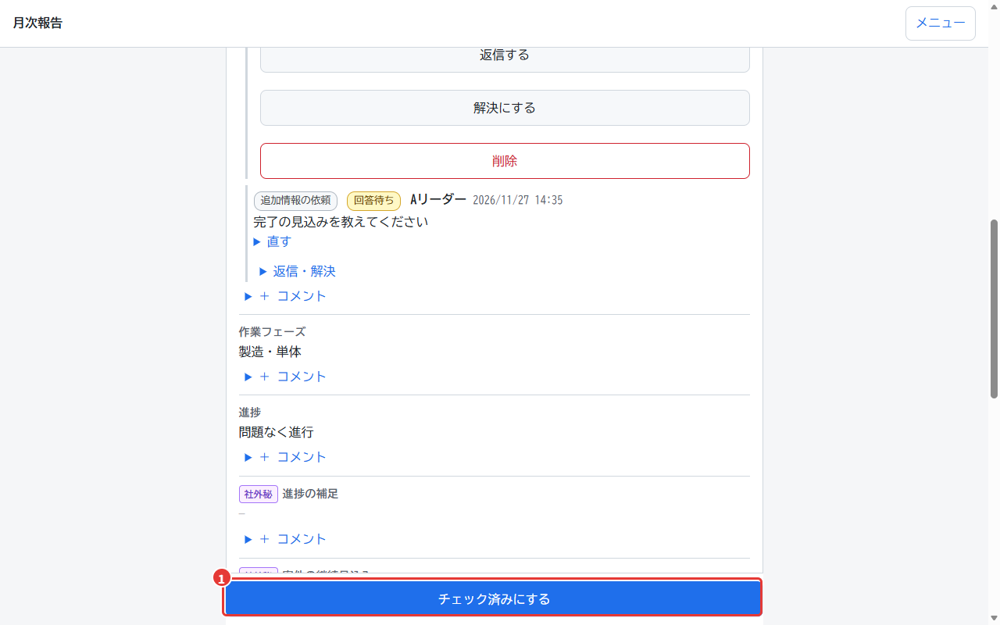

- 確認者・課長は、画面の下の「チェック済みにする」（図の 1）を押します。

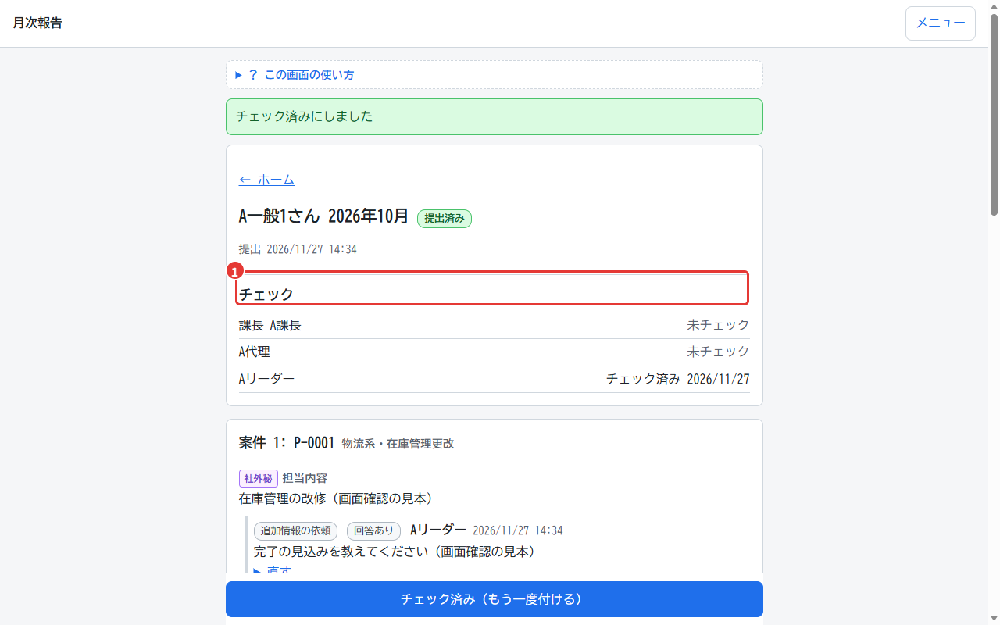

- 押すと「チェック済みにしました」と出て、チェックの欄（図の 1）の自分の行が「チェック済」になります。

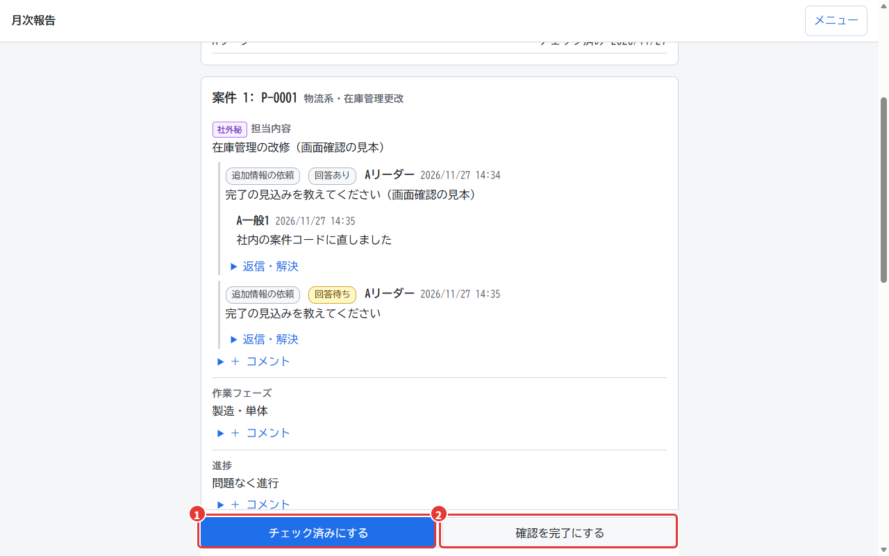

- 課長は「確認を完了にする」（図の 2）を押すと、報告が確認完了になります。完了は戻せます。
- 自分の報告は、自分で確認完了にできません。

チェックしない設定の確認者（8.1）は、報告を見てコメントはできますが、チェックの人数には数えません。

### 5.5 コメントの定型文

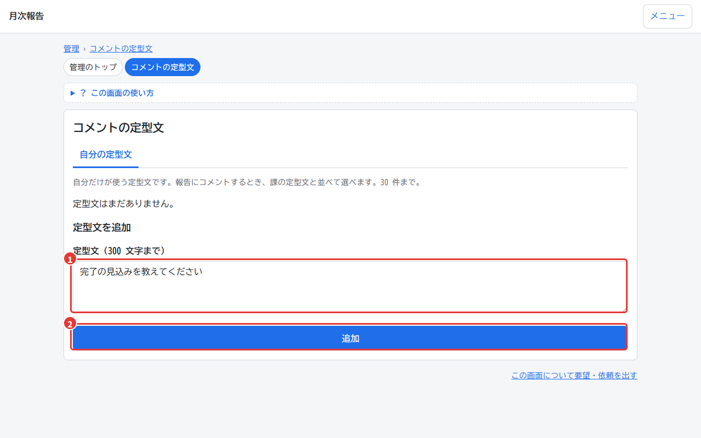

メニューの「コメントの定型文」で、よく使うコメントを登録できます。課長は課の定型文、確認者は自分だけの定型文を、それぞれ 30 件まで登録できます。

1. 「定型文（300 文字まで）」の欄（図の 1）に文を書く。
2. 「追加」（図の 2）を押す。

---

## 6. 提出状況・横並び・検索・出力・臨時の調査

### 6.1 提出状況（課長・課長代理・主任）

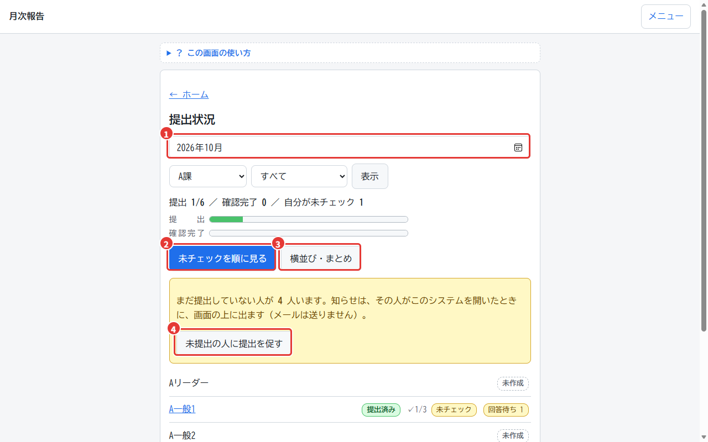

課の人ごとに、提出の状態とチェックの進み具合が出ます。

- 見る月は、図の 1 で選んで「表示」を押すと変わります（課・絞り込みも同じ行で選べます）。
- 「未チェックを順に見る」（図の 2）で、チェックしていない報告を順に開けます。
- 「横並び・まとめ」（図の 3）で、課の報告を横に並べて見られます（6.2）。
- 「前月から変更なし」の報告は、まとめてチェックできます。
- まだ出していない人がいれば「未提出の人に提出を促す」（図の 4）を押せます。促された人がこのシステムを開くと、画面の上に「（あなたの名前） さんから、提出するよう知らせが届いています」と出ます（メールは送りません）。同じ人には 1 日 1 回まで。促した日は、その人の行に「促した（日付）」と出ます。
- 人の名前を押すと、その人の報告を開きます。
- 管理者が確認者でない課を見るときは、提出の状態とチェックの数だけが出ます（中身へのリンクは出ません）。

### 6.2 横並び（課長・課長代理・主任）

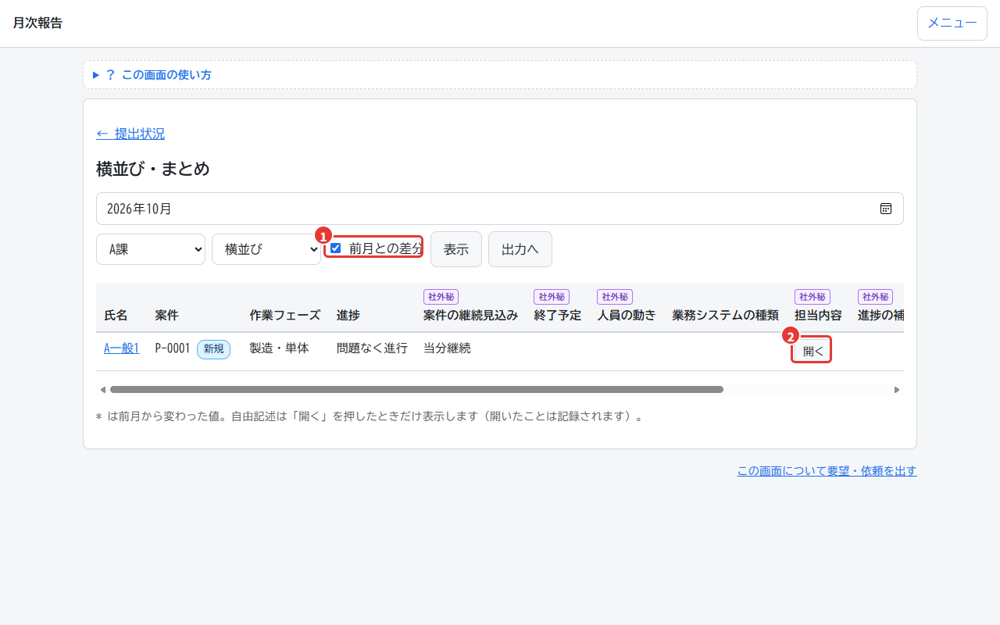

提出状況の画面から開きます。課の報告を、案件ごとに 1 行で横に並べて見られます。

- 「前月との差分」（図の 1）にチェックを付けて「表示」を押すと、変わった値に印が付きます。
- 自由記述は「開く」（図の 2）を押したときだけ出ます。開いたことは記録されます。
- 「限定」の項目の列は、課長にだけ出ます。
- 表が画面の幅に入りきらないときは、表の下のスクロールバーで横に動かします（`Shift` を押しながらマウスのホイールを回しても横に動きます）。

検索（6.3）は、全員が使うので「操作マニュアル」にあります。

### 6.4 出力（課長・PC のみ）

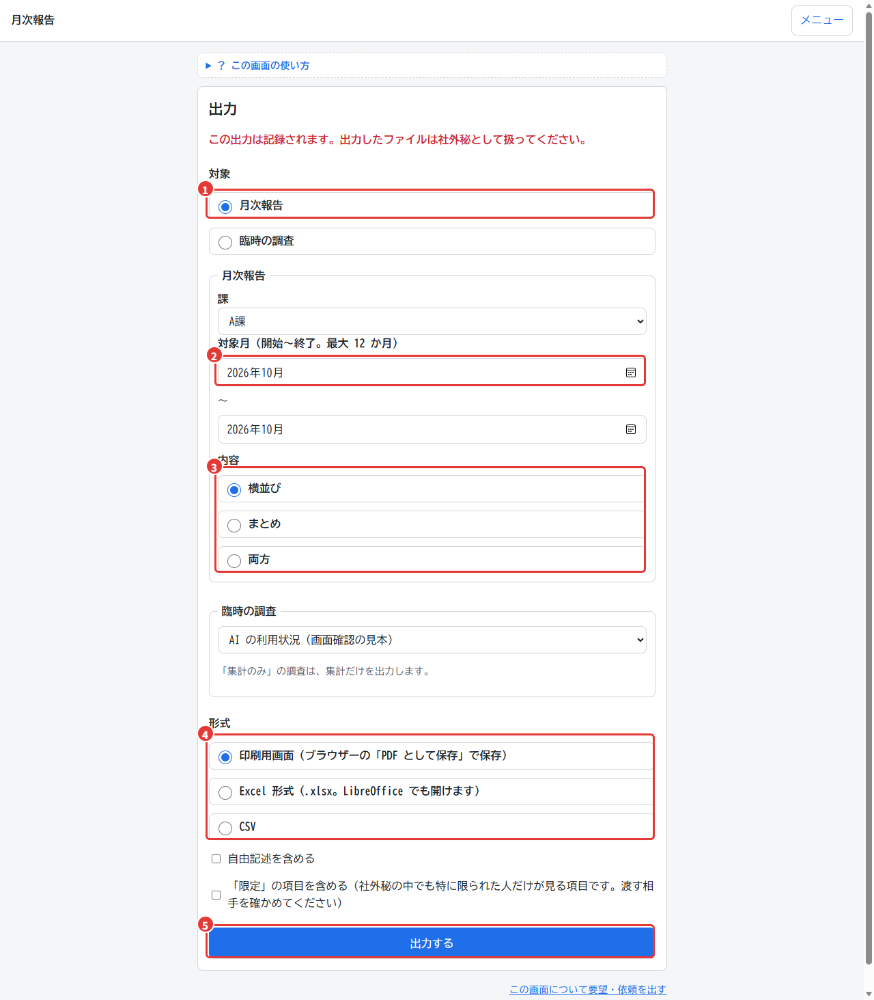

課の外への資料の元になるものを出力します。

1. メニューの「出力」を開き、対象（図の 1。月次報告か臨時の調査）を選ぶ。
2. 課と、対象月の範囲（図の 2。開始〜終了。最大 12 か月）を選ぶ。
3. 内容（図の 3。横並び・まとめ・両方）を選ぶ。
4. 形式（図の 4）を選ぶ。必要なら「自由記述を含める」「「限定」の項目を含める」にチェックを付ける。
5. 「出力する」（図の 5）を押す。

| 形式 | 使い方 |
| --- | --- |
| 印刷用画面 | ブラウザーの印刷で PDF に保存する（12.2） |
| Excel 形式（.xlsx） | LibreOffice Calc や Excel で開く（12.4）。ファイルは「ダウンロード」フォルダーに入る（0.5） |
| CSV | UTF-8（BOM 付き）。開き方は 12.3。ファイルは「ダウンロード」フォルダーに入る |

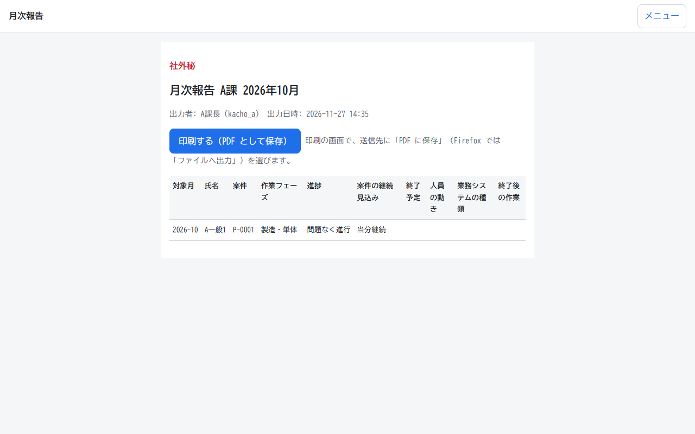

印刷用画面を選ぶと、上の図の画面が出ます。「印刷する（PDF として保存）」を押すか、`Ctrl` + `P` を押して PDF に保存します（12.2）。

- どの形式にも「社外秘」と出力者・日時が入ります。出力は記録に残ります。
- 「限定」の項目は、「「限定」の項目を含める」を選んだときだけ出ます。
- スマートフォンからは出力できません。

### 6.5 臨時の調査（課長）

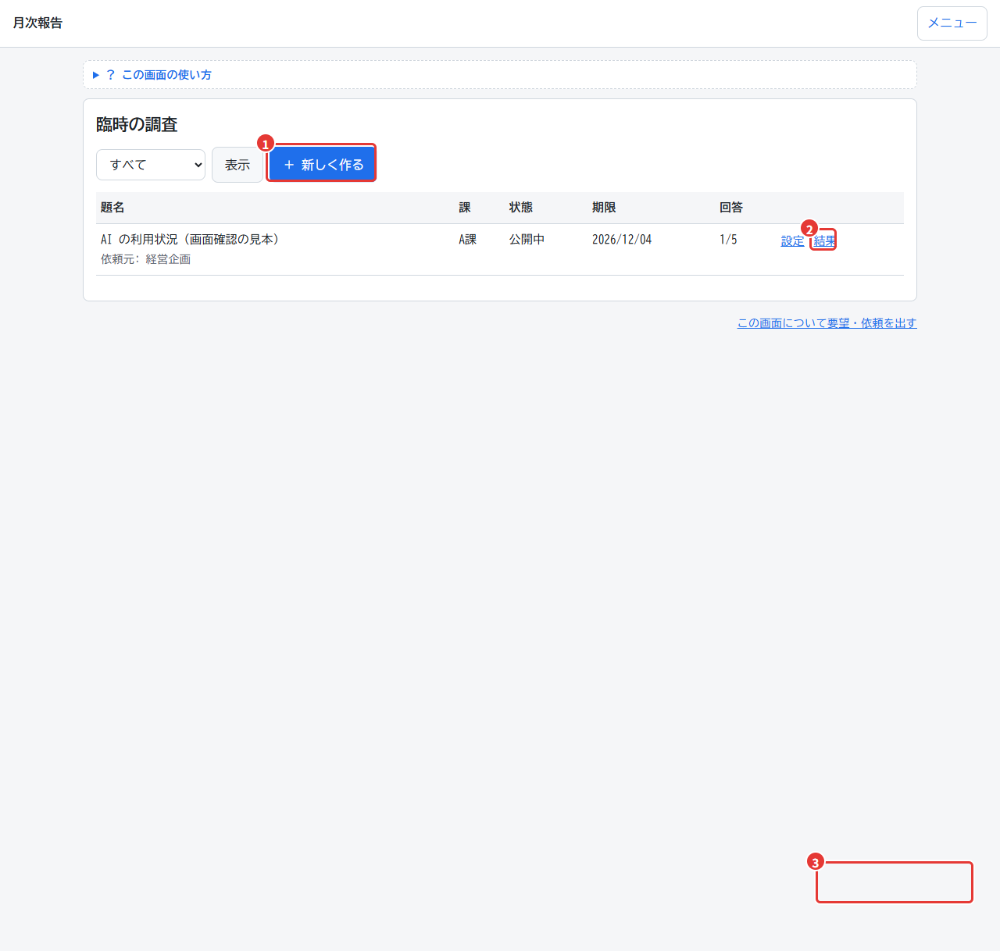

月次報告とは別の、その時だけの質問を作って課の人に答えてもらいます。

1. メニューの「臨時の調査」で「＋ 新しく作る」（図の 1）を押す。作った調査を直すときは「設定」（図の 3）を押します。

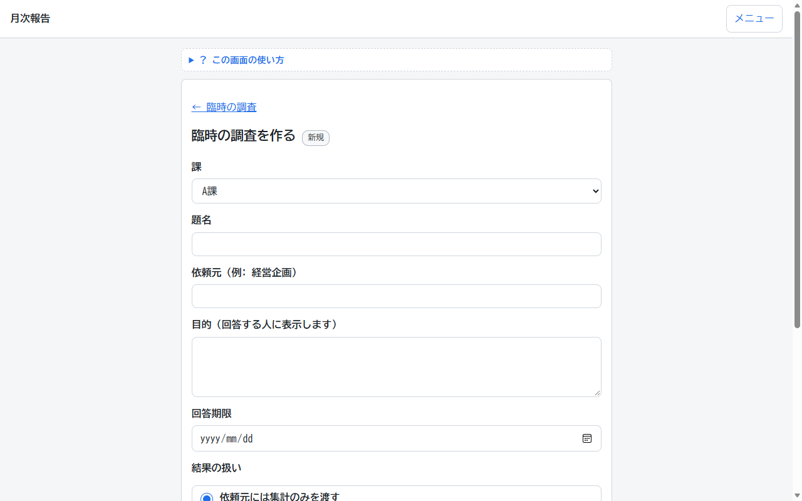

2. 題名・依頼元・期限・対象の人・目的・結果の扱いと、質問を決める。月次報告の項目を質問に使うと、最新の値が入った状態で答えてもらえます。
3. 「回答する人の画面で見る」で、答える人にどう見えるかを確かめる（見本。入力しても保存されません）。
4. 公開する。公開すると質問は変えられません。

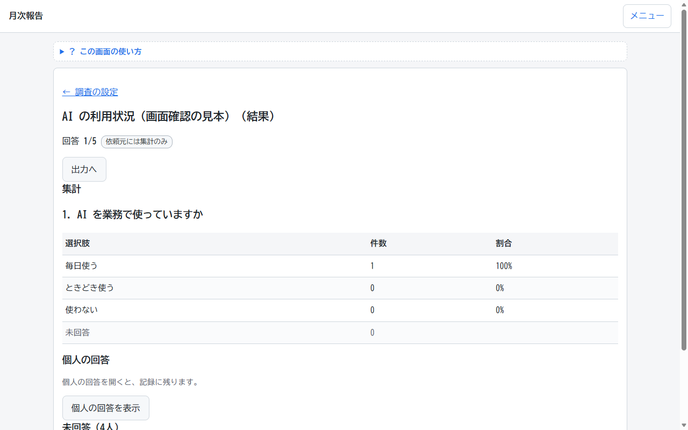

5. 一覧の「結果」（図の 2）で、集計と未回答の人を見る。個人の回答を開くと記録に残ります。

結果の扱いを「集計のみ」にした調査は、出力も集計だけになります。

---

## 7. 要望・依頼

コメントの一覧（7.1）とよくある質問（7.3）は、全員が使うので「操作マニュアル」にあります。

### 7.2 要望・依頼（課長・課長代理・主任）

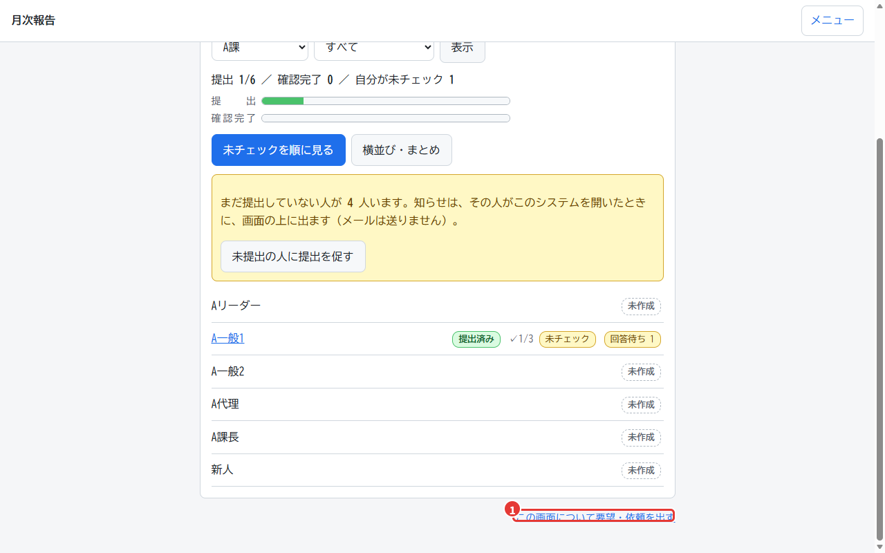

システムへの改善要望・対応依頼・不具合・質問を、システム管理者へ出せます。

- 画面のことなら、その画面の下の「この画面について要望・依頼を出す」（図の 1）から出すと、どの画面かが自動で入ります。
- 部下は直接出せません。課長・確認者を通して出してください。

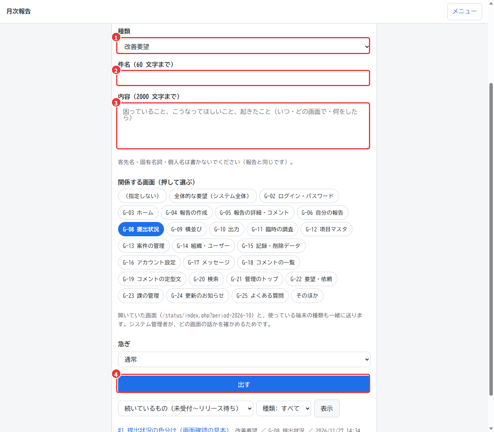

1. 種類（図の 1。改善要望・対応依頼・不具合・質問）を選ぶ。
2. 件名（図の 2。60 文字まで）を入れる。
3. 内容（図の 3。2,000 文字まで）に、困っていること・こうなってほしいこと・起きたこと（いつ・どの画面で・何をしたら）を書く。客先名・個人名は書かないでください。
4. 関係する画面と急ぎを選んで、「出す」（図の 4）を押す。

- 返信が来るとホームに出ます。受付前なら取り下げられます。

---

## 8. 課長の仕事

### 8.1 課の管理

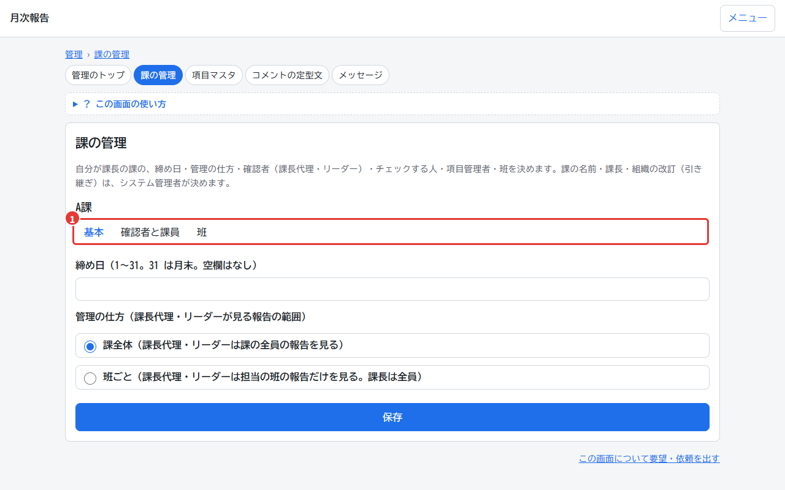

メニューの「課の管理」で、自分の課の次のことを決めます。画面は節（基本・確認者と課員・ライン）のタブ（図の 1）に分かれているので、押して切り替えます。

| 決めること | 内容 |
| --- | --- |
| 締め日 | 毎月の報告の締め日 |
| 管理の仕方 | 課全体で見るか、課長代理ごとのラインで見るか |
| 確認者 | 課長代理・主任と、担当のライン。ほかの課の人（課のない部長などを含む）も、表の下の「兼務の確認者を足す」で兼務の確認者にできます（足したあと、表で担当のライン・チェックするを決めて保存。外すときは表で「確認者」の印を外して保存） |
| チェックする／しない | 確認者ごとに。しない人もコメントはできる |
| 項目管理者 | 課の項目を管理できる人 |
| ライン | ラインの作成と、課員のライン |

課の追加や課長を決めるのは、システム管理者です（9.4）。

### 8.2 課の項目と選択肢

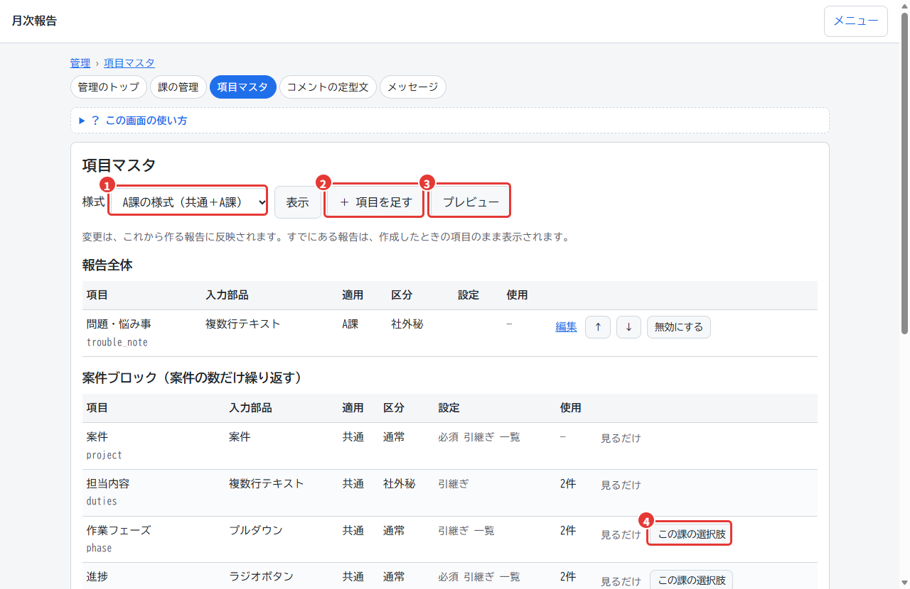

メニューの「項目マスタ」で、課の項目を追加・編集・並べ替えます。

- 見る様式（図の 1）を選んで「表示」を押します。
- 項目を足すときは「＋ 項目を足す」（図の 2）を押します。並べ替えは各行の「↑」「↓」、直すときは「編集」です。
- 「プレビュー」（図の 3）で入力画面の見え方を確かめられます（保存されません）。
- 共通の選択式の項目の選択肢は、「この課の選択肢」（図の 4）で、この課でだけ表示名を変える・出さない・足すことができます（IT 系以外の課のため）。ほかの課には影響しません。
- 変更は、これから作る報告に反映されます。すでにある報告は、作ったときの項目のままです。

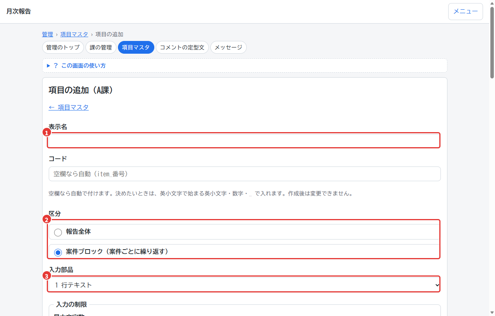

項目を足すときは、表示名（図の 1）、どこに出すか（図の 2。報告全体か、案件ごとに繰り返すか）、入力部品（図の 3。1 行テキスト・プルダウン・ラジオボタンなど）を決め、その下の設定（必須・機密区分・説明文など）を選んで「保存」を押します。入力部品を変えると、それに合う設定だけが出ます。

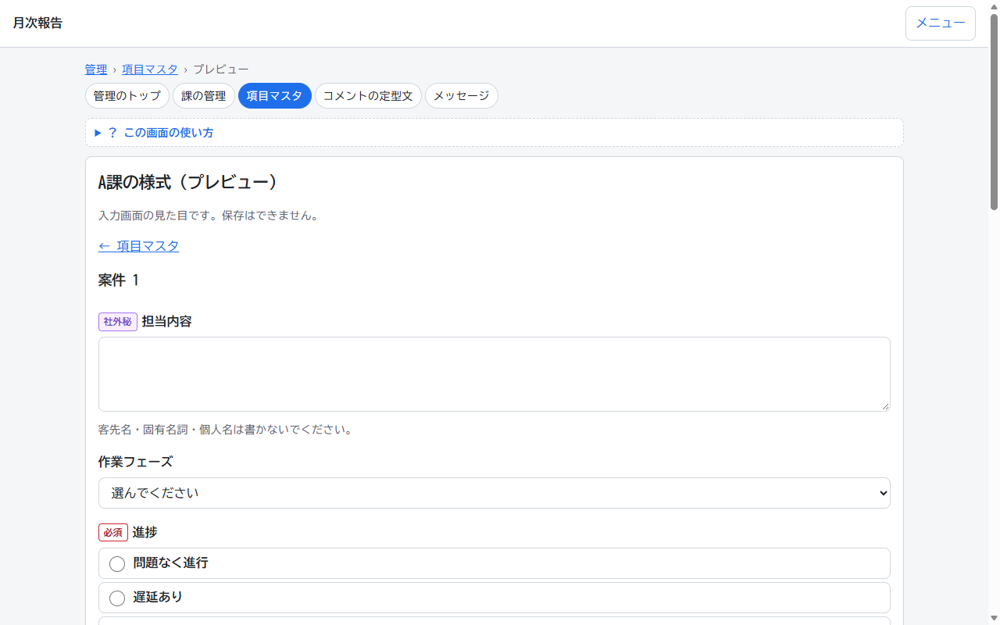

### 8.3 メッセージ（管理担当の課の課長）

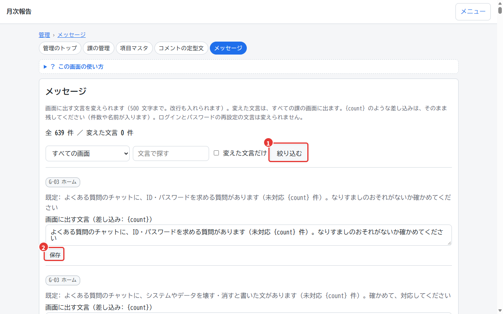

メニューの「メッセージ」で、画面に出す文言（「この画面の使い方」の文を含む）を変えられます。変えた文言は全員の画面に出ます。`{ }` の中の言葉は、そのまま残してください。

1. 変えたい文言を、上の欄で探して「絞り込む」（図の 1）を押す（`Ctrl` + `F` で画面の中を探してもかまいません）。
2. 文を直して、その行の「保存」（図の 2）を押す。
