# 月次報告システム 操作マニュアル

最終更新: 2026-11-20

この文書は、月次報告システムを使う人のための操作の説明です。
自分の役割の章だけ読めば使えます。各画面の上にある「？ この画面の使い方」を押すと、その画面の短い説明も開きます。

- 手順には、実際の画面の画像を付けています。**画像の赤い枠が押す場所・入れる場所で、枠の番号は手順の番号と同じ**です。
- 画像の名前・案件・日付は、説明のための見本です。自分の画面では、自分の名前や案件が出ます。役割によって、出るボタンや欄が少し違います。
- PC の画像は横幅 1280 ピクセルの画面、スマートフォンの画像は iPhone ほどの幅の画面で撮っています。Firefox・Google Chrome・Chromium のどれでも、画面の中身は同じです（入力欄の形が少し違うことがあります）。
- 文字コードは UTF-8、改行は LF です。Linux の端末（`less` など）でもそのまま読めます。画像も見るときは、ブラウザーで開いてください（0.7）。
- PC の操作は、Linux（Ubuntu など）の Firefox・Google Chrome / Chromium を前提に書いています（Windows・macOS でも同じです）。

## 目次

0. はじめる前に（PC の基本の操作。Linux の PC を使う人へ）
1. はじめに（役割と 1 か月の流れ）
2. ログイン
3. ホーム画面とメニュー
4. 月次報告を作る・出す（全員）
5. 報告を確認する（確認者・課長）
6. 提出状況・横並び・検索・出力・臨時の調査
7. コメントの一覧・要望・依頼・よくある質問
8. 課長の仕事
9. システム管理者・補佐の仕事
10. アカウント設定
11. 困ったとき
12. Linux の PC で使うときの注意（PDF・CSV・Excel 形式のファイル）
13. 通勤定期代の精算（全員。月次報告とは別）
14. 目標管理シート（全員。月次報告とは別）

---

## 0. はじめる前に（PC の基本の操作。Linux の PC を使う人へ）

この章は、Linux の PC に慣れていない人のための、ブラウザーとファイルの基本の操作です。慣れている人は飛ばしてかまいません。
ここでは、多くの会社で使われている Ubuntu（画面の左にアイコンが縦に並ぶ形）で説明します。ほかの Linux でも、名前が少し違うだけで同じように操作できます。

### 0.1 ブラウザーを開く

1. キーボードの **Super キー**（Windows のマークが付いたキー。左下の `Ctrl` と `Alt` の間）を押す。画面の左上の「アクティビティ」を押しても同じです。
2. 画面の上に検索の欄が出るので、`firefox` と打つ（Chrome を使うときは `chrome`、Chromium は `chromium`）。
3. 出てきたブラウザーのアイコンを押す（または `Enter` キー）。

- 画面の左に並ぶアイコン（ドック）に、ブラウザーのアイコン（Firefox はオレンジ色の狐の絵）があれば、それを押しても開きます。
- よく使うときは、ドックのアイコンを右クリックして「お気に入りに追加」を選ぶと、いつもドックに出ます。

### 0.2 システムのアドレスを開き、ブックマークする

1. ブラウザーで `Ctrl` + `L` を押す（上のアドレスの欄が選ばれ、青くなります）。
2. システム管理者から知らされたアドレス（`https://` で始まるもの）を打つか貼り付けて、`Enter` キーを押す。
3. ログインの画面（2.1 の図）が出たら、`Ctrl` + `D` を押し、出てきた窓で「保存」（Chrome は「完了」）を押す。

次からは、アドレスの欄に「月次報告」と打ち始めると候補に出るので、それを押すだけで開けます。
アドレスを打ち間違えると、「サーバーが見つかりません」などと出ます。もう一度アドレスを確かめてください。

### 0.3 よく使うキーボードの操作

| したいこと | キー |
| --- | --- |
| 文字を大きくする・小さくする・元に戻す | `Ctrl` + `+`（プラス）・`Ctrl` + `-`（マイナス）・`Ctrl` + `0`（ゼロ） |
| 画面を読み込み直す | `F5`（または `Ctrl` + `R`） |
| 1 つ前の画面に戻る | `Alt` + `←`（このシステムでは、画面の中の「← ホーム」などのリンクで戻るほうが確実です） |
| 選んだ文字をコピーする・貼り付ける | `Ctrl` + `C`・`Ctrl` + `V`（端末の中では `Ctrl` + `Shift` + `C`・`Ctrl` + `Shift` + `V`） |
| 印刷する（PDF に保存する） | `Ctrl` + `P`（12.2） |
| ダウンロードした一覧を出す | Firefox は `Ctrl` + `Shift` + `Y`、Chrome / Chromium は `Ctrl` + `J` |
| 画面の中の言葉を探す | `Ctrl` + `F` |

### 0.4 日本語の入力と、半角の入力を切り替える

- ログイン ID・パスワード・6 桁のコードは、**半角の英数字**で入れます。日本語の入力のままだと、正しく入りません。
- Ubuntu では、`半角/全角` キー（キーボードの左上）か、`Super` + `Space` で切り替えます。画面の右上に「あ」と出ていれば日本語の入力、「A」や「ja」と出ていれば半角の入力です。
- 報告の文（担当内容など）は、日本語の入力に切り替えて書きます。

### 0.5 ダウンロードしたファイルの置き場所

出力（6.4）で作った Excel 形式・CSV のファイルは、ふつう **ホームの「ダウンロード」フォルダー**（`~/ダウンロード`。英語の設定では `~/Downloads`）に入ります。

1. Super キーを押して `ファイル` と打ち、「ファイル」（ファイルを見るアプリ）を開く。
2. 左の一覧の「ダウンロード」を押す。
3. 開きたいファイルをダブルクリックする（開き方は 12.3・12.4）。

ブラウザーからも開けます。Firefox は右上の下向きの矢印（ダウンロード）を押してファイルを押す、Chrome / Chromium は `Ctrl` + `J` でダウンロードの一覧を出して、ファイルの名前を押します。

### 0.6 席を離れるとき

報告は社外秘です。席を離れるときは、**`Super` + `L`** で画面をロックしてください（戻ったら、PC のパスワードを入れて解除します）。
このシステムからも、使い終わったら右上の「メニュー」→「ログアウト」でログアウトしてください。

### 0.7 このマニュアルを画像付きで読む

この文書（`.md` のファイル）を、テキストエディターや端末で開くと、画像は出ません（`` という行が、画像の場所です）。

- システム管理者から「操作マニュアル.html」を受け取ったときは、それをダブルクリックすると、ブラウザーで画像付きで読めます。
- リポジトリから読むときは、端末で `python3 tools/lib/mdview.py docs/operation_manual.md` と打つと、ブラウザーで画像付きで開きます。

---

## 1. はじめに

### 1.1 役割

| 役割 | 主な端末 | 主にすること | 読む章 |
| --- | --- | --- | --- |
| 部下（課の社員） | 私物のスマートフォン | 月に 1 回、報告を作って出す。コメントに返信する。臨時の調査に答える | 2, 3, 4, 7, 10 |
| 確認者（課長代理・リーダー） | スマートフォン・PC | 課の報告を読み、コメントし、チェックする | 上に加えて 5, 6 |
| 課長（最終確認者） | PC・スマートフォン | 確認を完了にする。臨時の調査を作る。資料用に出力する。課の設定を決める | 上に加えて 8 |
| システム管理者 | PC | 共通の項目・課・ユーザー・案件の管理。記録の確認 | 2, 3, 9, 10 |
| システム管理者補佐 | PC | 管理者が対応できないときの代行。報告の中身は見ない | 2, 3, 9, 10 |

PC を使う人は、先に 0 章と 12 章も読んでください。

通勤定期代の精算（13 章）と目標管理シート（14 章）は、役割に関係なく全員が使えます（どちらも月次報告とは別の機能です）。

管理の権限と、報告を見る権限は別です。システム管理者でも、自分が確認者でない課の報告の中身は見られません。

### 1.2 1 か月の流れ

1. 部下が「今月の報告を作る」で報告を作る。前月の内容が入った状態で始まるので、変わったところだけ直して提出する。
2. 確認者が報告を読む。問題がなければ「チェック済みにする」。分からない点は項目ごとにコメントで聞く。
3. コメントを受けた部下は、ホームの「回答待ち」から返信する。報告に追記してもよい。
4. 確認者は返信を読み、コメントを「解決」にしてチェックする。
5. 課長が「確認を完了にする」。必要なら課の状況をまとめて見て、資料用に出力する。

報告の状態は「下書き → 提出済み → 確認完了」の 3 つです。差し戻しはありません。
提出したあとも本人が直せます。直すと変更の履歴が残り、確認者に「更新あり」と出ます。

### 1.3 守ること

- 客先名・個人名・固有名詞は書かないでください。客先名らしい言葉を入れると黄色の注意が出ます（保存は止めません）。
- 出力したファイルは社外秘です。
- 出力は PC から行います（スマートフォンにファイルを残さないため）。

---

## 2. ログイン

### 2.1 ふだんのログイン

1. ログイン画面の「ログイン ID」の欄を押して、ログイン ID を入れる（半角の英数字。0.4）。
2. 「パスワード」の欄にパスワードを入れる。入れた文字は「•」で隠れます。打ち間違いを確かめたいときは、右の「表示」を押すと見えます。
3. 「ログイン」を押す（`Enter` キーでもかまいません）。

2 段階認証のコードを聞かれたら、次のようにします。

1. スマートフォンの認証アプリ（Google Authenticator など）を開き、このシステムの欄に出ている **6 桁の数字** を「認証アプリの 6 桁のコード」の欄に入れる（数字の間の空白は入れなくてかまいません）。
2. 「この端末を 90 日間記憶する」にチェックが付いていることを確かめる（既定でオン）。付けておくと、その端末では 90 日間コードを聞かれません。共用の PC では外してください。
3. 「確認」を押す。

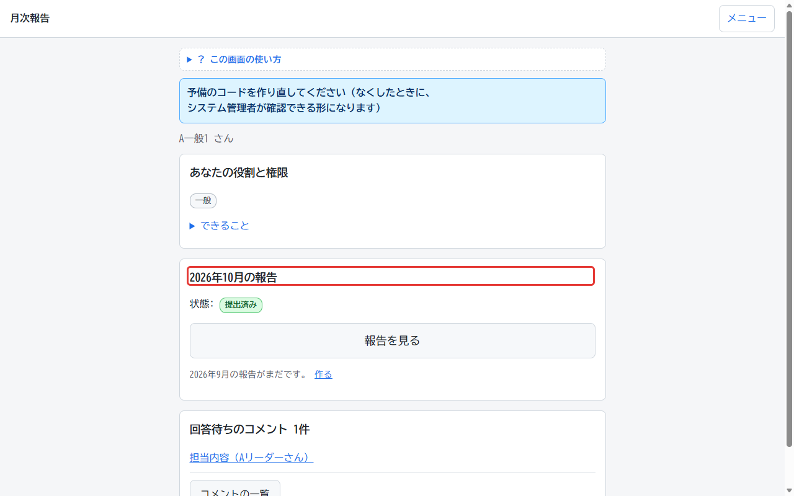

ホームの画面（3 章）が出れば、ログインできています。

- コードの画面は 5 分以内に済ませてください。過ぎると「最初からやり直してください」と出ます。
- 認証アプリの数字は 30 秒ごとに変わります。変わる直前に入れて「コードが違います」と出たら、新しい数字を入れ直してください。
- 認証アプリが使えないときは、予備のコード（`xxxx-xxxxxx` の形）を同じ欄に入れます。予備のコードは 1 つにつき 1 回だけ使えます。

### 2.2 はじめてのログイン（2 段階認証の設定）

はじめてログインすると、2 段階認証の設定の画面が出ます。設定が済むまで、ほかの画面は使えません。

**はじめてのログインは、スマートフォンで行ってください。** 先にスマートフォンに認証アプリを入れておくと、ボタン 1 つで登録できます。PC でログインしたときは、画面に「いまは PC で開いています」と、スマートフォンで開くアドレスが出ます。スマートフォンでそのアドレスを開き、同じログイン ID とパスワードでログインして設定してください。設定が終わったら、PC でもう一度ログインします。

#### PC でログインしたとき

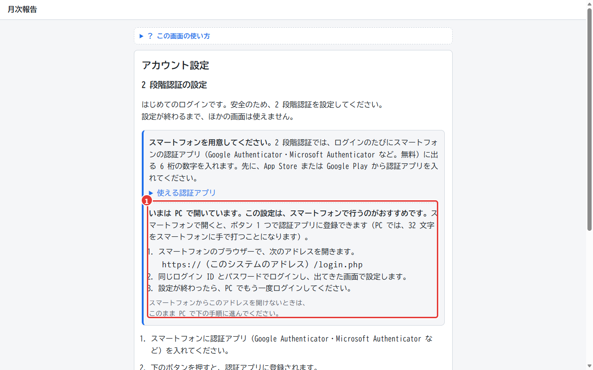

1. 「いまは PC で開いています」の案内（図の 1）に、スマートフォンで開くアドレスが出ます。このアドレスをスマートフォンのブラウザーで開き、下の「スマートフォンで設定するとき」に進んでください。

スマートフォンでアドレスを開けないときは、PC のまま、次のように設定します。

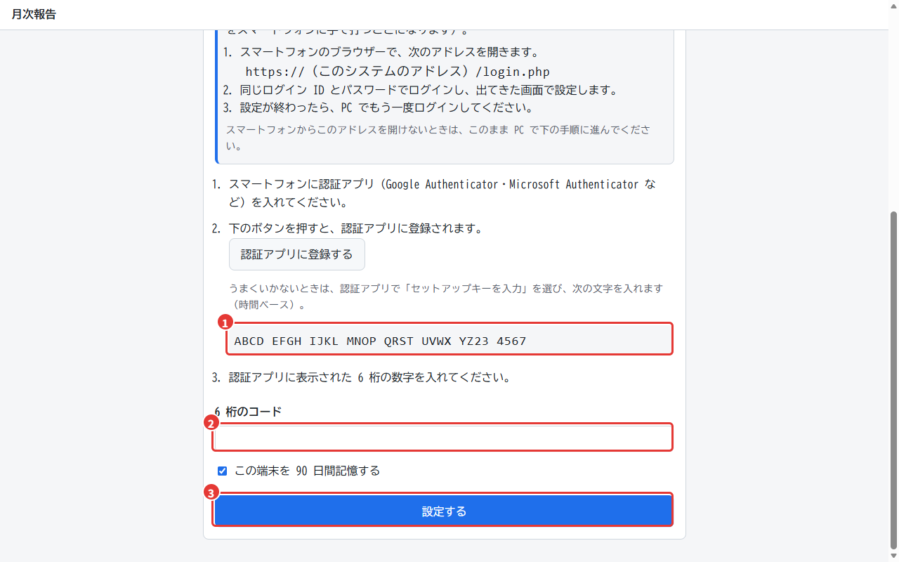

1. スマートフォンの認証アプリで「セットアップキーを入力」（アプリによっては「キーを入力」「手動で入力」）を選び、アカウント名に「月次報告」など分かる名前を、キーに画面の 32 文字（図の 1。空白は入れなくてかまいません）を入れて、種類は「時間ベース」にして追加する。「認証アプリに登録する」のボタンは、PC では働きません。
2. 認証アプリに出た 6 桁の数字を「6 桁のコード」の欄に入れる。
3. 「設定する」を押す。このあとは、下の 4. から同じです。

#### スマートフォンで設定するとき

1. スマートフォンに認証アプリ（Google Authenticator・Microsoft Authenticator など。App Store または Google Play から無料で入れられる）を入れておく。
2. 「認証アプリに登録する」を押す。認証アプリが開き、登録してよいか聞かれるので、「追加」「保存」などを押す。うまくいかないときは、その下の文字（セットアップキー）を、上の「PC で設定するとき」の 1. と同じように手で入れます。

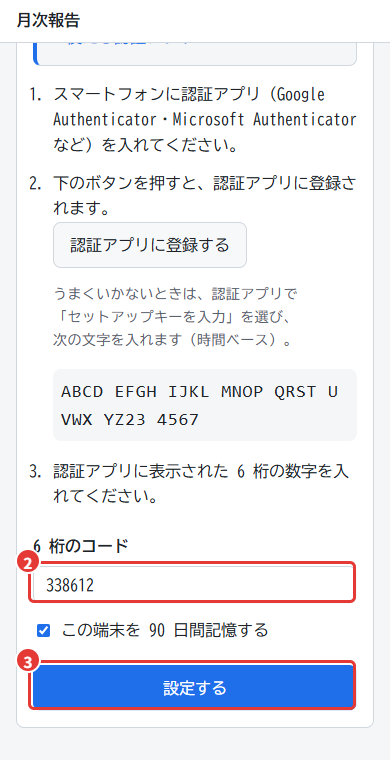

3. ブラウザーに戻り、認証アプリに出た 6 桁のコードを「6 桁のコード」の欄（図の 2）に入れて「設定する」（図の 3）を押す。

4. 予備のコード（図の 1）が一度だけ表示されます。紙に書くなどして、スマートフォンとは別の場所に保管してください。「予備のコードをコピー」（図の 2）を押すとまとめてコピーできるので、パスワードの管理アプリなどに貼り付けて保管してもかまいません（メールやチャットには貼らないでください）。
5. 保管したら「保管しました」（図の 3）を押す。

管理者から仮のパスワードを受け取った人は、ログインのあとにパスワードの変更を求められます。

1. 「新しいパスワード（10 文字以上）」に、新しいパスワードを入れる。思いつかないときは「自動で作る」を押すと作られます（「コピー」で写して、パスワードの管理アプリなどに保管してください）。
2. 「新しいパスワード（確認）」に、同じパスワードをもう一度入れる。
3. 「変更する」を押す。

#### 使える認証アプリ

「時間ベース」の 6 桁のコードを出すアプリなら使えます。迷ったら、iPhone・Android のどちらでも同じ名前で入れられる Google Authenticator か Microsoft Authenticator を選んでください。設定の画面の「使える認証アプリ」を開いても同じ一覧が見られます。

| アプリ | iPhone | Android | 備考 |
|---|---|---|---|
| Google Authenticator | ○ | ○ | 無料 |
| Microsoft Authenticator | ○ | ○ | 無料。Microsoft のアカウントがなくても使える |
| IIJ SmartKey | ○ | ○ | 無料。画面が日本語 |
| Authy | ○ | ○ | 無料 |
| iPhone の「パスワード」 | ○ | × | iPhone に最初から入っている（iOS 18 以降。iOS 15〜17 は「設定」の「パスワード」） |
| Aegis | × | ○ | 無料 |

- SMS でコードを受け取る方式や、ボタンを押して承認するだけの方式には対応していません。
- 機種変更のとき、アプリによってはコードを新しいスマートフォンへ引き継げません。そのときは予備のコードでログインし、アカウント設定で 2 段階認証を設定し直します（10.）。

### 2.3 自動でログアウトされるとき

- 最後の操作から 30 分たったとき
- ログインから 12 時間たったとき

入力の途中でログアウトされないよう、長い入力は「下書き保存」をこまめに押してください（報告の画面は自動でも保存します。4.2）。

### 2.4 パスワードを忘れたとき

1. ログイン画面の「パスワードを忘れた場合」を押す。

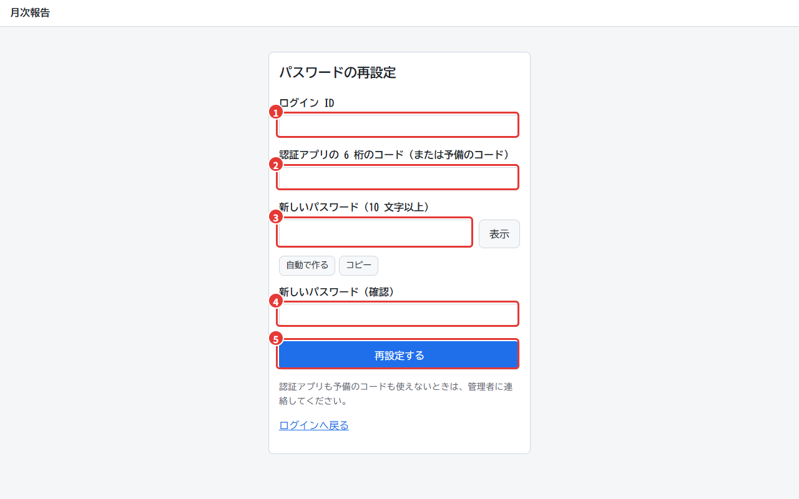

2. 次のように入れて、「再設定する」（図の 5）を押す。
    - 図の 1: ログイン ID
    - 図の 2: 認証アプリの 6 桁のコード（または予備のコード）
    - 図の 3・4: 新しいパスワード（10 文字以上）を 2 回

パスワードは、好きな言葉をつなげた文の形にすると覚えやすくなります。
認証アプリも予備のコードも使えないときは、管理者に連絡してください（9.4）。

### 2.5 ロックされたとき

ログインに 10 回続けて失敗すると、15 分ほどログインできなくなります。時間をおいてからやり直してください。急ぐときは管理者に解除を頼めます。

---

## 3. ホーム画面とメニュー

### 3.1 ホームに出るもの

ホームには、今やることが上から並びます（図は部下のホーム。図の 1 が報告の欄、図の 2 が回答待ちのコメントの欄、図の 3 がメニューです）。

| 欄 | 出る人 | 内容 |
| --- | --- | --- |
| （年月）の報告 | 全員 | 今月の報告の状態（未作成・下書き・提出済み・確認完了）と締め日。「今月の報告を作る」または「続きを書く」 |
| 前月の報告がまだです | 全員 | 前月の報告が未作成・下書きのときだけ |
| 回答待ちのコメント | 全員 | 自分の報告に来た、まだ返信していないコメント |
| 臨時の調査 | 対象の人 | まだ答えていない調査と期限 |
| 更新のお知らせ | 全員 | システムの変更のお知らせ |
| （課名）（年月）（確認） | 確認者・課長 | 未チェックの件数、回答ありの件数、未提出の人数。「未チェックを順に見る」「提出状況」 |
| 要望・依頼の回答 | 課長・確認者 | 出した要望・依頼にシステム管理者から返信が来たとき |

- 締め日まで 3 日以内になると、締め日が赤で出ます。
- 締め日まで 3 日以内でまだ出していないとき、前の月の締め日を過ぎてまだ出していないとき、課長・確認者から提出を促されたときは、どの画面でも上に黄色の知らせが出ます（報告の作成の画面を除く）。押すと、その月の報告を開きます。提出すると消えます。メールは届きません。
- 「今月」は、締め日までは前月、締め日を過ぎると当月です（月次報告は前月の状況を月初に報告するため）。
- メンテナンス中は画面の上に知らせが出て、保存などの操作ができません。

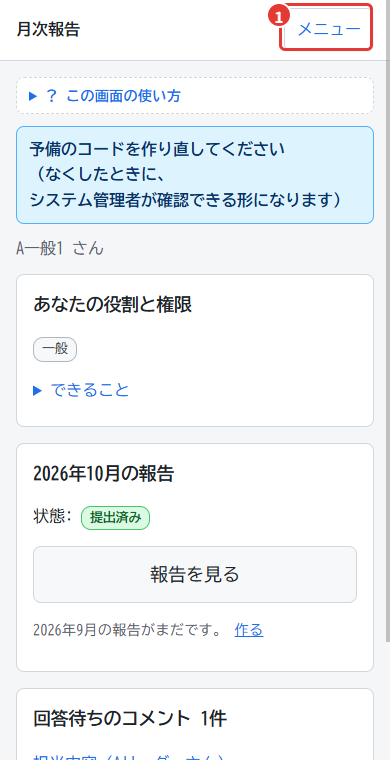

スマートフォンでも、同じ欄が縦に並びます。メニューは右上の「メニュー」（図の 1）です。

### 3.2 メニュー

1. 画面右上の「メニュー」を押す。
2. 開いたメニュー（図の 2）から、使いたい画面を押す。閉じるときは、もう一度「メニュー」を押します。

見出しごとに、使える画面だけが出ます。

| 見出し | 画面 | 使える人 |
| --- | --- | --- |
| 報告 | ホーム、自分の報告、コメント、検索 | 全員 |
| 確認 | 提出状況 | 確認者・課長・管理者 |
| 確認 | 臨時の調査、出力 | 課長 |
| 確認 | 要望・依頼 | 確認者・課長 |
| 管理 | 管理のトップ | 「管理」の画面を 1 つ以上使える人 |
| 管理 | 課の管理 | 課長 |
| 管理 | 項目マスタ | 課長・項目管理者・管理者 |
| 管理 | コメントの定型文 | 確認者・課長 |
| 管理 | メッセージ | 管理担当の課の課長・補佐 |
| 管理 | 要望・依頼、更新のお知らせ、案件の管理、組織・ユーザー、記録・削除データ | 管理者・補佐 |
| 目標管理 | 目標管理シート（14 章） | 全員 |
| 精算 | 通勤定期代の精算（13 章） | 全員 |
| アカウント | よくある質問、アカウント設定 | 全員 |

ログアウトは、メニューのいちばん下の「ログアウト」です。

### 3.3 この画面の使い方

1. 画面の上の「？ この画面の使い方」を押すと、その画面の短い説明が開きます。
2. 説明の最後の「よくある質問」を押すと、その画面についての質問と答えが並ぶ画面（7.3）に移ります。

---

## 4. 月次報告を作る・出す（全員）

### 4.1 報告を作る

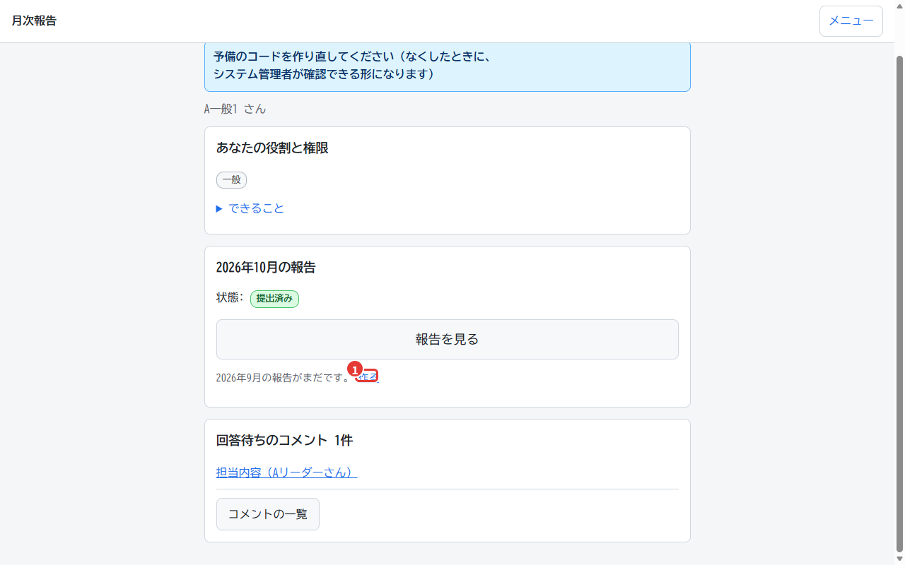

1. ホームの「今月の報告を作る」（下書きがあれば「続きを書く」、前月の分は「作る」）を押す。
2. 前月の報告の内容が入った状態で開きます。変わったところだけ直してください。
3. 最後に「提出する」を押す（4.6）。

作れるのは、当月と過去 3 か月までの報告です。

### 4.2 楽に出す方法

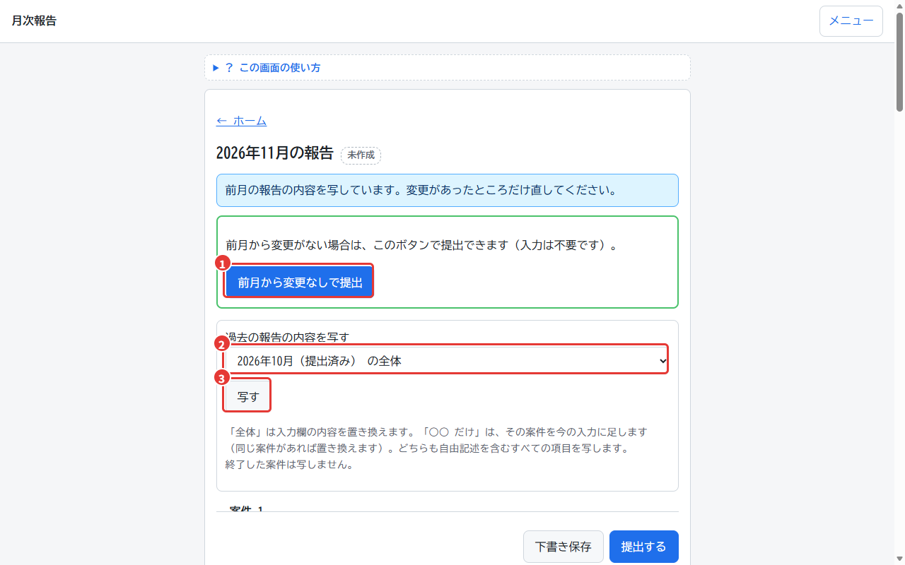

- **前月から変更なしで提出**（図の 1）: 先月から何も変わっていなければ、このボタンだけで提出できます。入力はいりません。
- **過去の報告の内容を写す**（図の 2・3）: 写したい月（とその範囲）を図の 2 で選んで、「写す」（図の 3）を押すと、その月の内容が入ります。「全体」は入力欄の内容を置き換えます。「○○ だけ」は、その案件を今の入力に足します。

### 4.3 入力のしかた

- 報告は「案件ごとの欄」と「報告全体」の欄に分かれています。案件ごとの欄は、案件（図の 1）を選んでから、担当内容（図の 2）・作業フェーズ（図の 3）などを入れます。
- 一覧から選ぶ欄（図の 1・3）は、押すと選択肢が出るので、押して選びます。丸い印の選択肢（ラジオボタン）は、文字のところを押しても選べます。
- 「必須」の札が付いた項目は入力が必要です。足りないと、提出のときに知らせます。
- 「社外秘」の札が付いた項目は、暗号化して保存されます。
- 入力が変わると 60 秒ごとに自動でも下書き保存します（画面の下に「自動保存しました 10:42」と出ます）。

項目によっては、ほかの答えに応じて出たり消えたりします。例: 進捗が「遅延あり」（図の 1）のときだけ「進捗の補足」（図の 2）が出ます。

客先名らしい言葉（「株式会社」など）を入れると、欄の下に黄色の注意（図の 1）が出ます。社内の案件コードや呼び名に書き換えてください（注意が出たままでも保存はできますが、提出の前に確認が出ます）。

### 4.4 案件を足す・外す

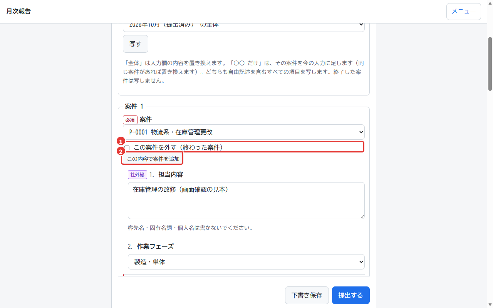

- 終わった案件は「この案件を外す（終わった案件）」（図の 1）にチェックを付けます。
- 「この内容で案件を追加」（図の 2）を押すと、その案件の内容を、下の「案件を追加するとき」の欄に写せます（案件は選び直します）。

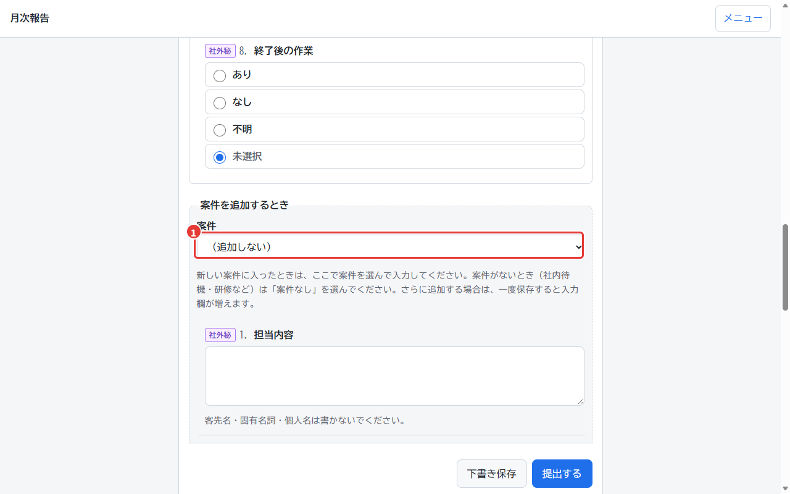

- 新しい案件に入ったときは、いちばん下の「案件を追加するとき」の欄で案件（図の 1）を選んで入力します。もっと足すときは、保存すると欄が増えます。
- 案件がないとき（社内待機・研修など）は、案件で「案件なし 社内待機・研修など」（いちばん上）を選んで、担当内容などを書いてください。案件を選ばずに書くと、「案件を選んでください」と出て保存されません（書いた内容は残ります）。
- 選べる案件がないときは、課長か管理者に案件の登録を頼んでください。

### 4.5 スマートフォンで答える

スマートフォンでは 1 問ずつ答えられます。

1. 画面の下に、いま何問目か（図の 1。例: 「1 / 11 問」）が出ます。
2. 答えたら「次へ」（図の 2）を押します。最後の問いまで進むと、答えを確かめて提出できます。
3. 全部の項目を一度に見たいときは「一覧で表示する」（図の 3）で切り替えます。

一覧の表示から 1 問ずつに戻すときは、同じ場所のリンク（図の 1）を押します。

### 4.6 保存する・提出する

「下書き保存」（図の 1）と「提出する」（図の 2）は、画面の下にいつも出ています（下に動かさなくても押せます）。

1. 途中で終えるときは「下書き保存」を押す。いつでも途中を保存できます。

2. 入力が終わったら「提出する」を押す。

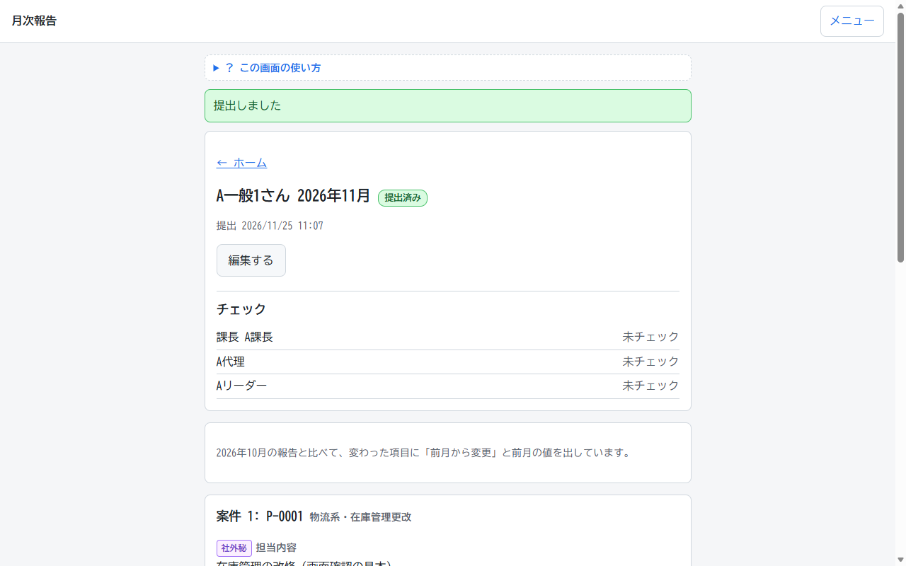

「提出しました」と出て、報告の詳細の画面に移れば、提出できています。必須の欄が空のときは、その欄の下に「入力してください」と赤で出ます（入れた値は残っているので、足して、もう一度「提出する」を押します）。

### 4.7 提出したあと

- 提出したあとも、本人が直せます。報告の詳細の画面の「編集する」を押して直し、「保存」すると変更の履歴が残り、確認者に「更新あり」と知らせます。出し直しの操作はいりません。
- 確認完了になった報告は直せません。
- 下書きは「下書きを削除」で消せます。

### 4.8 自分の報告を見る

メニューの「自分の報告」に、月ごとの状態（下書き・提出済み・確認完了）、回答待ちのコメントの数、チェックの数（例: チェック 3/3）が出ます。行（図の 1）を押すと報告を開きます。

### 4.9 コメントに返信する

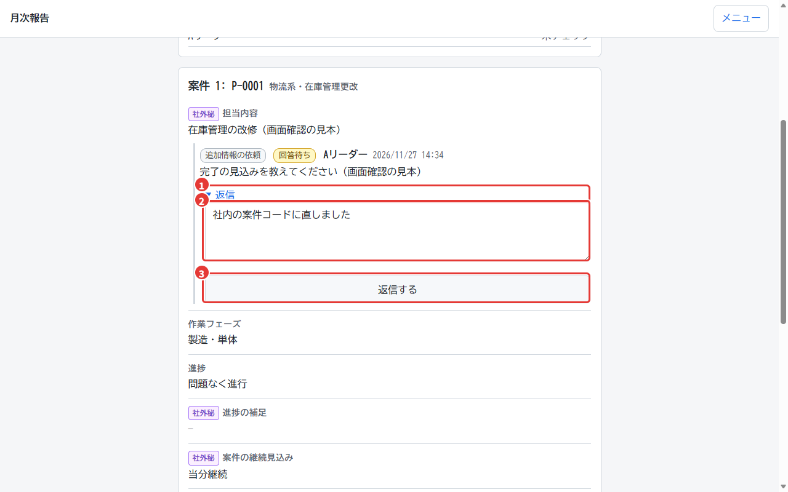

1. ホームの「回答待ちのコメント」か、メニューの「コメント」から、コメントの付いた報告を開く。コメントの下の「返信」（図の 1）を押す。
2. 開いた欄（図の 2）に返信を書く。報告の中身を直して答えてもかまいません。
3. 「返信する」（図の 3）を押す。コメントの状態が「回答あり」になります。

コメントの種類は次の 3 つです。

| 種類 | 状態の流れ | 返事 |
| --- | --- | --- |
| 追加情報の依頼 | 回答待ち → 回答あり → 解決 | 求められる |
| 認識の確認 | 回答待ち → 回答あり → 解決 | 求められる |
| 連絡 | 状態なし | いらない |

### 4.10 臨時の調査に答える

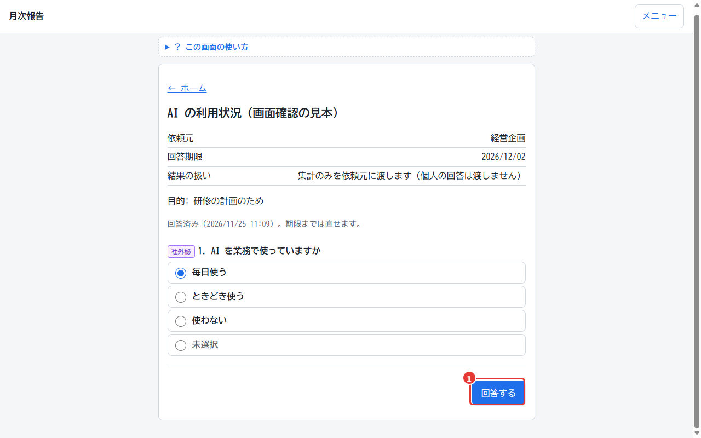

1. ホームの「臨時の調査」から調査を開く。依頼元・期限・目的・結果の扱いが上に出ます。
2. 質問に答えて「回答する」（図の 1）を押す。月次報告と同じ質問には、最新の報告の値が入っています。

期限の日までは答えを直せます。期限を過ぎると「この調査は締め切られました。」と出ます。

---

## 5. 報告を確認する（確認者・課長）

### 5.1 未チェックの報告を順に見る

1. ホームの確認の欄にある「未チェックを順に見る」（図の 1）を押す。
2. 最初の未チェックの報告が開きます。読み終えてチェックすると、次の報告へ進めます。

課の全員の状態を見たいときは「提出状況」（図の 2。6.1）を押します。

### 5.2 報告の詳細の画面

- 上に、だれの何月の報告かと状態（図の 1）が出ます。
- その下の「チェック」の欄（図の 2）に、確認者ごとに「未チェック」「チェック済」「更新あり（再確認待ち）」が出ます。
- 前回チェックしたあとに変わった値には「更新あり」の札が付きます。
- 前月の報告と違う項目には「前月から変更」の札と前月の値が出ます。前月になかった案件には「前月にない案件」と出ます。
- 客先名らしい言葉がある欄には「注意: 客先名の可能性」と出ます。
- 提出後の変更は、下の「変更履歴」を開くと見られます。
- 「限定」の項目は、本人と課長だけが見られます。確認者には「（限定のため表示しません）」と出ます。

### 5.3 コメントする

1. 聞きたい項目の下の「＋ コメント」（図の 1。報告全体へは下の欄）を押す。
2. 種類（追加情報の依頼・認識の確認・連絡）を選ぶ（図の 2）。
3. 本文を書く。よく使う文は「定型文を選ぶ」（図の 3）から選ぶと、本文に入ります（5.5）。
4. 「コメントする」（図の 4）を押す。

- 本人が返信すると「回答あり」になります。読んで済んだら「返信・解決」（図の 1）を開いて「解決にする」（図の 2）を押します。もう一度聞くときは、同じ欄に書いて「返信する」を押します。
- 解決にできるのは、確認者は自分が出したコメントだけ、課長はすべてです。
- 自分が書いたコメント・返信は、本文の下の「直す」で直せます。直すと「（日時 に直しました）」と出ます。

### 5.4 チェックする・確認を完了にする

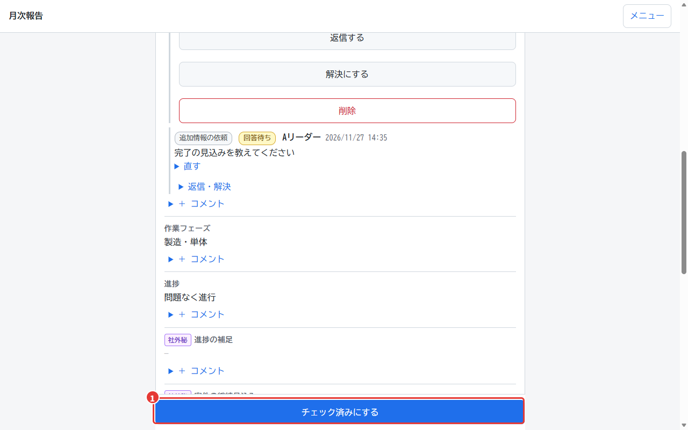

- 確認者・課長は、画面の下の「チェック済みにする」（図の 1）を押します。

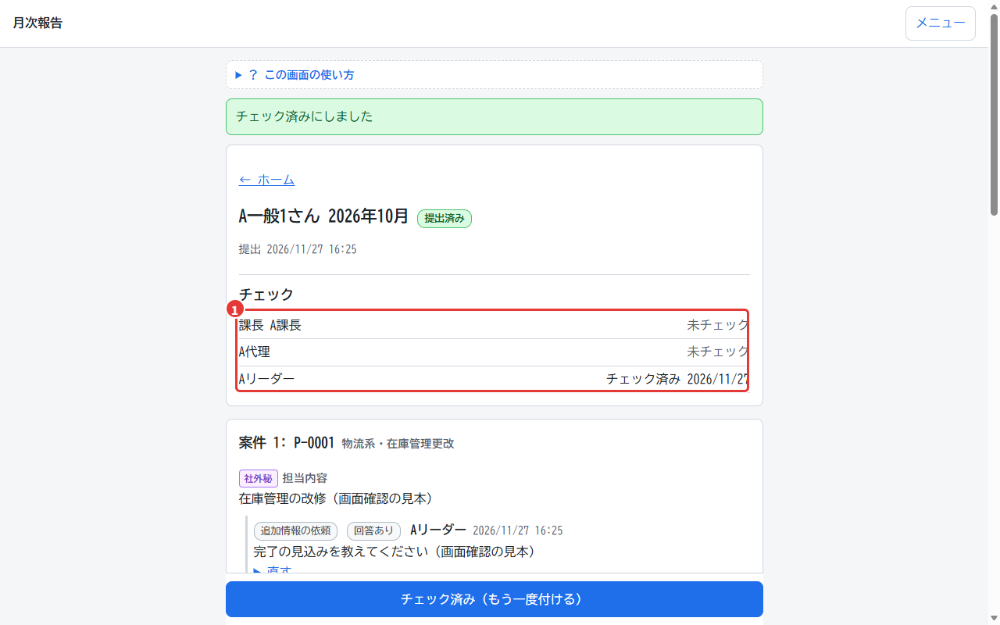

- 押すと「チェック済みにしました」と出て、チェックの欄（図の 1）の自分の行が「チェック済」になります。

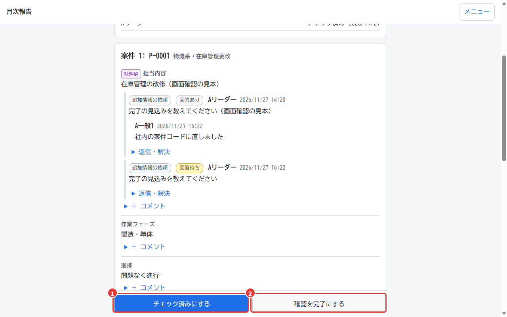

- 課長は「確認を完了にする」（図の 2）を押すと、報告が確認完了になります。完了は戻せます。
- 自分の報告は、自分で確認完了にできません。

チェックしない設定の確認者（8.1）は、報告を見てコメントはできますが、チェックの人数には数えません。

### 5.5 コメントの定型文

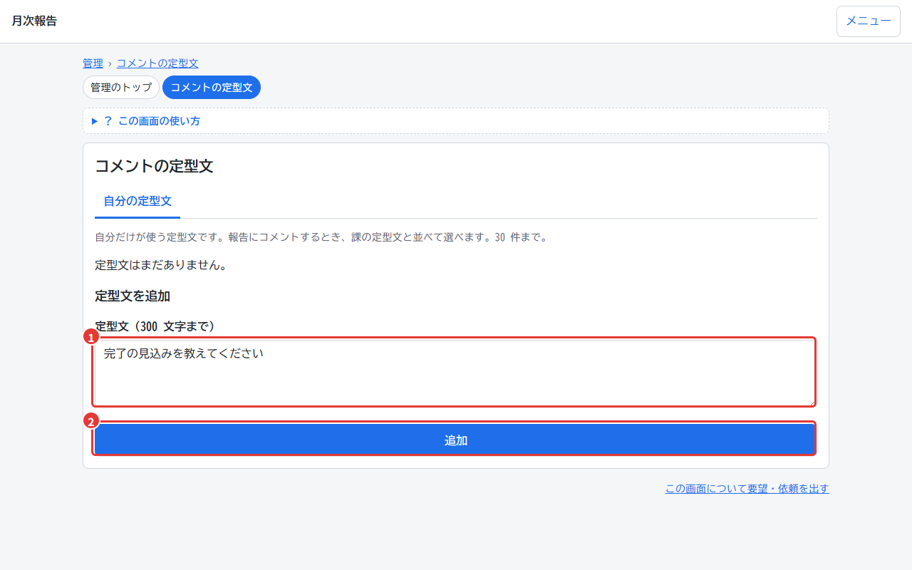

メニューの「コメントの定型文」で、よく使うコメントを登録できます。課長は課の定型文、確認者は自分だけの定型文を、それぞれ 30 件まで登録できます。

1. 「定型文（300 文字まで）」の欄（図の 1）に文を書く。
2. 「追加」（図の 2）を押す。

---

## 6. 提出状況・横並び・検索・出力・臨時の調査

### 6.1 提出状況（確認者・課長）

課の人ごとに、提出の状態とチェックの進み具合が出ます。

- 見る月は、図の 1 で選んで「表示」を押すと変わります（課・絞り込みも同じ行で選べます）。
- 「未チェックを順に見る」（図の 2）で、チェックしていない報告を順に開けます。
- 「横並び・まとめ」（図の 3）で、課の報告を横に並べて見られます（6.2）。
- 「前月から変更なし」の報告は、まとめてチェックできます。
- まだ出していない人がいれば「未提出の人に提出を促す」（図の 4）を押せます。促された人がこのシステムを開くと、画面の上に「（あなたの名前） さんから、提出するよう知らせが届いています」と出ます（メールは送りません）。同じ人には 1 日 1 回まで。促した日は、その人の行に「促した（日付）」と出ます。
- 人の名前を押すと、その人の報告を開きます。
- 管理者が確認者でない課を見るときは、提出の状態とチェックの数だけが出ます（中身へのリンクは出ません）。

### 6.2 横並び（確認者・課長）

提出状況の画面から開きます。課の報告を、案件ごとに 1 行で横に並べて見られます。

- 「前月との差分」（図の 1）にチェックを付けて「表示」を押すと、変わった値に印が付きます。
- 自由記述は「開く」（図の 2）を押したときだけ出ます。開いたことは記録されます。
- 「限定」の項目の列は、課長にだけ出ます。
- 表が画面の幅に入りきらないときは、表の下のスクロールバーで横に動かします（`Shift` を押しながらマウスのホイールを回しても横に動きます）。

### 6.3 検索（全員）

対象月・課・選択式の値・キーワードで報告を探します。

1. 対象月の範囲（図の 1）を選ぶ。
2. 探す範囲（図の 2）を選ぶ。確認者・課長は「担当の課の報告」、それ以外の人は「自分の報告」の中から探します（部下の画面には、この欄は出ません）。
3. キーワード（図の 3）を入れる（50 文字まで）。課・選択式の値でも絞れます。
4. 「探す」（図の 4）を押す。

結果は下に並びます。押すと、その報告を開きます。

- キーワードは「検索の対象」の項目と、案件のコード・呼び名から探します。

### 6.4 出力（課長・PC のみ）

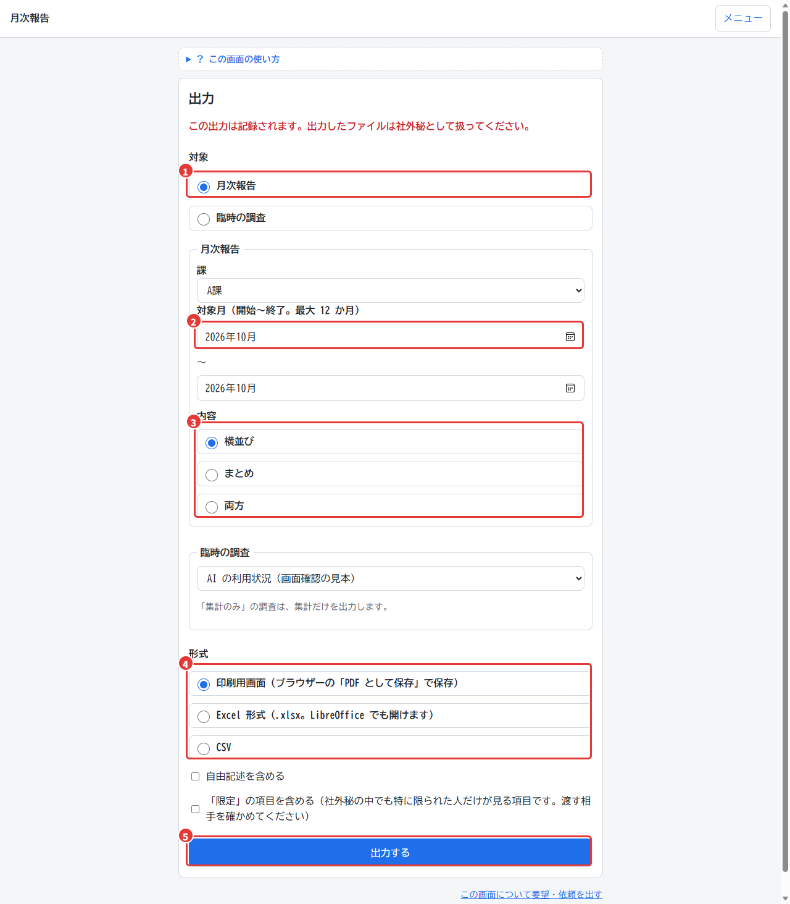

課の外への資料の元になるものを出力します。

1. メニューの「出力」を開き、対象（図の 1。月次報告か臨時の調査）を選ぶ。
2. 課と、対象月の範囲（図の 2。開始〜終了。最大 12 か月）を選ぶ。
3. 内容（図の 3。横並び・まとめ・両方）を選ぶ。
4. 形式（図の 4）を選ぶ。必要なら「自由記述を含める」「「限定」の項目を含める」にチェックを付ける。
5. 「出力する」（図の 5）を押す。

| 形式 | 使い方 |
| --- | --- |
| 印刷用画面 | ブラウザーの印刷で PDF に保存する（12.2） |
| Excel 形式（.xlsx） | LibreOffice Calc や Excel で開く（12.4）。ファイルは「ダウンロード」フォルダーに入る（0.5） |
| CSV | UTF-8（BOM 付き）。開き方は 12.3。ファイルは「ダウンロード」フォルダーに入る |

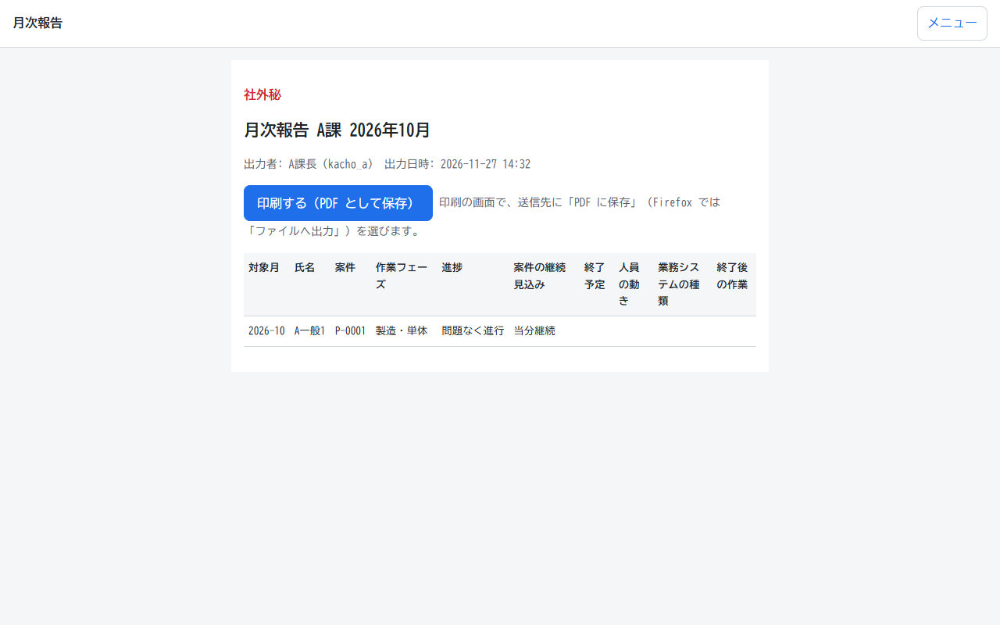

印刷用画面を選ぶと、上の図の画面が出ます。「印刷する（PDF として保存）」を押すか、`Ctrl` + `P` を押して PDF に保存します（12.2）。

- どの形式にも「社外秘」と出力者・日時が入ります。出力は記録に残ります。
- 「限定」の項目は、「「限定」の項目を含める」を選んだときだけ出ます。
- スマートフォンからは出力できません。

### 6.5 臨時の調査（課長）

月次報告とは別の、その時だけの質問を作って課の人に答えてもらいます。

1. メニューの「臨時の調査」で「＋ 新しく作る」（図の 1）を押す。作った調査を直すときは「設定」（図の 3）を押します。

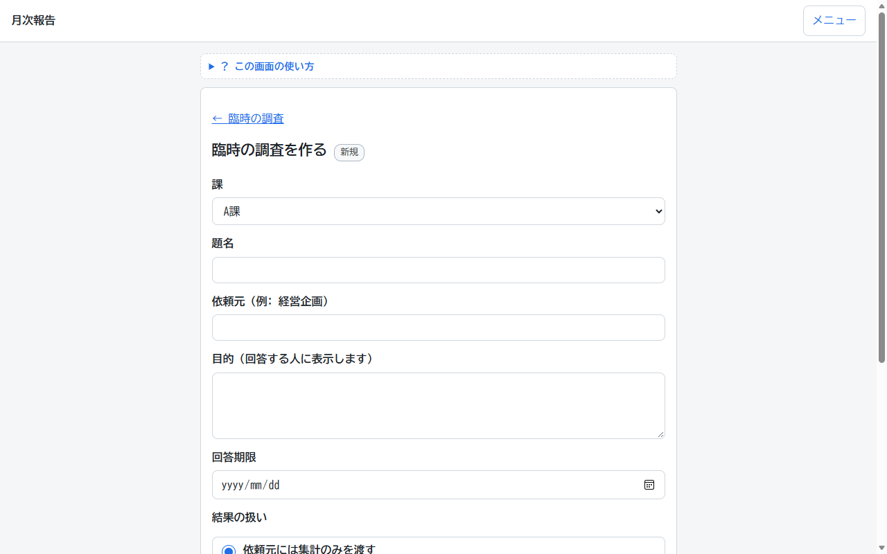

2. 題名・依頼元・期限・対象の人・目的・結果の扱いと、質問を決める。月次報告の項目を質問に使うと、最新の値が入った状態で答えてもらえます。
3. 「回答する人の画面で見る」で、答える人にどう見えるかを確かめる（見本。入力しても保存されません）。
4. 公開する。公開すると質問は変えられません。

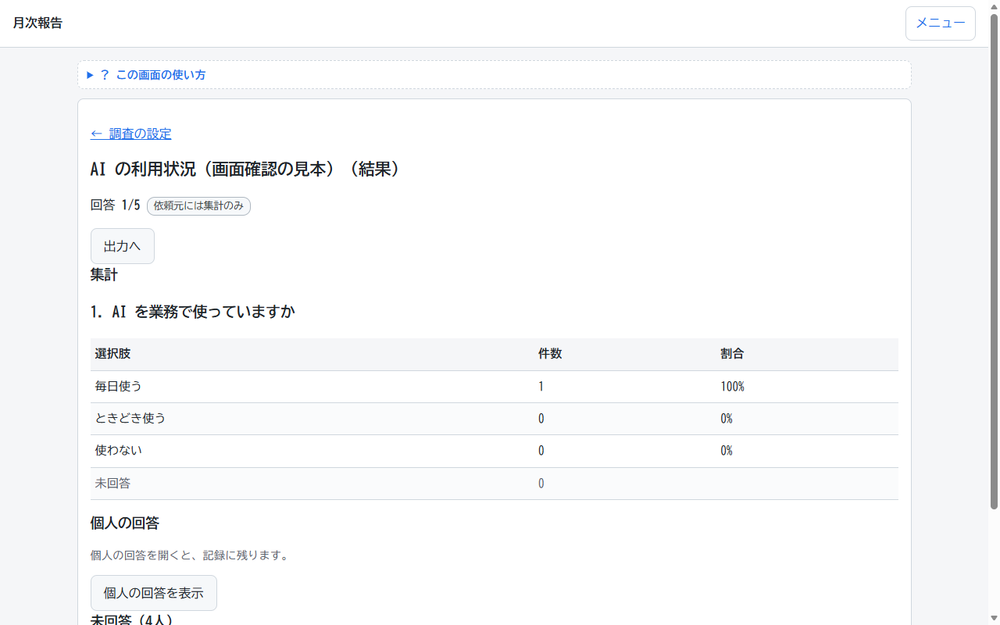

5. 一覧の「結果」（図の 2）で、集計と未回答の人を見る。個人の回答を開くと記録に残ります。

結果の扱いを「集計のみ」にした調査は、出力も集計だけになります。

---

## 7. コメントの一覧・要望・依頼・よくある質問

### 7.1 コメントの一覧（全員）

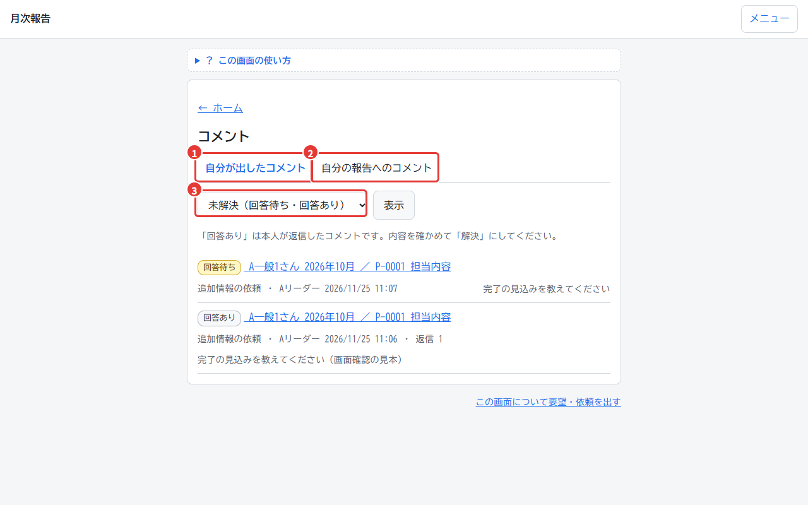

メニューの「コメント」に、自分の報告へのコメントと、自分が出したコメントが報告をまたいで並びます。

- 確認者・課長は「自分が出したコメント」（図の 1）と「自分の報告へのコメント」（図の 2）を切り替えて見ます（部下には「自分の報告へのコメント」だけが出ます）。
- 状態（図の 3）で絞り込んで「表示」を押します。
- 部下は「回答待ち」を探して返信します。
- 確認者は「回答あり」を探して解決にします。
- 行を押すと、そのコメントの付いた報告を開きます。

### 7.2 要望・依頼（確認者・課長）

システムへの改善要望・対応依頼・不具合・質問を、システム管理者へ出せます。

- 画面のことなら、その画面の下の「この画面について要望・依頼を出す」（図の 1）から出すと、どの画面かが自動で入ります。
- 部下は直接出せません。課長・確認者を通して出してください。

1. 種類（図の 1。改善要望・対応依頼・不具合・質問）を選ぶ。
2. 件名（図の 2。60 文字まで）を入れる。
3. 内容（図の 3。2,000 文字まで）に、困っていること・こうなってほしいこと・起きたこと（いつ・どの画面で・何をしたら）を書く。客先名・個人名は書かないでください。
4. 関係する画面と急ぎを選んで、「出す」（図の 4）を押す。

- 返信が来るとホームに出ます。受付前なら取り下げられます。

### 7.3 よくある質問（全員）

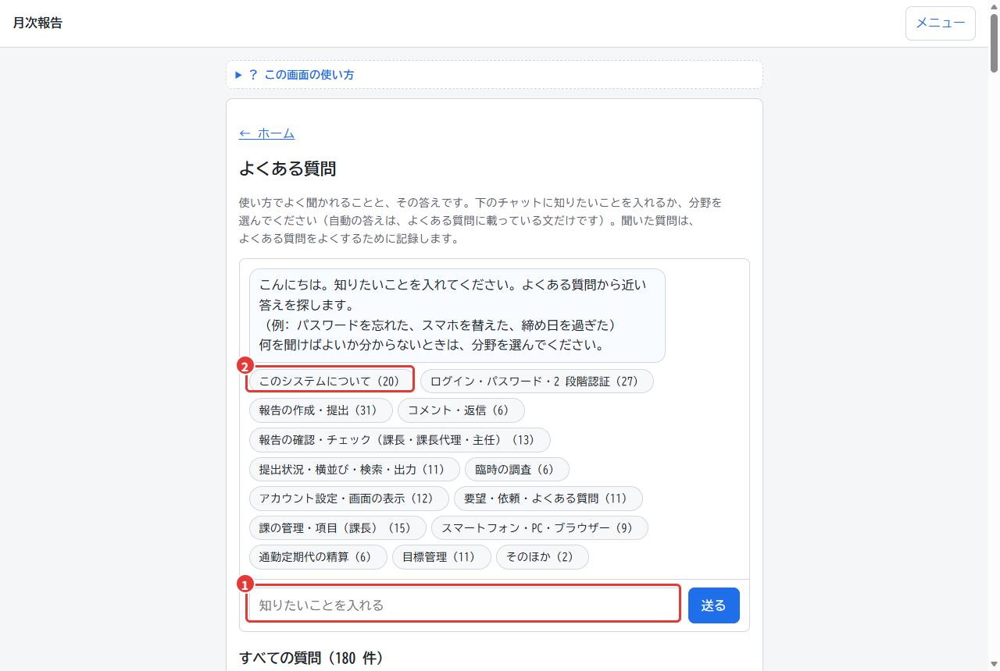

メニューの「よくある質問」に、使い方でよく聞かれることと答えが並びます。質問を押すと答えが開きます。

**分野から選ぶ**: 分野「システムの管理（管理者・補佐）」は、システム管理者・補佐にだけ出ます。何を聞けばよいか分からないときは、チャットの最初に出る分野（ログイン・報告の作成・コメントなど）のボタン（図の 2）を押すと、その分野の質問が並びます。近いものを押すと答えが出ます。「この画面の使い方」から開いたときは、その画面の分野が太く出ます。

**チャットで聞く**: 上のチャットの欄（前の図の 1）に知りたいこと（例: パスワードを忘れた、スマホを替えた）を入れて「送る」を押すと、近い質問の答え（この図の 1）が吹き出しで返ってきます。ほかにも近い質問があれば、ボタンを押すとその答えが出ます。答えを読んだら「解決した」（図の 2）「解決しない」（図の 3）を押します。「解決した」を押すと、チャットは開いたときの状態に戻ります。「解決しない」を押すと、関係がありそうな質問を出し、それでも見つからなければ、詳しく入れ直す・分野から選ぶ・質問として送る（課長・確認者）を案内します。言葉が少し違っても（「スマホ」と「スマートフォン」、「締切」と「締め日」など）探せます。見つからないときは、言葉を変えて入れるか、分野から選んでください。
「使い方がわからない」「教えて」のように、何について知りたいかが入っていないときは、「どのことについて知りたいですか？」と聞き返して分野のボタンを出します。
このシステムに関係のない質問（天気・趣味・ほかの社内手続きなど）には「その質問には返答できません。」、乱暴な言葉が入った文には「不適切な表現が含まれているため、返答できません。」と返します。どちらかが合わせて 5 回続くと、それからは返事をしません。システムの質問をするか、分野を選ぶと、また答えます。
チャットで聞いた質問と返した答えは、よくある質問をよくするために記録します（聞いた人も記録し、システム管理者と補佐が見られます。1 年で消えます）。
つらい・限界・眠れないなど、心の不調に関わる言葉が入っていたときは、気づかいの言葉を返します。一人で抱えずに、上司やシステム管理者に相談してください。
急病やけがなど、命や体に関わる急いだほうがよい状態が書かれていたときは、119 番に電話するよう案内します。少しでも危ないと感じたら、チャットではなく、すぐに 119 番に電話してください。
チャットに「ログインの有効期限が切れました」と出たときは、画面を開き直して、もう一度ログインしてください（30 分操作しないと、自動でログアウトします）。
病気や体のこと、家族のことなど、個人的な事情に触れる文には、チャットでは詳しく答えず、相談先を案内します（その文は記録しません）。報告や締め日のことで困ったときは、課長に相談してください。
返ってくる答えは、よくある質問に載っている文そのままです（AI が文を作ることはありません）。

**答えが見つからないとき**:

| 人 | すること |
|---|---|
| 課長・確認者（課長代理・リーダー） | 「解決しない」か「質問として送る」を押すと送る欄が出ます。「質問として送る」を押すと、入れた文がそのまま「要望・依頼」の「質問」としてシステム管理者に届きます（最初の行が件名。補足を書き足せます）。返信はホームと「要望・依頼」に出ます |
| 部下 | 課長・確認者に聞いてください。課長・確認者が、この画面から質問を送れます |

各画面の「？ この画面の使い方」の「よくある質問」から開いたときは、その画面について質問したことも一緒に届きます。

---

## 8. 課長の仕事

### 8.1 課の管理

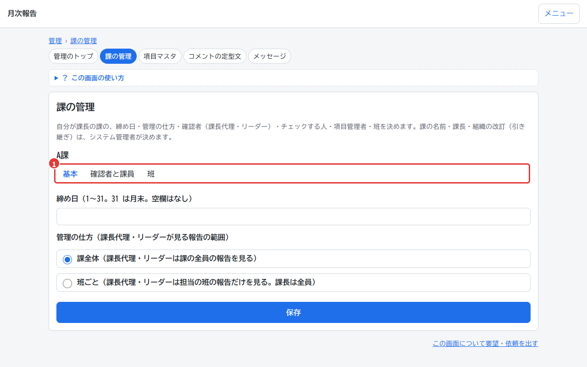

メニューの「課の管理」で、自分の課の次のことを決めます。画面は節（基本・確認者と課員・班）のタブ（図の 1）に分かれているので、押して切り替えます。

| 決めること | 内容 |
| --- | --- |
| 締め日 | 毎月の報告の締め日 |
| 管理の仕方 | 課全体で見るか、課長代理ごとの班で見るか |
| 確認者 | 課長代理・リーダーと、担当の班 |
| チェックする／しない | 確認者ごとに。しない人もコメントはできる |
| 項目管理者 | 課の項目を管理できる人 |
| 班 | 班の作成と、課員の班 |

課の追加や課長を決めるのは、システム管理者です（9.4）。

### 8.2 課の項目と選択肢

メニューの「項目マスタ」で、課の項目を追加・編集・並べ替えます。

- 見る様式（図の 1）を選んで「表示」を押します。
- 項目を足すときは「＋ 項目を足す」（図の 2）を押します。並べ替えは各行の「↑」「↓」、直すときは「編集」です。
- 「プレビュー」（図の 3）で入力画面の見え方を確かめられます（保存されません）。
- 共通の選択式の項目の選択肢は、「この課の選択肢」（図の 4）で、この課でだけ表示名を変える・出さない・足すことができます（IT 系以外の課のため）。ほかの課には影響しません。
- 変更は、これから作る報告に反映されます。すでにある報告は、作ったときの項目のままです。

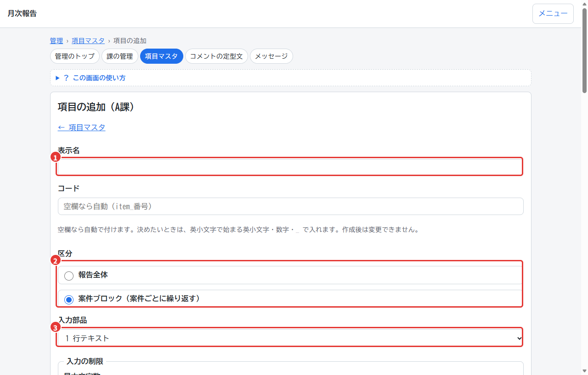

項目を足すときは、表示名（図の 1）、どこに出すか（図の 2。報告全体か、案件ごとに繰り返すか）、入力部品（図の 3。1 行テキスト・プルダウン・ラジオボタンなど）を決め、その下の設定（必須・機密区分・説明文など）を選んで「保存」を押します。入力部品を変えると、それに合う設定だけが出ます。

### 8.3 メッセージ（管理担当の課の課長）

メニューの「メッセージ」で、画面に出す文言（「この画面の使い方」の文を含む）を変えられます。変えた文言は全員の画面に出ます。`{ }` の中の言葉は、そのまま残してください。

1. 変えたい文言を、上の欄で探して「絞り込む」（図の 1）を押す（`Ctrl` + `F` で画面の中を探してもかまいません）。
2. 文を直して、その行の「保存」（図の 2）を押す。

---

## 9. システム管理者・補佐の仕事

補佐は管理の仕事を代行できますが、個々の情報（報告の中身・コメント、人ごとの提出状況、閲覧・出力の記録、削除データの中身）は見られません（よくある質問の記録の、聞いた人は見られます。心の不調・退職に関わる質問は見られません）。補佐の操作は「補佐として」記録され、管理者が管理のトップで確かめます。

補佐のうち 1 名（このシステムの設計・製造・保守の担当者）には、管理者が「補佐（開発担当）」の印を付けます。補佐（開発担当）は管理者と同じことができます（個々の情報も見られます）。ただし、心の不調・退職に関わる質問は見られません（管理者だけ）。

所属の課がない管理者のホームには、報告の欄の代わりに管理の画面への入口が並びます。

### 9.1 管理のトップ

管理の仕事ごとの入口と、今の状態が並びます。目立つ札は、対応が要るものです。

- 上の並び（図の 1）で、管理の画面を切り替えられます。どの管理の画面にも出ます。
- カード（図の 2）を押すと、その仕事の画面に移ります。カードには件数などの状態が出ます。
- バックアップの状態（最後のバックアップの日時。7 日より古いと知らせが出る）
- メンテナンスの切り替え（メンテナンス中は、管理者・補佐以外は保存などの操作ができない）
- 課長がいない課があるときの知らせ（その課は確認を完了にできない）

### 9.2 項目マスタ

共通の項目と課の項目を追加・編集・並べ替えます。変更は、これから作る報告に反映されます。操作は 8.2 と同じです。

### 9.3 案件の管理

案件コードと社内向けの呼び名を管理します。客先名は入れないでください。

- 案件を足すときは、呼び名などを入れて「＋ 案件を追加（コードは自動）」（図の 1）を押します。終わった案件は「終了」を押します。
- 案件台帳との突き合わせには「案件の一覧を CSV に出力」（図の 2）を使います。

### 9.4 組織・ユーザー

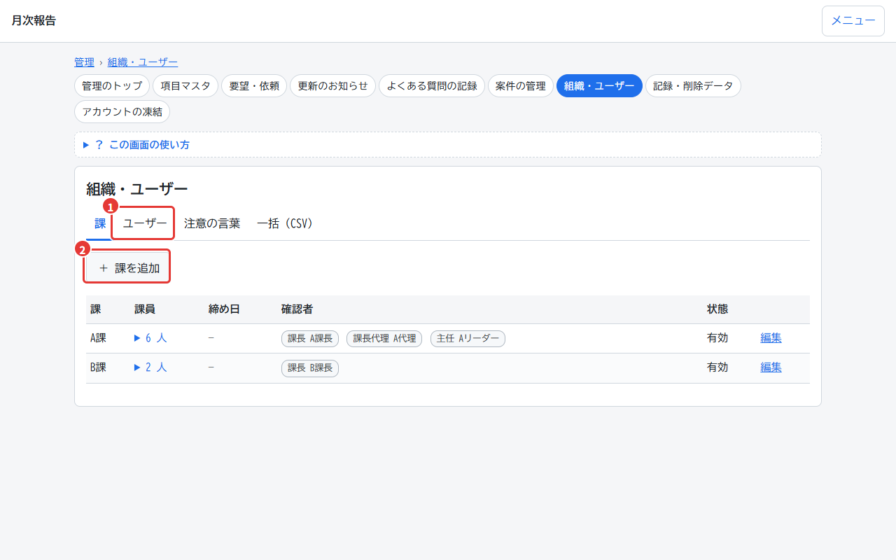

「組織・ユーザー」は、課・ユーザー・注意の言葉・一括（CSV）のタブに分かれています。課を足すときは「＋ 課を追加」（図の 2）、ユーザーの仕事は「ユーザー」のタブ（図の 1）です。

ユーザーを足すときは「＋ ユーザーを追加」（図の 1）を押します。一覧の行の「編集」を押すと、そのユーザーの編集の画面が開きます。

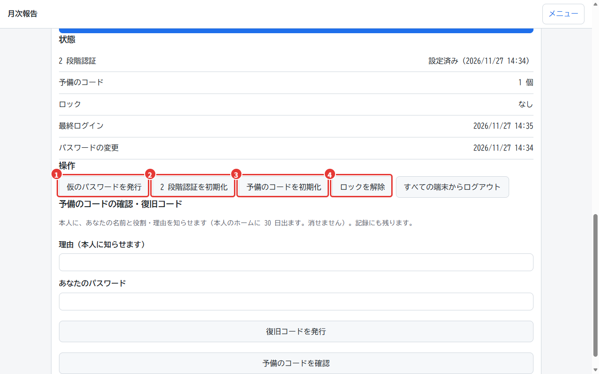

ユーザーの編集の画面の下の「操作」に、パスワードや 2 段階認証のボタン（図の 1〜4）が並びます。押して確認が出たら、内容を読んで「OK」を押します。

| 仕事 | 内容 |
| --- | --- |
| 課 | 課の追加・名前・並び・有効／無効、課長を決める |
| ユーザー | 追加、表示名・役職・所属の課・有効の変更 |
| 仮のパスワード | 発行する（図の 1）。一度だけ表示されるので、本人に伝える。はじめての人には、先にスマートフォンに認証アプリを入れ、はじめてのログインはスマートフォンで行うよう伝える |
| 2 段階認証の初期化 | 本人が認証アプリも予備のコードも使えなくなったとき（図の 2） |
| 予備のコードの初期化 | 本人が予備のコードをメールやチャットに貼った、なくした、などのとき（図の 3）。今のコードがすべて使えなくなる（認証アプリはそのまま使える）。本人のホームに作り直しの知らせが出るので、アカウント設定の「予備のコード」で作り直すよう伝える。補佐も行える（管理者・補佐の利用者は、管理者と補佐（開発担当）だけ） |
| ロックの解除 | ログインの失敗でロックされた人（図の 4） |
| 注意の言葉 | 客先名らしい言葉の一覧 |
| 組織の一括の入れ替え | 毎年の組織改訂を CSV で入れる。事前に予告がある改訂は、反映する日を予約できる |

一括の入れ替えの CSV は UTF-8 で作ってください（12.3）。先に「今の組織を CSV に出力」で今の組織を出し、それを直して取り込むと間違いが少なくなります。取り込むと、変わる内容が先に表示されるので、確かめてから反映します。

### 9.5 記録・削除データ

- 閲覧・出力・管理の操作・ログインの記録を探せます。「ログインの失敗」で、不正なアクセスの疑いを確かめられます。記録に報告の中身は入っていません。
- **無い ID でのログイン**: 存在しない ID でログインしようとした記録があると、システム管理者・補佐のホームに知らせが出ます。種類「無い ID でのログイン」で、入れた ID と IP アドレスを見て、打ち間違いか、なりすまし・総当たりのおそれがないか確かめ、「確かめた」を押してください。
- **ID・パスワードを求める質問**: よくある質問のチャットで、ほかの人の ID・パスワードを求める質問があると、システム管理者・補佐のホームに知らせが出ます。「よくある質問の記録」の「知らせる質問」の欄で聞いた人を確かめ、「対応した」を押してください。パスワードは教えないでください。
- **システム・データを壊すと書いた文**: よくある質問のチャットで「DBを消してやる」「システムをぶっ壊す」のように、システムやデータを壊す・消す・持ち出すつもりの文があると、チャットは答えずに断り、システム管理者・補佐のホームに知らせが出ます。「よくある質問の記録」の「知らせる質問」の欄で聞いた人を確かめ、必要なら課長と相談して対応し、「対応した」を押してください。「DBを消したい」のような、ふつうの言い方は知らせません（消す機能が無いことを答えます）。

- 削除した報告・コメント・臨時の調査は、削除から一定の日数の間は戻せます。

### 9.6 更新のお知らせ

システムの改善や変更を、出す期間の間、全員のホームに知らせます。要望を出した人の名前や要望の文は、そのまま書かないでください。

### 9.7 要望・依頼への返信

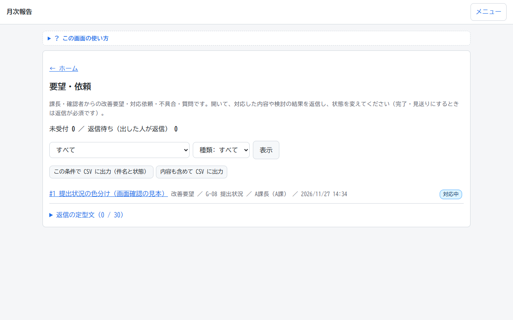

1. メニューの「要望・依頼」で一覧を開く。件名を押すと詳細が開きます。

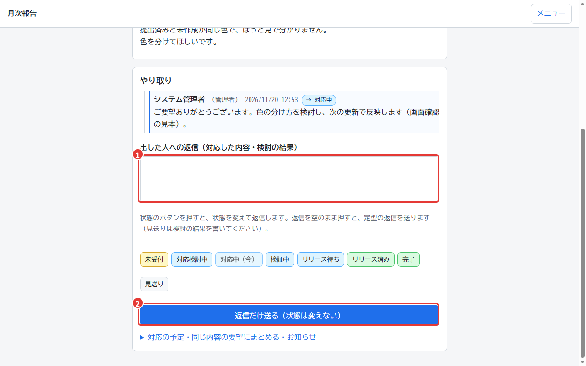

2. 詳細を開き、返信の文（図の 1）を書いて、状態のボタンで状態を変えて返信する（返信が空なら定型の返信になる）。状態を変えずに返信だけするときは「返信だけ送る（状態は変えない）」（図の 2）を押します。

種類が「質問」で閉じた要望・依頼は、「よくある質問に載せる」でよくある質問にできます。質問と答えは書き直して載せ、出した人の文や名前は出しません。

### 9.8 よくある質問の管理

よくある質問の画面で、分野・質問（200 文字まで）・答え（2,000 文字まで）を載せる・直す・消す・並べ替えることができます。200 件まで載せられます。「↑」「↓」は同じ分野の中で並べ替えます。
**載せる文の注意**: よくある質問はだれでも読めます（「システムの管理」の分野は管理者・補佐だけ）。コマンド・ファイルの場所・鍵やパスワードの置き場所など、システムの内部の情報は書かないでください。

**標準のよくある質問**: この操作マニュアルの全章とシステムの概要から想定される質問（171 件）を、システムに用意してあります。「すべての質問」の下の「標準のよくある質問を取り込む」を押すと、まだ載っていない質問だけを分野つきで足します（同じ質問の文があるものは足しません）。新しい版で標準の質問が増えたとき・答えが新しくなったときも、もう一度押せば、増えた分を足し、答えを新しくします（ここで直した答えは変えません）。取り込んだあとは、自由に直す・消すことができます。
探すときは、質問と答えの文の中の言葉で探します（質問に当たるほうを先に出します）。利用者が使いそうな言い方（「スマホ」「締切」など）を質問か答えに入れておくと、見つかりやすくなります。

**よくある質問の記録**: メニューの「よくある質問の記録」で、チャットで聞かれた質問と返した答え・反応を見られます。
- 「答えられなかった質問」（見つからなかった・「解決しない」・質問として送ったもの）を多い順に出します。「よくある質問に載せる」を押すと、その文が入った状態で載せる欄が開きます。
- 「「解決しない」が多い答え」は、答えの文を直す候補です。
- 「関係のない質問とした文」にシステムの質問が出ていたら、開発担当に伝えてください（言葉の表に足します）。
- 「不適切な表現」に、乱暴な言葉の文と聞いた人が出ます。聞いた人の名前は、システム管理者と補佐が見られます。対応のためだけに使ってください。管理のトップのカードにも、7 日の件数が出ます。
- 「心の不調・退職に関わる質問」に、心の不調に関わる言葉が入った文と、退職に関わる質問、聞いた人が出ます（命に関わる言葉を先に）。ホームと管理のトップにも、未対応の件数が目立つ札で出ます。この欄と知らせは、システム管理者だけに出ます（補佐には出ません）。内容を確かめ、必要なら本人の上司などと連携して対応し、「対応した」を押してください。言葉だけで見分けているので、軽い言い方も入ります。健康に関わる情報なので、対応に必要な人の間だけで扱ってください。
- 記録は 1 年で消えます。記録の画面を見たことは、操作の記録に残ります。

よくある質問で見つからずに送られた質問は、「要望・依頼」に種類「質問」で届きます（7.3）。答えたら、閉じた詳細の「よくある質問に載せる」で載せると、次から探して見つかるようになります。

---

## 10. アカウント設定

メニューの「アカウント設定」で、次のことを本人が行います。画面の上のタブを押して切り替えます。

| タブ | できること |
| --- | --- |
| 2 段階認証 | 設定・設定し直し（機種変更のとき） |
| 予備のコード | 作り直し（古いコードは使えなくなる） |
| 端末 | ログインを覚えた端末の一覧と解除。「すべての端末からログアウト」 |
| パスワード | 変更。「自動で作る」で作ることもできる |
| 表示 | 画面のテーマ（色）。10.1 |

- **2 段階認証**: 機種変更のときは、「今のパスワード」を入れて「設定し直す」を押し、2.2 と同じ手順で新しいスマートフォンに登録します。

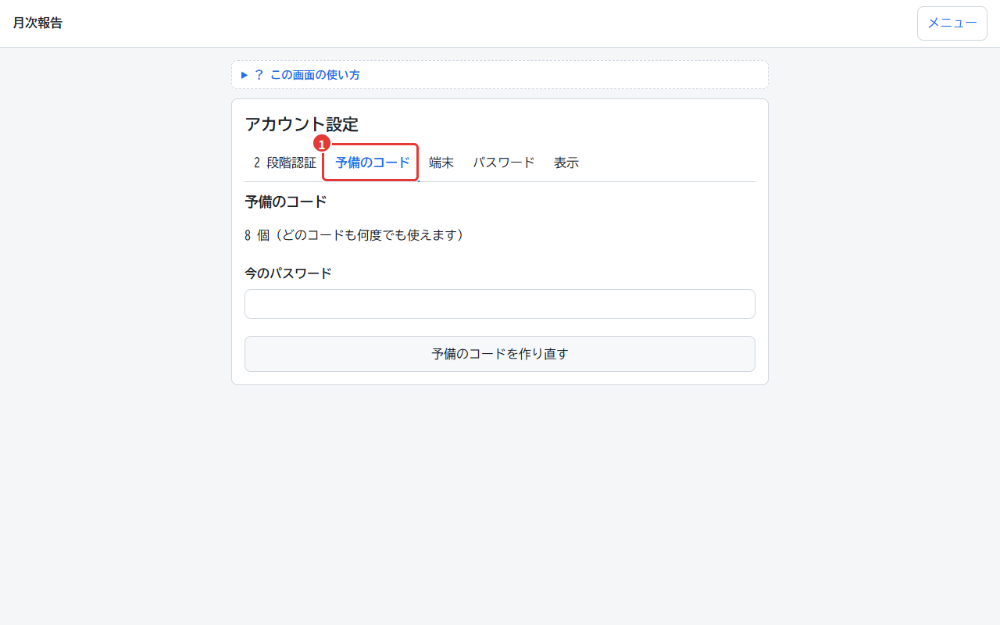

- **予備のコード**: 「今のパスワード」を入れて「予備のコードを作り直す」を押すと、新しいコードが一度だけ出ます（2.2 の 4.）。古いコードは使えなくなります。

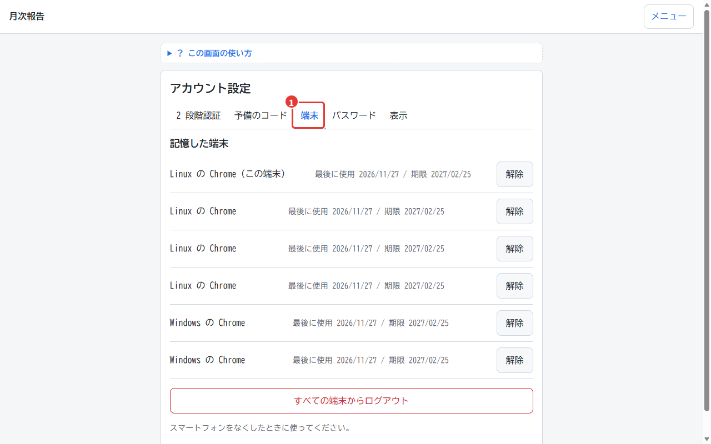

- **端末**: 「この端末を記憶する」にした端末が並びます。使わなくなった端末は「解除」を押します。

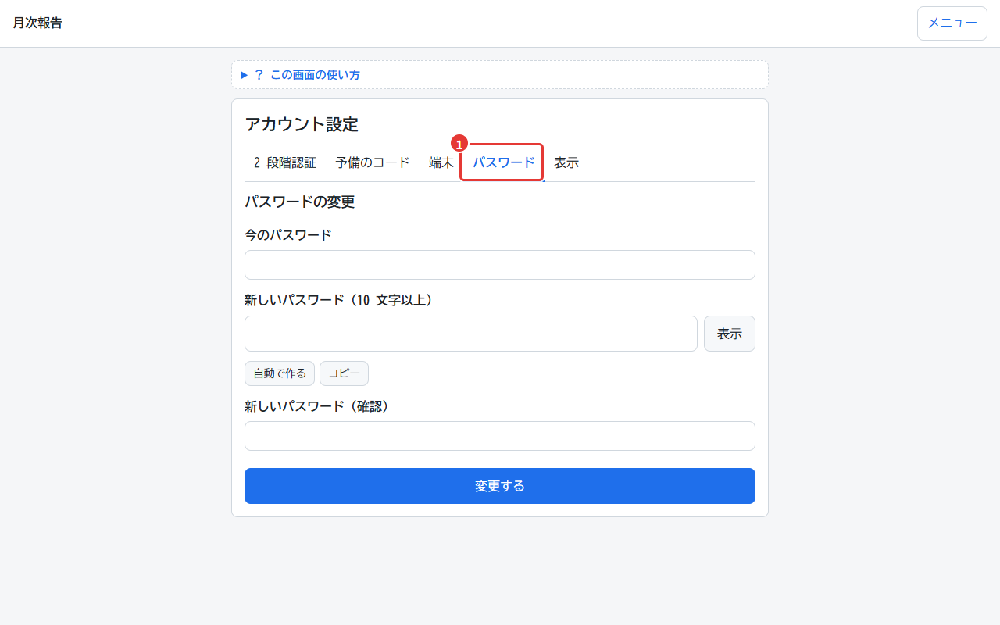

- **パスワード**: 「今のパスワード」「新しいパスワード（10 文字以上）」「新しいパスワード（確認）」を入れて「変更する」を押します。

スマートフォンをなくしたときは、別の端末から「すべての端末からログアウト」を行ってください。自分でできないときは管理者に頼んでください。

### 10.1 画面のテーマ

「アカウント設定」→「表示」で、画面の色（テーマ）を選び、「このテーマにする」（画面の下）を押します。変わるのは自分の画面だけです（ほかの人の画面は変わりません）。注意やエラーを表す色の意味は、どのテーマでも同じです。

| テーマ | 見た目 |
| --- | --- |
| 自動 | 端末の明るさの設定に合わせて、既定とダークが切り替わる（はじめはこれ） |
| 既定（明るい） | 灰・白・青 |
| ダーク | 黒・濃い灰・青 |
| さくら | 淡い桜色。桜の枝と、舞う花びら |
| 夜桜1 | 暗いテーマ。夜空に満月と星、桜の枝と花びら |
| 夜桜2 | 夜桜1 の桜を、白に近いソメイヨシノの色にしたもの |
| 若葉 | 淡い緑。若葉の枝、舞い落ちる若葉、木漏れ日 |
| 若葉2 | 若葉の左下に、せせらぎが流れる |
| 見分けやすい色（カラーユニバーサルデザイン） | 色が見分けにくい人にも見分けやすい配色。札に形の印が付く（下の 10.2） |
| 自分の色 | 土台（明るい／暗い）・強調の色・背景の色を自分で選ぶ。文字が読みにくくなる組み合わせのときは注意が出る（保存はできる） |

- 端末の設定で画面の動きを減らしている（Windows の「アニメーション効果」をオフ、iPhone の「視差効果を減らす」、Ubuntu の「設定」→「アクセシビリティ」の「アニメーションを減らす」など）と、花びらや若葉は舞わず、せせらぎも止まります（枝やせせらぎの絵は出ます）。
- 印刷するときは、どのテーマでも白い背景で印刷されます。
- このマニュアルの画像は、既定（明るい）のテーマで撮っています。

### 10.2 見分けやすい色（カラーユニバーサルデザイン）

赤と緑、緑と黄などが見分けにくい人（色覚の多様性）にも、状態を見分けやすくしたテーマです。だれが選んでもかまいません。「状態の札の色が似ていて分かりにくい」と感じたら、試してください。

- 色は、青（済み・ボタン・リンク）、黄（注意・待ち）、朱（エラー・限定）で分けています。赤と緑の対比は使いません。
- 文字と背景の明るさの差を大きくしています。
- 色だけでなく、札の頭の印と枠の線でも見分けられます。

| 印 | 意味 | 出るところ |
| --- | --- | --- |
| － | 未作成 | 提出状況・ホーム |
| ✎（点線の枠） | 下書き | 自分の報告・提出状況 |
| ● | 提出済み | 提出状況・報告の詳細 |
| ✓ | 確認完了・解決・完了 | 提出状況・コメント・要望・依頼 |
| … | 待ち（未チェック・回答待ち・未受付） | 提出状況・コメント・要望・依頼 |
| ◆ | 変わった・回答あり・対応中 | 報告の詳細・コメント・要望・依頼 |
| ! | 注意（客先名らしい言葉など） | 提出状況・報告の詳細 |
| ＊ | 必須 | 報告の作成 |
| ■ | 限定 | 報告の作成・詳細 |
| ◇（点線の枠） | 社外秘 | 報告の作成・詳細 |
| × | エラー・ログインの失敗 | 画面の上の知らせ・記録 |

- 提出状況の棒は、斜線の模様で出します（確認完了は細い逆向きの斜線）。
- キーボードで項目を選んでいるところは、太い黄色の枠で示します。

---

## 11. 困ったとき

| 困ったこと | 対処 |
| --- | --- |
| 「ログイン ID またはパスワードが違います」と出る | 入力を確かめる。日本語の入力になっていないか確かめる（0.4）。忘れたときは 2.4 |
| 「しばらくログインできません」と出る | 15 分ほど待つ（2.5）。急ぐときは管理者に解除を頼む |
| 状態の札の色が見分けにくい | アカウント設定の「表示」で「見分けやすい色」を選ぶ（10.2） |
| 「コードが違います」と出る | 認証アプリの最新の 6 桁を入れる。スマートフォンの時刻が合っているか確かめる（スマートフォンの設定で、日付と時刻を「自動」にする） |
| 機種変更で認証アプリが使えない | 予備のコードでログインし、アカウント設定で 2 段階認証を設定し直す |
| 認証アプリも予備のコードも使えない | 管理者に 2 段階認証の初期化を頼む |
| 「一定時間操作がなかったため、ログアウトしました」と出る | ログインし直す。報告は自動で下書き保存されている |
| 「所属の課が設定されていません」と出る | 管理者に所属の課の設定を頼む |
| 選びたい案件がない | 課長か管理者に案件の登録を頼む |
| 報告を直せない | 確認完了の報告は直せない。課長に完了を戻してもらう |
| 出力の画面に「PC から行ってください」と出る | PC のブラウザーで開く |
| 画面が開かない・「サーバーが見つかりません」と出る | アドレスを確かめる（0.2）。ほかのサイトも開けないときは、PC のネットワーク（画面の右上）を確かめる |
| ボタンを押しても何も起きない・画面が崩れている | `Ctrl` + `Shift` + `R` で読み込み直す。直らないときは、ブラウザーを閉じて開き直す |
| 文字が小さくて読みにくい | `Ctrl` + `+` で大きくする（0.3） |
| 出力したファイルが見つからない | 「ダウンロード」フォルダーを見る（0.5） |
| CSV を開くと文字化けする | 12.3 の手順で、文字エンコーディングに「Unicode (UTF-8)」を選んで開き直す |
| 使い方が分からない | 画面の上の「？ この画面の使い方」、メニューの「よくある質問」のチャットで聞く。見つからないときは、課長・確認者は「質問として送る」、部下は課長・確認者に聞く |

---

## 12. Linux の PC で使うときの注意

### 12.1 ブラウザー

Firefox・Google Chrome・Chromium の新しい版を使ってください。特別な設定やプラグインはいりません。開き方は 0.1 です。
「この端末を記憶する」は、ブラウザーの Cookie で覚えています。Cookie を消す設定やプライベートウィンドウでは、毎回コードを聞かれます。

### 12.2 PDF に保存する（印刷用画面）

1. 出力（6.4）で、形式に「印刷用画面」を選んで出力する。
2. 出てきた画面の「印刷する（PDF として保存）」を押す（または `Ctrl` + `P`）。印刷の画面が開きます。
3. 保存先を PDF にする。
    - **Firefox**: 右側の「プリンター」の欄を押して「PDF に保存」を選ぶ。
    - **Google Chrome・Chromium**: 右側の「送信先」の欄を押して「PDF として保存」を選ぶ。
    - 印刷の画面の形が違い、「ファイルに出力」（版によっては「ファイルへ出力」）という行があるときは、それを選び、出力形式を「PDF」にします。
4. 「保存」（「ファイルに出力」のときは「印刷」）を押す。
5. 保存する場所とファイルの名前を聞かれるので、場所（例: 「ダウンロード」）を選び、名前を確かめて「保存」を押す。

- 横に長い表は、印刷の画面の「向き」（Firefox は「方向」）を「横」にすると収まりやすくなります。
- 紙に印刷するときは、3. でプリンターを選んで「印刷」を押します。社外秘の資料なので、プリンターに置き忘れないでください。

### 12.3 CSV を開く・作る

出力した CSV は UTF-8（BOM 付き）、改行は CRLF、値はすべて `"` で囲んであります。

**LibreOffice Calc で開く**

1. 「ファイル」（0.5）で「ダウンロード」を開き、CSV のファイルを右クリックして「別のアプリケーションで開く」→「LibreOffice Calc」を選ぶ（ダブルクリックで Calc が開く PC では、ダブルクリックでかまいません）。
2. 「テキストのインポート」の窓が開くので、次のように選ぶ。
    - 「文字エンコーディング」: 「Unicode (UTF-8)」
    - 「区切りのオプション」: 「区切る」を選び、「コンマ」にだけチェックを付ける
    - 窓の下の見本に、日本語が正しく出て、列が分かれていることを確かめる
3. 「OK」を押す。

**端末で見る**: `less` や `cat` でそのまま読めます。行末の CR が気になるときは `tr -d '\r' < 入力.csv > 出力.csv` で取り除けます。

**CSV を作る（組織の一括の入れ替え 9.4 で取り込むとき）**: UTF-8 で保存してください（BOM はあってもなくてもかまいません）。
LibreOffice Calc で保存するときは、次のようにします。

1. 「ファイル」→「名前を付けて保存」を押す。
2. 下の「ファイルの種類」を「テキスト CSV (.csv)」にする。
3. 「フィルター設定を編集する」にチェックを付けて「保存」を押す（形式を確かめる窓が出たら、「テキスト CSV」の形式を使うほうのボタンを押す）。
4. 出てきた窓で、「文字エンコーディング」を「Unicode (UTF-8)」、「フィールドの区切り」を「,」にして「OK」を押す。

### 12.4 Excel 形式（.xlsx）

LibreOffice Calc でそのまま開けます。「ダウンロード」フォルダー（0.5）のファイルをダブルクリックするか、右クリックして「別のアプリケーションで開く」→「LibreOffice Calc」を選びます。
値はすべて文字列のセルで入っているので、数値として計算したいときは、Calc で列の書式を変えてください。
出力したファイルは社外秘です。使い終わったら、「ダウンロード」フォルダーから消してください（ファイルを右クリックして「ゴミ箱へ移動」。そのあと、ゴミ箱も空にします）。

---

## 13. 通勤定期代の精算（全員。月次報告とは別）

通勤定期代の「交通費・通勤定期代精算書」を、このシステムで作って、総務の様式のままの Excel のファイル（.xlsx）で受け取れます。受け取ったファイルは、これまでどおり提出してください。

- **受け付けるのは通勤定期だけです。** 通勤実費・業務交通費・その他の交通費は、別のシステムで申請してください（このシステムでは登録できません）。
- **精算書を見られるのは、作った自分だけです。** 課長・確認者・システム管理者も見られません。承認の流れもありません。
- **通勤定期の締め日は、その月の末日です。**
- 入力はスマートフォンでもできます。Excel のファイルを受け取るのは PC だけです（スマートフォンにファイルを残さないため）。

### 13.1 精算書を作る

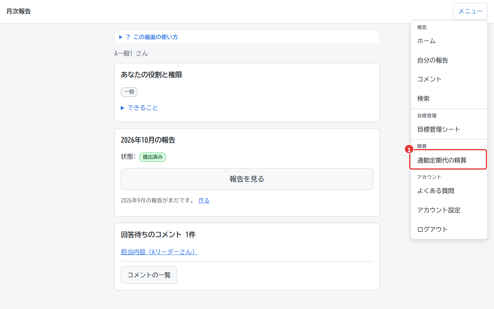

1. 右上の「メニュー」を押し、見出し「精算」の「通勤定期代の精算」（図の 1）を押す。

2. 「＋ 新しく作る」（図の 2）を押す。

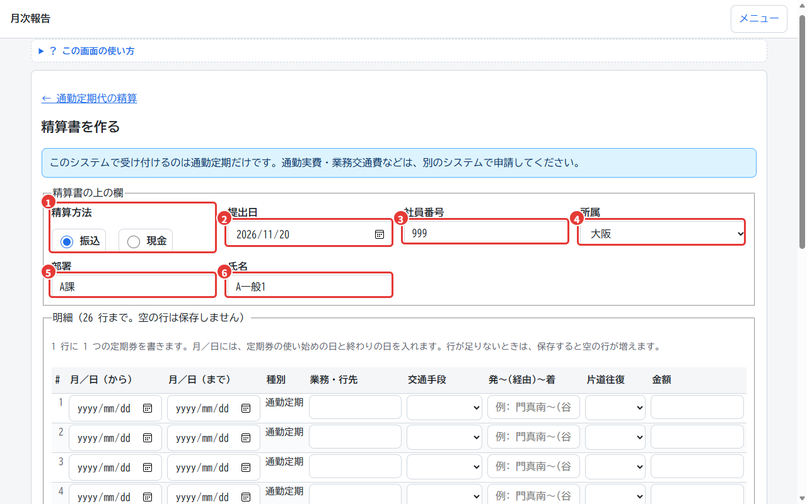

3. 精算書の上の欄を入れる。
    - 図の 1: 精算方法（振込・現金）
    - 図の 2: 提出日（はじめは今日が入っています）
    - 図の 3〜6: 社員番号・所属（大阪・東京）・部署・氏名。部署と氏名には、はじめは所属の課と表示名が入っています。2 回目からは、前に作った精算書と同じ値が入ります。

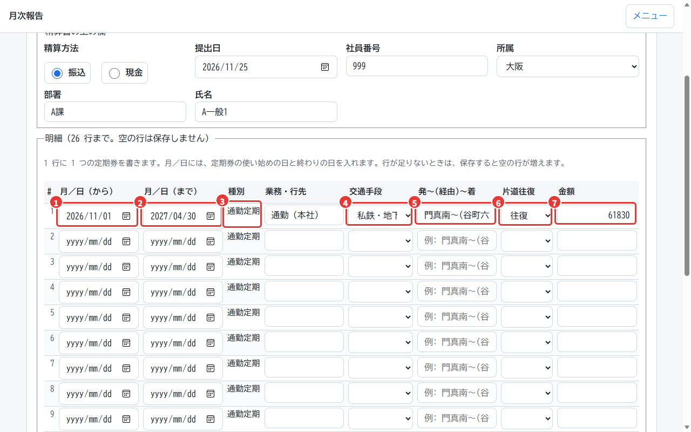

4. 明細に、1 行に 1 つの定期券を書く。
    - 図の 1・2: 月／日。定期券の使い始めの日と終わりの日を入れます（欄を押すと日付を選べます。半角で `2026/11/01` のように打ってもかまいません）。
    - 図の 3: 種別は「通勤定期」に決まっています（選べません）。
    - 図の 4: 交通手段（ＪＲ・私鉄・地下鉄・バス・タクシー・その他）を選ぶ。
    - 図の 5: 発～(経由)～着（例: 門真南～(谷町六丁目)～天王寺）。業務・行先は空でもかまいません。
    - 図の 6・7: 片道か往復と、金額（円。数字だけ）。
    - 明細は 26 行まで書けます（様式の 13 行 × 2 枚）。行が足りないときは、一度保存すると空の行が増えます。空の行は保存しません。

5. 小計（図の 1）と合計（図の 3）は、金額を入れると自動で計算されます。仮払いがあれば、図の 2 に入れます（合計から引きます）。
6. 「保存」（図の 4）を押す。入れ忘れや誤りがあると、画面の上に赤で出ます（入れた値は残っているので、直してもう一度「保存」を押します）。

### 13.2 総務の様式の Excel で受け取る（PC）

1. 保存すると「精算書を保存しました」と出ます。「精算書の Excel を受け取る（.xlsx）」（図の 1）を押す。
2. ファイル（`<社員番号>_交通費通勤定期代精算書_<提出日>.xlsx`。例: `999_交通費通勤定期代精算書_2026-11-20.xlsx`）が「ダウンロード」フォルダーに入ります（0.5）。
3. ファイルを開くと、総務の様式（交通費・通勤定期代精算書）に、入れた内容が入っています。明細が 13 行を超えると、No.2 の欄に続きが入ります。小計・合計は様式の式で計算されます。支払日・印・受付の欄は空のままです。
    - LibreOffice Calc でも Excel でも開けます（12.4）。印刷するときは、開いたソフトの印刷（`Ctrl` + `P`）で印刷するか、PDF に保存します。

### 13.3 精算書を直す・写す・消す

- 一覧の「開く」（図の 1）で、保存した精算書を直せます。「Excel」（図の 2）で、すぐに Excel のファイルを受け取れます。
- 定期券を更新するときは、前の精算書の「写して新しく作る」（図の 3）を押すと、同じ内容で新しい精算書を作れます（提出日は今日、仮払いは空になります）。日付と金額を直して保存してください。
- 消すときは、精算書を開いて、いちばん下の「この精算書を削除」を押します。消した精算書は元に戻せません。

---

## 14. 目標管理シート（全員。月次報告とは別）

会社の目標管理制度の「目標管理評価シート」を、このシステムで書いて評価し、会社の様式のままの Excel のファイル（.xlsx）で受け取れます。

- 評価期間は 10 月 1 日〜翌 9 月 30 日です。年度の始めに目標を書き、中間（3 月末）と最終（9 月末）に報告と本人評価を書きます。
- **シートを見られるのは、本人と、その課の課長・課長代理だけです**（課長代理は一般・主任の人のシートだけ）。同じ課のほかの人・リーダー・システム管理者は見られません。
- 本人は目標・報告・本人評価を、課長は配点と上長評価を入れます。課長代理は、読んでコメントします。
- コメントと面談の記録は、あとから直したり消したりできません（監査のため）。直したいことは、新しく書いて残してください。
- 提出は、これまでどおり課長がまとめて管理部へ出します（課長が Excel のファイルを受け取ります）。

### 14.1 シートを作る（本人）

1. メニューの見出し「目標管理」の「目標管理シート」を開き、「＋ （年度） 年度のシートを作る」（図の 1）を押す。次の年度の目標を早めに書くときは、次の年度のボタンを押します。

2. 様式（図の 1）は役職で決まります。一般の人は「一般」、主任・課長代理は「リーダー・課長代理」の様式で、選び直せません。課長・部長だけは、この場所に様式を選ぶ欄が出るので、営業・間接部門の人は選び直して「様式を切り替える」を押します（コンピテンシーの項目が変わります）。様式は、保存したあとは変えられません。
3. 所属・氏名・職位（図の 2）を確かめる。課長以上・営業の様式では、業績目標の計画と実績（千円）も入れます。

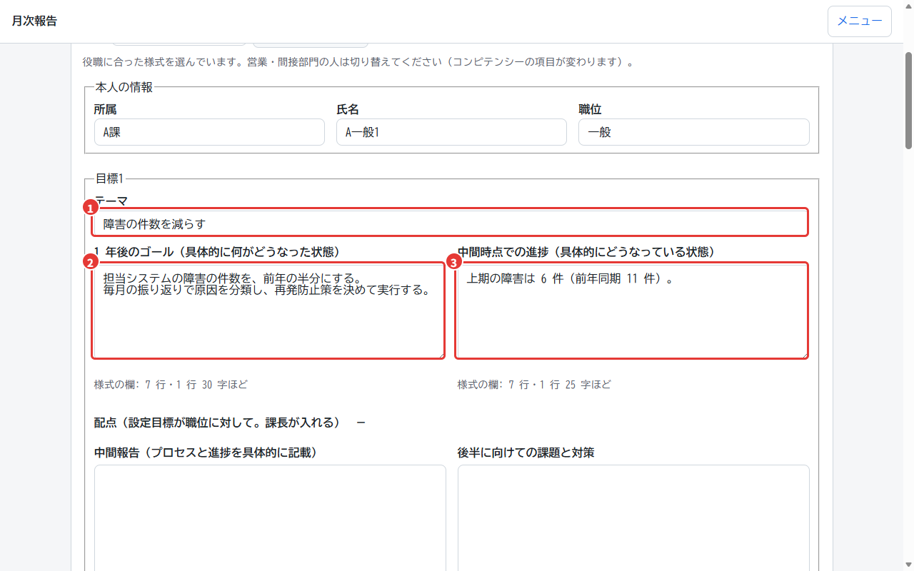

4. 目標 1・2 のテーマ（図の 1）、1 年後のゴール（図の 2）を書く。中間時点での進捗（図の 3）は、中間のときに書きます。
    - 欄の下の「様式の欄: 7 行・1 行 30 字ほど」は、会社の様式の枠に収まる長さのめやすです。長すぎると、保存のときに知らせます（行を減らすか、短くしてください）。

### 14.2 中間・最終の報告と本人評価（本人）

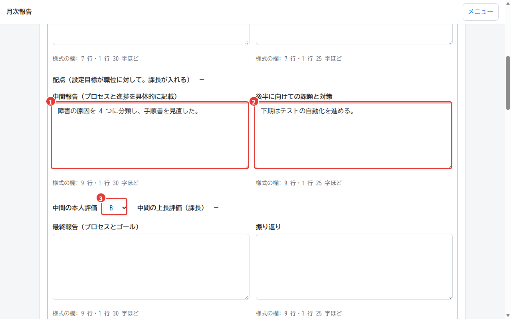

1. 中間のとき: 中間報告（図の 1）と、後半に向けての課題と対策（図の 2）を書き、中間の本人評価（図の 3。A・B・C1・C2・C3・D・E）を選ぶ。
2. 最終のとき: 同じように、最終報告・振り返り・最終の本人評価を書く。

3. コンピテンシー評価（行動特性評価）の本人評価（図の 1。5：満足できる結果 〜 0：評価に値せず）を、項目ごとに選ぶ。
4. 「保存」（図の 2）を押す。何度でも書き直して保存できます。
    - 点の付け方に迷ったら、コンピテンシー評価の欄の上の「コンピテンシー評価基準を見る（別のタブで開く）」を押すと、会社の評価基準（システム・ヘルプデスク・管理職登用基準・職能レベル定義）が別のタブで開きます。上のタブで切り替えて見ます。表が画面に入りきらないときは、表の上のつまみ（横スライド）を左右に動かすか、◀ ▶ を押すと、表が横に動きます。

5. 保存すると、「会社の様式の Excel を受け取る（.xlsx）」（図の 1）で、様式に書いた内容を入れたファイルを受け取れます（PC だけ）。評点（配点 × 評価の係数、コンピテンシーの 100 点換算）は様式の式で計算されます。

### 14.3 評価する（課長）

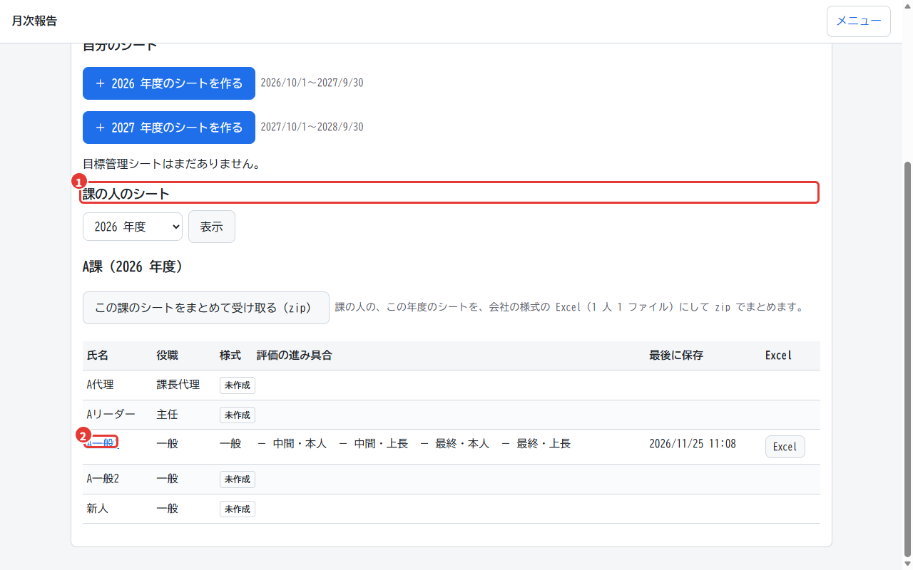

1. 「目標管理シート」の下の「課の人のシート」（図の 1）に、課の人が並びます。年度を選んで「表示」を押すと、その年度のシートと、評価の進み具合（✓ が入ったもの）が出ます。名前（図の 2）を押すと、シートが開きます。まだ作っていない人には「未作成」と出ます。

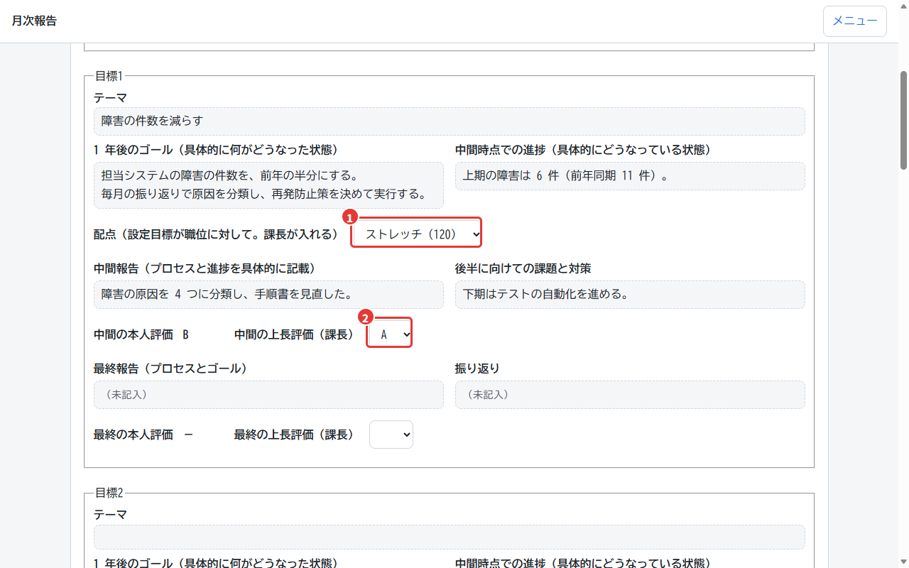

2. 目標ごとに、配点（図の 1。設定目標が職位に対して ストレッチ 120／適正 100／物足りない 60）と、中間・最終の上長評価（図の 2）を選ぶ。本人が書いた欄は直せません（直してほしいことは、コメントか面談で伝えます）。

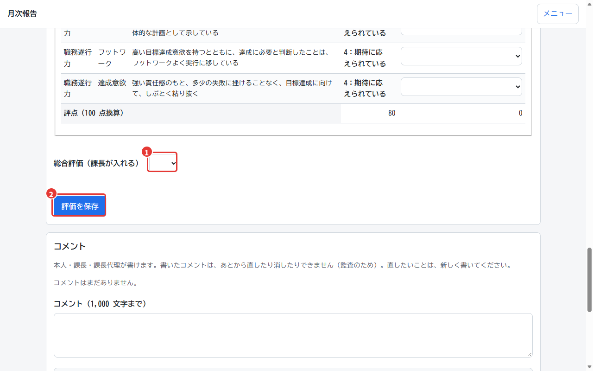

3. コンピテンシーの上長評価と、総合評価（図の 1）を選び、「評価を保存」（図の 2）を押す。
4. 管理部へ出すときは、「課の人のシート」の一覧から受け取ります（PC だけ）。
    - 1 人ずつ: その人の行の「Excel」を押す（シートを開いて、上の「会社の様式の Excel を受け取る（.xlsx）」を押しても同じです）。
    - まとめて: 一覧の上の「この課のシートをまとめて受け取る（zip）」を押すと、その年度の課の人のシートが、1 人 1 ファイルの Excel になって zip にまとまります（`目標管理評価シート_<年度>年度_<課の名前>.zip`）。zip のファイルは、右クリックして「ここで展開」（Windows は「すべて展開」）で開きます。
    - 課長代理の一覧には、この 2 つは出ません。

### 14.4 コメント・面談の記録（本人・課長・課長代理）

- シートの下の「コメント」の欄（図の 1）に書いて「コメントする」（図の 2）を押すと、本人・課長・課長代理が読めます。

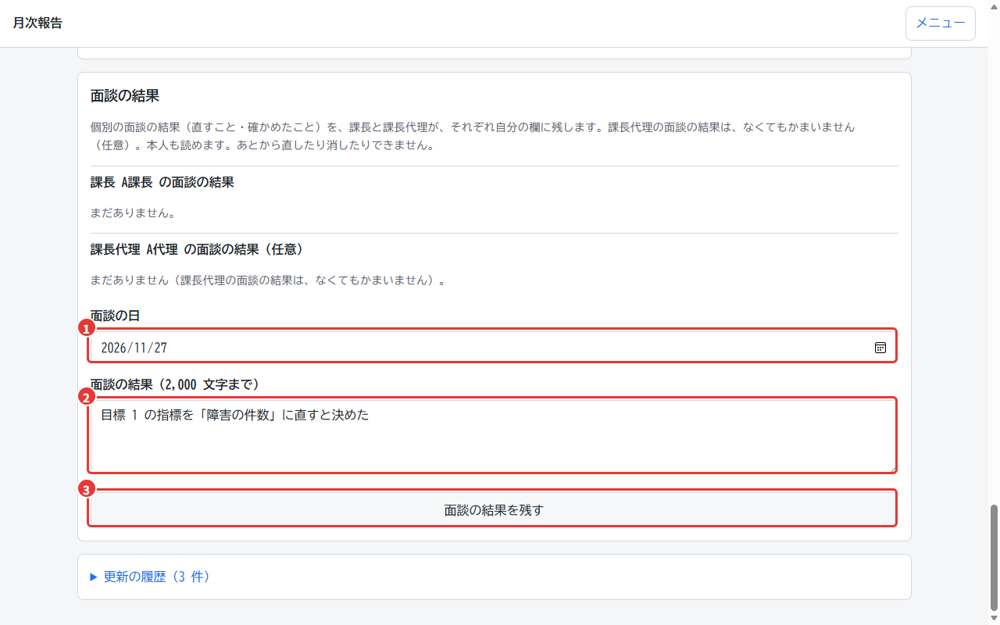

- 「面談の結果」は、課長と課長代理の一人ずつに欄が分かれています（その人のシートを見る課長代理が 2 人いれば、課長と合わせて 3 つの欄）。個別の面談をしたら、自分の欄（「課長 （名前） の面談の結果」など）で、面談の日（図の 1）と、面談の結果（図の 2）を書いて「面談の結果を残す」（図の 3）を押します。ほかの人の欄には書けません。本人も読めます。課長代理の面談の結果は、なくてもかまいません（任意）。

- コメントに答えるときは、コメントの下の「返信」（図の 1）を押し、文（図の 2）を書いて「返信する」（図の 3）を押します。
- シートのいちばん下の「更新の履歴」を開くと、だれが・いつ保存・コメント・面談の記録をしたかが見られます。
