# 月次報告システム 操作マニュアル

最終更新: 2026-11-27

月次報告システムの使い方です。毎月の報告・コメントへの返信・臨時の調査・通勤定期代の精算・目標管理シートの操作を説明します。
各画面の上の「？ この画面の使い方」を押すと、その画面の短い説明も開きます。

- 画像の赤い枠が押す場所・入れる場所で、枠の番号は手順の番号と同じです。
- 画像の名前・案件・日付は見本です。

課長・課長代理・主任の操作（報告の確認・提出状況・出力・臨時の調査の作成・課の管理など）は、別冊「課長・課長代理・主任向けマニュアル」にあります（節の番号は共通です）。

## 目次

0. はじめる前に（PC の基本の操作）
1. はじめに
2. ログイン
3. ホーム画面とメニュー
4. 月次報告を作る・出す
6.3 報告を探す
7. コメントの一覧・よくある質問
10. アカウント設定
11. 困ったとき
12. Linux の PC で使うときの注意
13. 通勤定期代の精算
14. 目標管理シート

---

## 0. はじめる前に（PC の基本の操作）

PC（Ubuntu などの Linux）で使う人向けです。スマートフォンだけで使う人は飛ばしてかまいません。

### 0.1 ブラウザーを開く

1. キーボードの **Super キー**（左下の `Ctrl` と `Alt` の間）を押す。
2. `firefox` と打ち（Chrome は `chrome`）、出てきたアイコンを押す。

### 0.2 システムを開き、ブックマークする

1. ブラウザーで `Ctrl` + `L` を押し、知らされたアドレス（`https://` で始まるもの）を入れて `Enter` キーを押す。
2. ログインの画面が出たら、`Ctrl` + `D` を押して「保存」を押す。次からは、アドレスの欄に「月次報告」と打つと候補に出ます。

### 0.3 よく使うキー

| したいこと | キー |
| --- | --- |
| 文字を大きく・小さく・元に戻す | `Ctrl` + `+`・`Ctrl` + `-`・`Ctrl` + `0` |
| 画面を読み込み直す | `F5` |
| コピー・貼り付け | `Ctrl` + `C`・`Ctrl` + `V` |
| 画面の中の言葉を探す | `Ctrl` + `F` |

### 0.4 半角の入力にする

ログイン ID・パスワード・6 桁のコードは **半角の英数字** で入れます。`半角/全角` キーで切り替えます（画面の右上が「あ」なら日本語の入力です）。

### 0.5 ダウンロードしたファイル

受け取った Excel のファイル（精算書・目標管理シート）は、ホームの「ダウンロード」フォルダーに入ります。Super キーを押して `ファイル` と打ち、「ダウンロード」を開きます。

### 0.6 席を離れるとき

**`Super` + `L`** で画面をロックしてください。使い終わったら、このシステムも「メニュー」→「ログアウト」でログアウトします。

---

## 1. はじめに

### 1.1 毎月すること

1. 月に 1 回、報告を作って出す（4 章）。前月の内容が入った状態で始まるので、変わったところだけ直します。
2. 課長・課長代理・主任からコメントが来たら、返信する（4.9）。
3. 臨時の調査が来たら、答える（4.10）。

報告の状態は「下書き → 提出済み → 確認完了」です。提出したあとも、確認完了になるまでは自分で直せます。

通勤定期代の精算（13 章）と目標管理シート（14 章）も、このシステムで行えます（月次報告とは別の機能です）。

### 1.2 守ること

- 客先名・個人名・固有名詞は書かないでください。客先名らしい言葉を入れると、黄色の注意が出ます。
- 報告の内容は社外秘です。

---

## 2. ログイン

### 2.1 ふだんのログイン

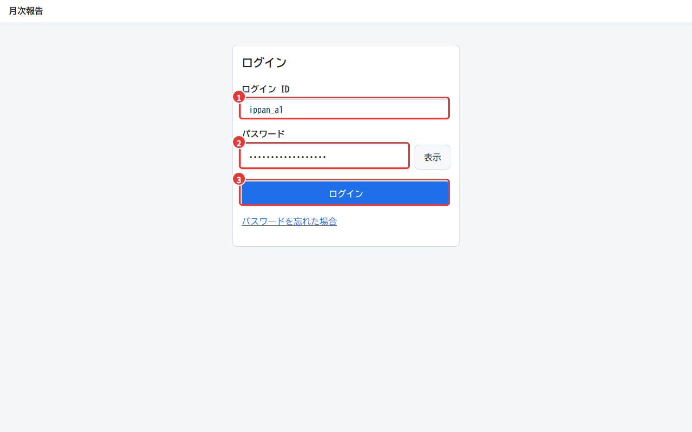

1. ログイン ID（図の 1）とパスワード（図の 2）を入れて、「ログイン」（図の 3）を押す。

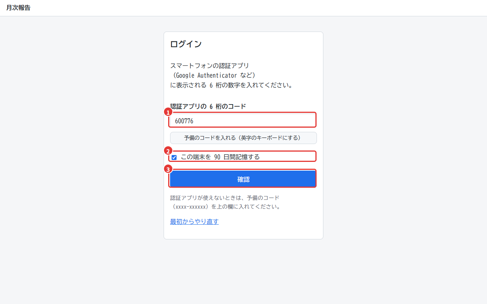

2. スマートフォンの認証アプリに出ている **6 桁の数字** を入れる（図の 1）。
3. 「確認」（図の 3）を押す。「この端末を 90 日間記憶する」（図の 2）にチェックがあると、その端末では 90 日間コードを聞かれません（共用の PC では外してください）。

- 数字は 30 秒ごとに変わります。「コードが違います」と出たら、新しい数字を入れ直してください。
- 認証アプリが使えないときは、予備のコード（`xxxx-xxxxxx` の形）を同じ欄に入れます。予備のコードは何度でも使えます。人に教えないでください。

### 2.2 はじめてのログイン（2 段階認証の設定）

はじめてログインすると、2 段階認証の設定の画面が出ます。**はじめてのログインは、スマートフォンで行ってください。** 先に、スマートフォンに認証アプリ（Google Authenticator・Microsoft Authenticator など。無料）を入れておきます。

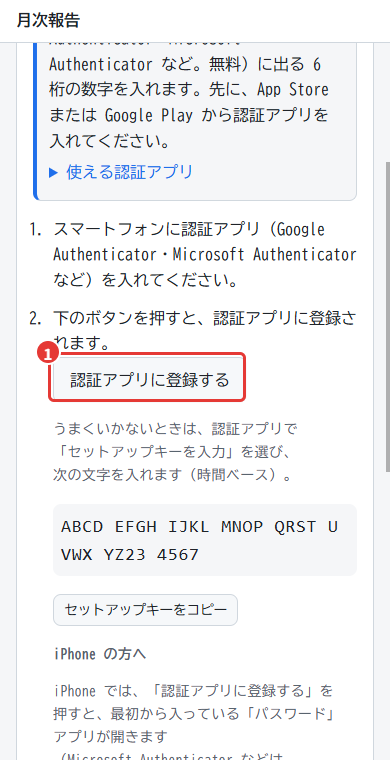

1. 「認証アプリに登録する」（図の 1）を押し、認証アプリで「追加」「保存」などを押す。
    - **iPhone** では、このボタンで iPhone の「パスワード」アプリが開きます。そのまま使ってもかまいません。Microsoft Authenticator を使うときは、下の「iPhone で Microsoft Authenticator を使うとき」の手順で登録します。

2. ブラウザーに戻り、認証アプリに出た 6 桁の数字を入れて（図の 2）、「設定する」（図の 3）を押す。

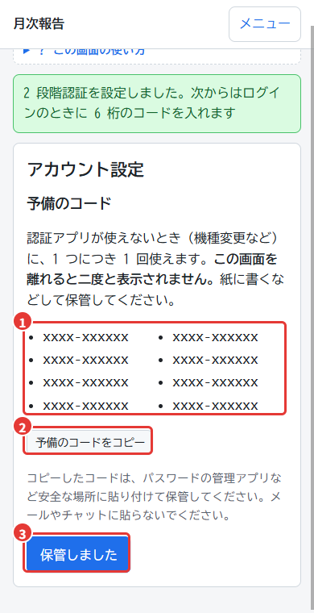

3. 予備のコード（図の 1）が一度だけ出ます。紙に書くなどして、スマートフォンとは別の場所に保管し、「保管しました」（図の 3）を押す。メールやチャットには貼らないでください。

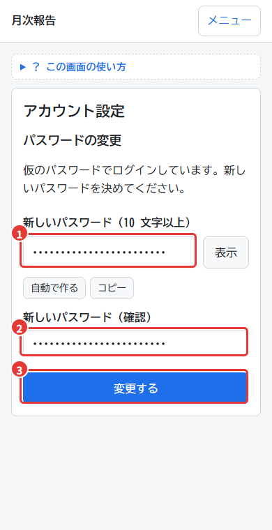

4. 仮のパスワードを、自分で決めたパスワード（10 文字以上）に変える。「自動で作る」で作ることもできます。

**PC でログインしたとき**: 画面に「いまは PC で開いています」と、スマートフォンで開くアドレスが出ます。スマートフォンでそのアドレスを開いて設定してください。

スマートフォンで開けないときは、認証アプリで「セットアップキーを入力」を選び、画面の 32 文字を入れて登録します。

#### iPhone で Microsoft Authenticator を使うとき

1. 設定の画面で「セットアップキーをコピー」を押す（「認証アプリに登録する」は押しません。押して「パスワード」アプリが開いたら、何も保存せずに閉じます）。
2. Microsoft Authenticator を開き、右上の「＋」→「その他（Google、Facebook など）」→「またはコードを手動で入力」と進む。
3. アカウント名に「月次報告」、秘密キーにコピーした文字を貼り付けて、「完了」を押す。
4. Safari に戻り、出た 6 桁の数字を入れて「設定する」を押す（このあとは上の 3. から同じ）。

数字が合わないときは、iPhone の「設定」→「一般」→「日付と時刻」の「自動設定」をオンにしてください。

### 2.3 自動でログアウトされるとき

最後の操作から 30 分、またはログインから 12 時間たつと、ログアウトされます。長い入力は「下書き保存」をこまめに押してください（報告は自動でも保存します）。
ログアウトされたあとに「保存」などを押すと、「ログインが切れたため、送信していません」と出ます。入力は画面に残っているので、ログインし直してから、もう一度押してください。

### 2.4 パスワードを忘れたとき

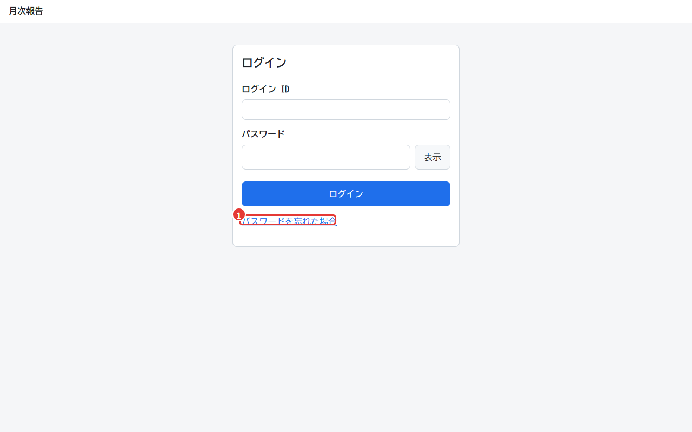

1. ログイン画面の「パスワードを忘れた場合」を押す。

2. ログイン ID（図の 1）、認証アプリの 6 桁の数字か予備のコード（図の 2）、新しいパスワード（図の 3・4）を入れて、「再設定する」（図の 5）を押す。

認証アプリも予備のコードも使えないときは、システム管理者に連絡してください。

### 2.5 ロックされたとき

ログインに 10 回続けて失敗すると、15 分ほどログインできなくなります。時間をおいてからやり直してください。

---

## 3. ホーム画面とメニュー

### 3.1 ホーム

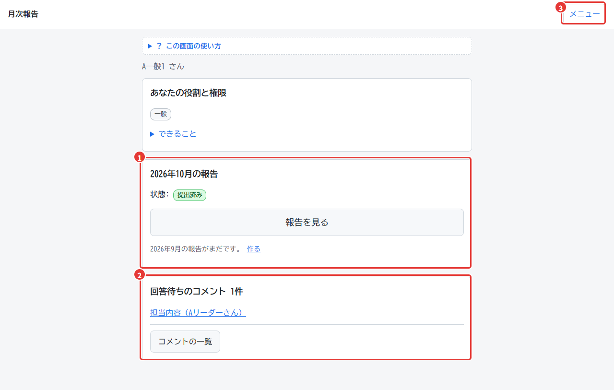

ホームには、今やることが上から並びます。

| 欄 | 内容 |
| --- | --- |
| （年月）の報告（図の 1） | 今月の報告の状態と締め日。「今月の報告を作る」「続きを書く」 |
| 回答待ちのコメント（図の 2） | 返信していないコメント |
| 臨時の調査 | まだ答えていない調査と期限 |
| 更新のお知らせ | システムの変更のお知らせ |

- 締め日が近いのにまだ出していないときは、どの画面でも上に黄色の知らせが出ます。押すと報告を開きます。
- 「今月」は、締め日までは前月、締め日を過ぎると当月です。

### 3.2 メニュー

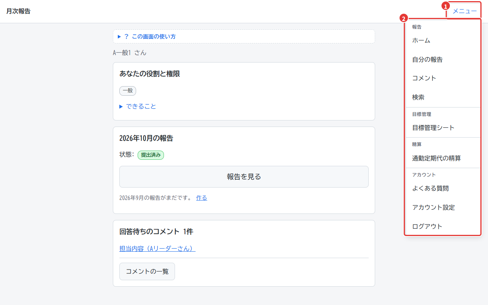

画面右上の「メニュー」（図の 1）を押すと、画面の一覧（図の 2）が開きます。ログアウトは、メニューのいちばん下です。

### 3.3 この画面の使い方

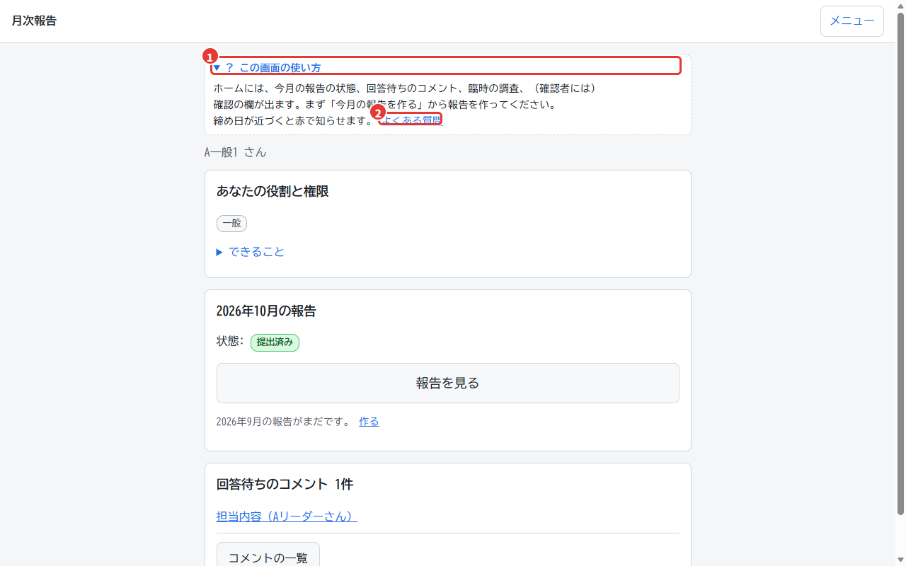

画面の上の「？ この画面の使い方」（図の 1）を押すと、その画面の説明が開きます。「よくある質問」（図の 2）から、質問と答えを見られます（7.3）。

---

## 4. 月次報告を作る・出す

### 4.1 報告を作る

1. ホームの「今月の報告を作る」（図の 1。下書きがあれば「続きを書く」）を押す。
2. 前月の内容が入った状態で開くので、変わったところだけ直す。
3. 「提出する」を押す（4.6）。

### 4.2 楽に出す方法

- **前月から変更なしで提出**（図の 1）: 何も変わっていなければ、このボタンだけで提出できます。
- **過去の報告を写す**（図の 2・3）: 月を選んで「写す」を押すと、その月の内容が入ります。

### 4.3 入力のしかた

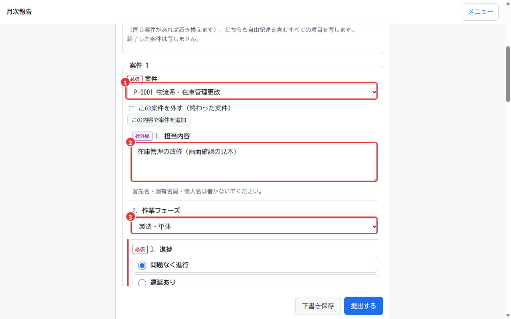

- 案件（図の 1）を選んでから、担当内容（図の 2）・作業フェーズ（図の 3）などを入れます。
- 「必須」の札の項目は、入れないと提出できません。
- 入力すると、60 秒ごとに自動で下書き保存します。

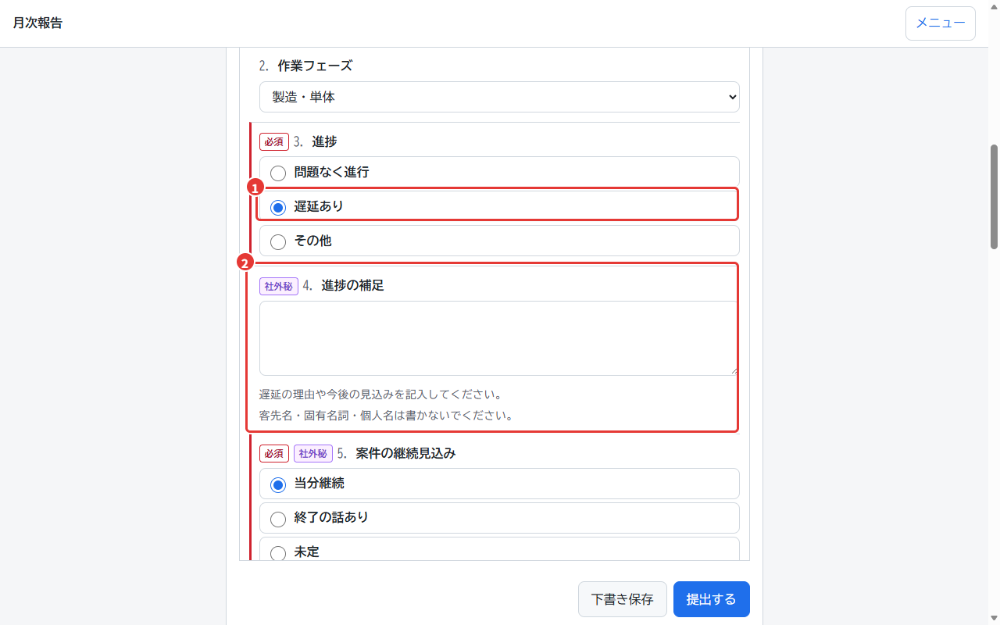

答えによって出る項目もあります（例: 進捗が「遅延あり」（図の 1）のとき「進捗の補足」（図の 2）が出る）。

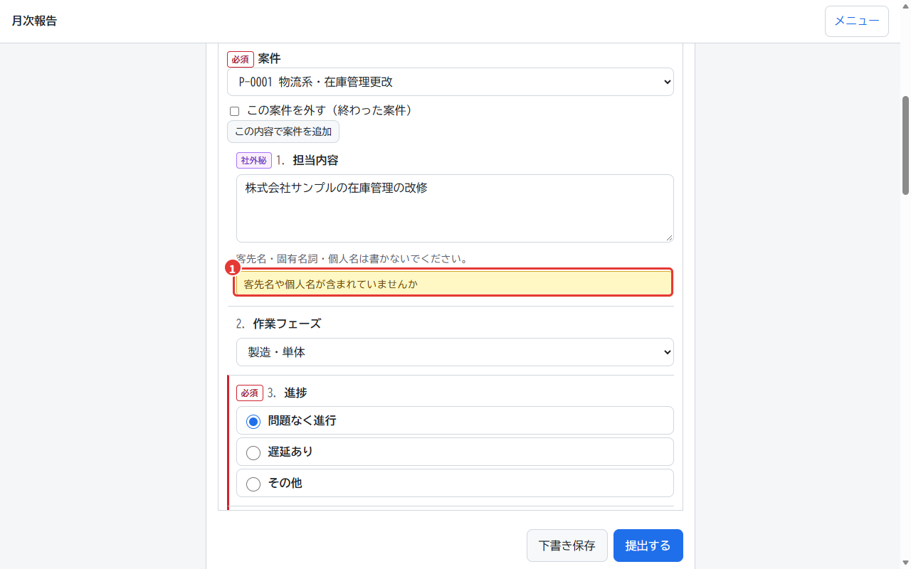

客先名らしい言葉を入れると、黄色の注意（図の 1）が出ます。社内の案件コードや呼び名に書き換えてください。

### 4.4 案件を足す・外す

- 終わった案件は「この案件を外す」（図の 1）にチェックを付けます。
- 「この内容で案件を追加」（図の 2）で、同じ内容を新しい案件の欄に写せます。

- 新しい案件は、いちばん下の「案件を追加するとき」の欄で案件（図の 1）を選んで入れます。
- 案件がないとき（社内待機・研修など）は、「案件なし」を選びます。
- 選びたい案件がないときは、課長に頼んでください。

### 4.5 スマートフォンで答える

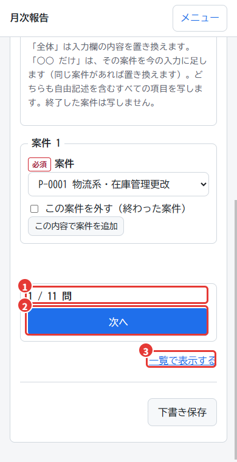

スマートフォンでは 1 問ずつ答えられます。答えたら「次へ」（図の 2）を押します。全部を一度に見たいときは「一覧で表示する」（図の 3）を押します。

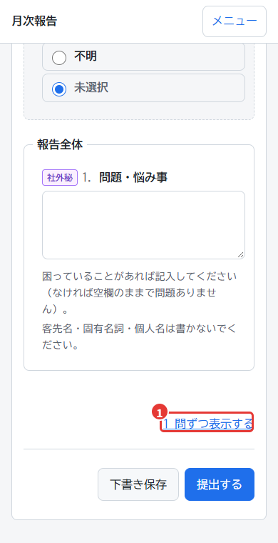

### 4.6 保存する・提出する

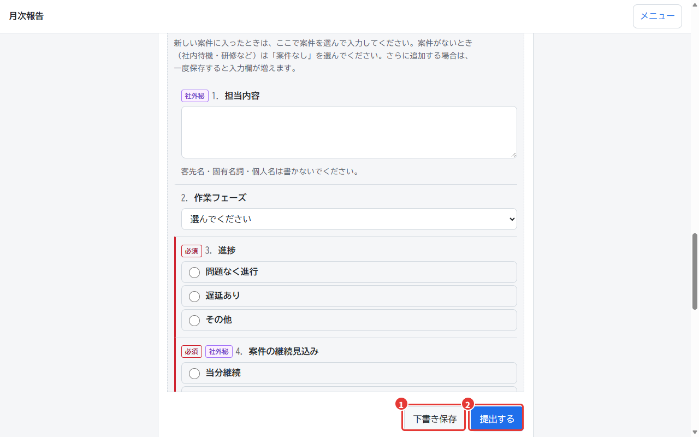

- 途中でやめるときは「下書き保存」（図の 1）を押します。
- 入れ終わったら「提出する」（図の 2）を押します。

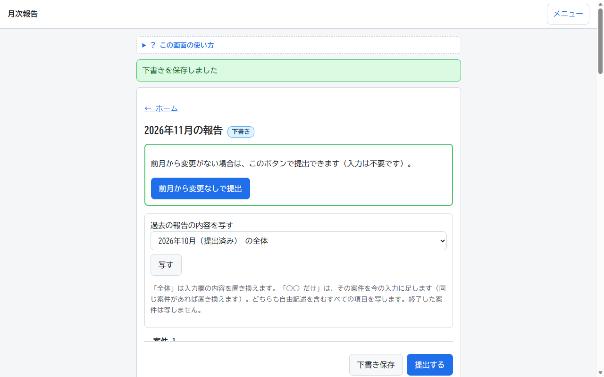

「提出しました」と出れば完了です。入れ忘れがあると、その欄の下に赤で出るので、足してもう一度「提出する」を押します。

### 4.7 提出したあと

- 確認完了になるまでは、報告の「編集する」から直せます。直すと、課長・課長代理・主任に知らせが出ます。
- 確認完了の報告は直せません。

### 4.8 自分の報告を見る

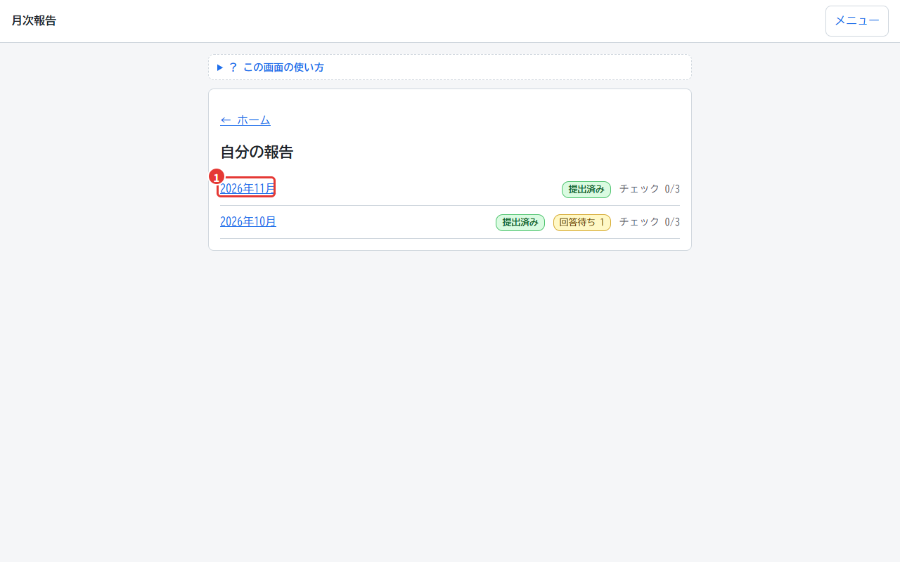

メニューの「自分の報告」に、月ごとの報告（図の 1）と状態が並びます。押すと開きます。

### 4.9 コメントに返信する

1. ホームの「回答待ちのコメント」から報告を開き、コメントの下の「返信」（図の 1）を押す。
2. 返信（図の 2）を書いて、「返信する」（図の 3）を押す。報告を直して答えてもかまいません。

「連絡」のコメントには、返信はいりません。

### 4.10 臨時の調査に答える

ホームの「臨時の調査」から開き、質問に答えて「回答する」（図の 1）を押します。期限までは答えを直せます。

---

## 6.3 報告を探す

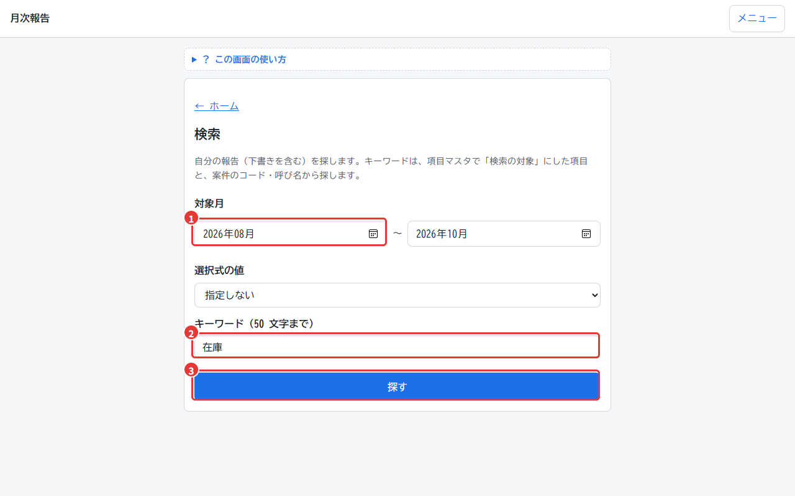

メニューの「検索」で、自分の報告をキーワードで探せます。対象月（図の 1）とキーワード（図の 2）を入れて「探す」（図の 3）を押します。

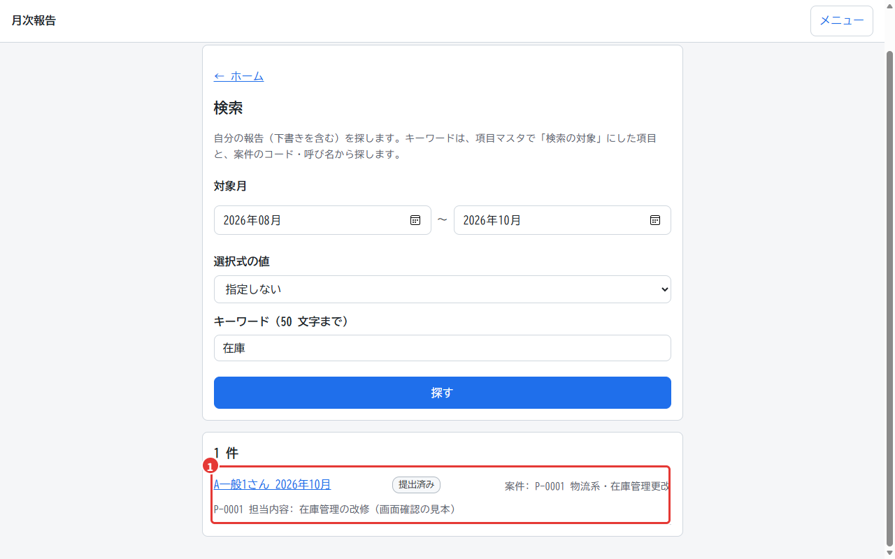

見つかった報告（図の 1）を押すと、その報告を開きます。

---

## 7. コメントの一覧・よくある質問

### 7.1 コメントの一覧

メニューの「コメント」に、自分の報告へのコメントが並びます。状態（図の 1）で「回答待ち」を選ぶと、返信がまだのものだけが出ます。行を押すと報告を開きます。

### 7.3 よくある質問

メニューの「よくある質問」で、使い方を調べられます。

- 欄（図の 1）に知りたいこと（例: パスワードを忘れた）を入れて「送る」を押すと、答えが出ます。分野のボタン（図の 2）から選ぶこともできます。

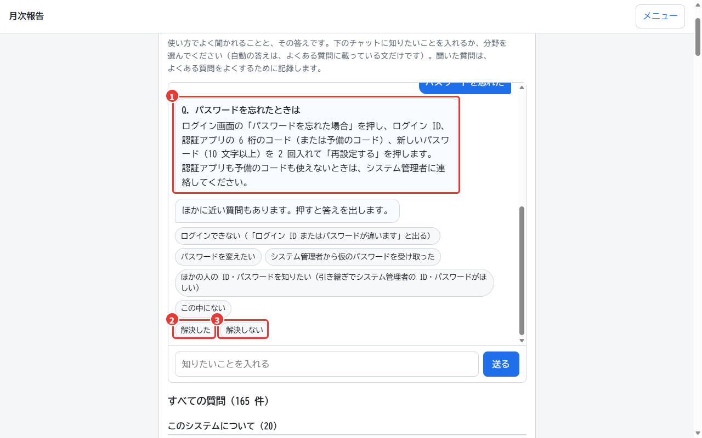

- 答え（図の 1）を読んだら、「解決した」（図の 2）か「解決しない」（図の 3）を押します。
- 見つからないときは、課長・課長代理・主任に聞いてください。
- 聞いた質問は、よくある質問をよくするために記録します（1 年で消えます）。
- 急病やけがなど、急いだほうがよいときは、すぐに 119 番に電話してください。

---

## 10. アカウント設定

メニューの「アカウント設定」で、自分の設定を変えます。画面の上のタブで切り替えます。

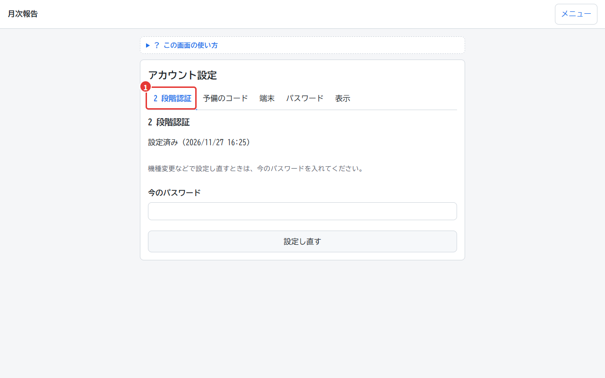

- **2 段階認証**: 機種変更のときは、今のパスワードを入れて「設定し直す」を押し、新しいスマートフォンで登録します（2.2）。

- **予備のコード**: 作り直すと、新しいコードが一度だけ出ます。前のコードは使えなくなります。

- **端末**: ログインを覚えた端末が並びます。使わなくなった端末は「解除」を押します。スマートフォンをなくしたときは、別の端末から「すべての端末からログアウト」を押してください。

- **パスワード**: 今のパスワードと、新しいパスワード（10 文字以上）を入れて「変更する」を押します。

**知らせに心当たりがないとき**: ホームに「予備のコードを確認した」などの知らせが出て、心当たりがないときは、「心当たりがない（知らせて凍結する）」を押してください。試しに押さないでください。

### 10.1 画面のテーマ

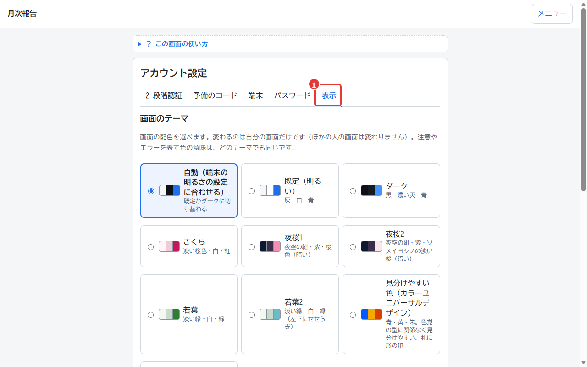

「表示」のタブで、画面の色（テーマ）を選び、「このテーマにする」を押します。変わるのは自分の画面だけです。

| テーマ | 見た目 |
| --- | --- |
| 自動 | 端末の明るさの設定に合わせる（はじめはこれ） |
| 既定・ダーク | 明るい・暗い |
| さくら・夜桜1・夜桜2・若葉・若葉2 | 季節の絵が入る |
| 見分けやすい色 | 色が見分けにくい人にも見分けやすい配色（10.2） |
| 自分の色 | 色を自分で選ぶ |

### 10.2 見分けやすい色

状態の札の色が見分けにくいときに使うテーマです。色に加えて、札の頭の印（✓ 済み、… 待ち、◆ 変わった、! 注意 など）でも見分けられます。

---

## 11. 困ったとき

| 困ったこと | 対処 |
| --- | --- |
| 「ログイン ID またはパスワードが違います」と出る | 半角の入力か確かめる（0.4）。忘れたときは 2.4 |
| 「しばらくログインできません」と出る | 15 分ほど待つ |
| 「コードが違います」と出る | 新しい 6 桁を入れる。スマートフォンの時刻を「自動」にする |
| 機種変更で認証アプリが使えない | 予備のコードでログインし、アカウント設定で設定し直す |
| 認証アプリも予備のコードも使えない | システム管理者に連絡する |
| 「所属の課が設定されていません」と出る | システム管理者に連絡する |
| 選びたい案件がない | 課長に頼む |
| 報告を直せない | 確認完了の報告は直せない。課長に相談する |
| 画面が崩れている・ボタンが効かない | `Ctrl` + `Shift` + `R` で読み込み直す |
| 状態の札の色が見分けにくい | 「見分けやすい色」のテーマにする（10.2） |
| 使い方が分からない | 「？ この画面の使い方」か「よくある質問」を見る。課長・課長代理・主任に聞く |

---

## 12. Linux の PC で使うときの注意

### 12.1 ブラウザー

Firefox・Google Chrome・Chromium の新しい版を使ってください。プライベートウィンドウでは、毎回 6 桁のコードを聞かれます。

### 12.4 Excel 形式（.xlsx）のファイル

精算書・目標管理シートの Excel のファイルは、「ダウンロード」フォルダー（0.5）のファイルをダブルクリックすると、LibreOffice Calc で開けます。使い終わったら、ファイルを消してください（社外秘のため）。

---

## 13. 通勤定期代の精算

通勤定期代の精算書を作って、総務の様式の Excel のファイルで受け取れます。受け取ったファイルは、これまでどおり提出してください。

- 受け付けるのは **通勤定期だけ** です（ほかの交通費は別のシステムです）。
- 精算書を見られるのは自分だけです。
- 通勤定期の締め日は、その月の末日です。
- Excel のファイルを受け取るのは PC だけです。

### 13.1 精算書を作る

1. メニューの「通勤定期代の精算」（図の 1）を押す。

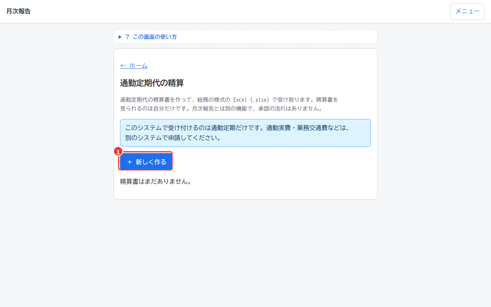

2. 「＋ 新しく作る」（図の 1）を押す。

3. 精算方法・提出日・社員番号・所属・部署・氏名（図の 1〜6）を入れる。2 回目からは、前と同じ値が入ります。

4. 明細に、1 行に 1 つの定期券を書く（使い始めと終わりの日（図の 1・2）、交通手段（図の 3）、発～着（図の 4）、片道・往復（図の 5）、金額（図の 6））。

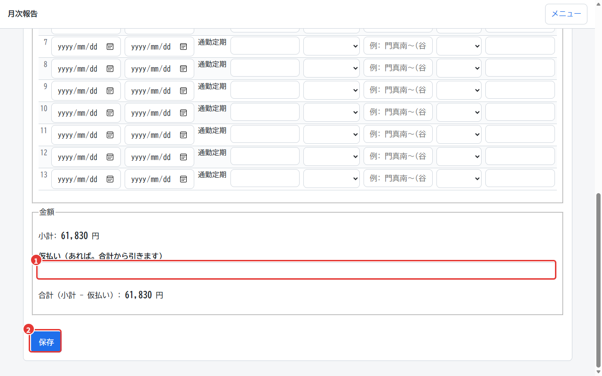

5. 小計・合計は自動で計算されます。仮払いがあれば図の 1 に入れて、「保存」（図の 2）を押す。

### 13.2 Excel で受け取る（PC）

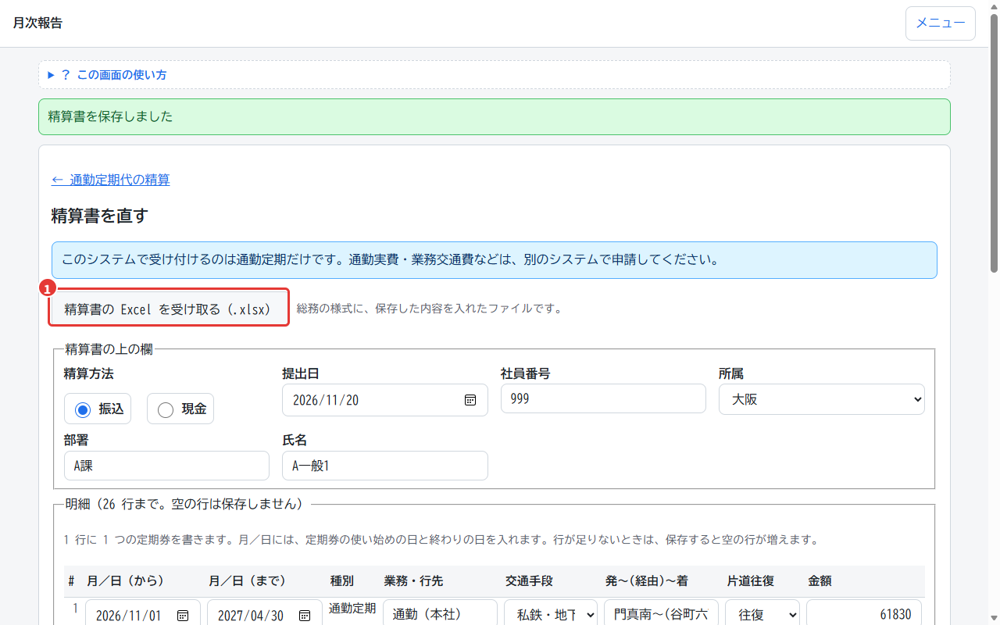

「精算書の Excel を受け取る」（図の 1）を押すと、総務の様式のファイルが「ダウンロード」フォルダーに入ります。

### 13.3 直す・写す・消す

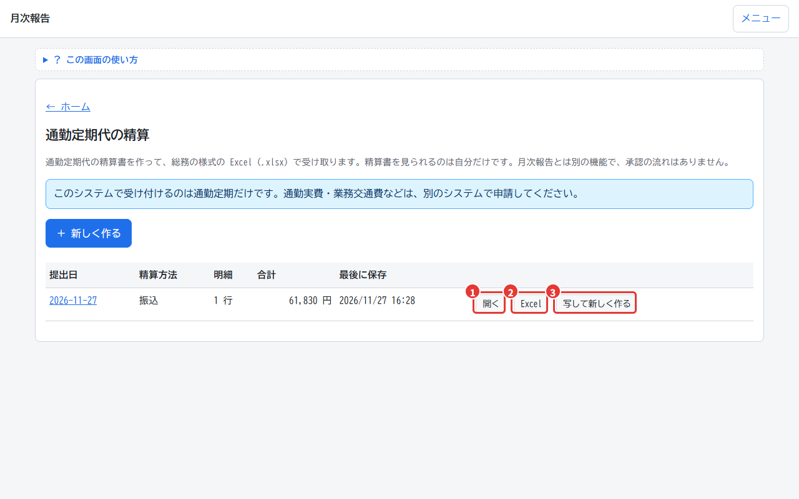

- 「開く」（図の 1）で直せます。「Excel」（図の 2）で、すぐにファイルを受け取れます。
- 定期券を更新するときは、「写して新しく作る」（図の 3）で同じ内容から作れます。
- 消すときは、精算書を開いて「この精算書を削除」を押します。

---

## 14. 目標管理シート

会社の目標管理評価シートを書いて、会社の様式の Excel のファイルで受け取れます。

- 年度の始めに目標を書き、中間（3 月末）と最終（9 月末）に報告と本人評価を書きます。
- シートを見られるのは、本人と、その課の課長・課長代理だけです。
- コメントは、あとから直したり消したりできません。

### 14.1 シートを作る

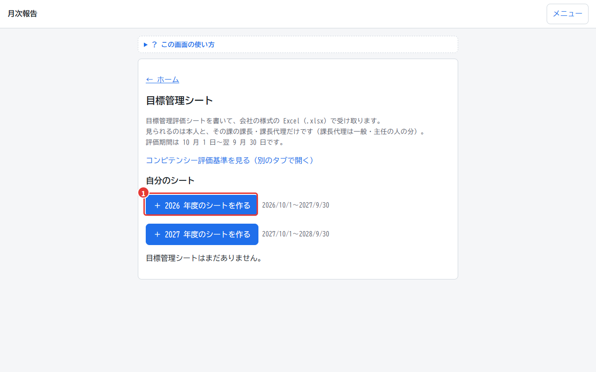

1. メニューの「目標管理シート」を開き、「＋ （年度） 年度のシートを作る」（図の 1）を押す。

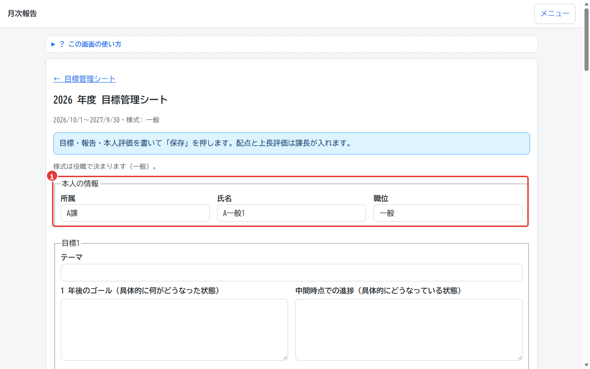

2. 様式は役職で決まります。所属・氏名・職位（図の 1）を確かめる。

3. 目標のテーマ（図の 1）と、1 年後のゴール（図の 2）を書く。

### 14.2 中間・最終の報告と本人評価

1. 中間のとき: 中間報告（図の 1）と課題と対策（図の 2）を書き、本人評価（図の 3）を選ぶ。最終のときも同じように書く。

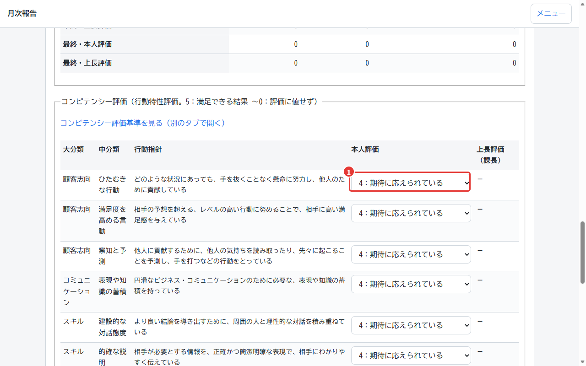

2. コンピテンシー評価の本人評価（図の 1）を項目ごとに選び、下の「保存」を押す。何度でも書き直せます。点の付け方は、「コンピテンシー評価基準を見る」で確かめられます。

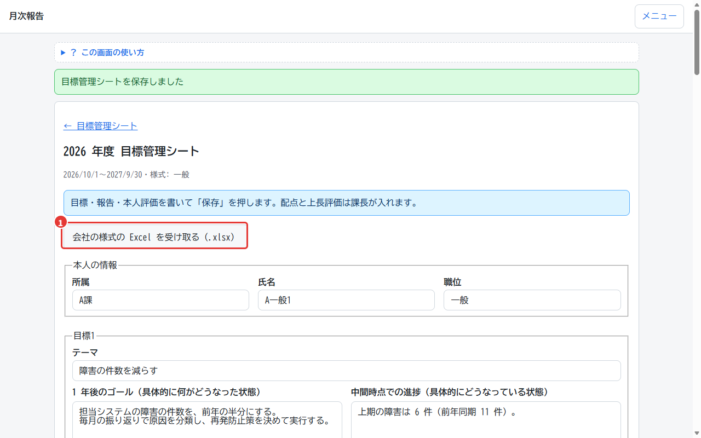

3. 「目標管理評価シートの Excel を受け取る」（図の 1）で、様式のファイルを受け取れます（PC だけ）。

### 14.4 コメント

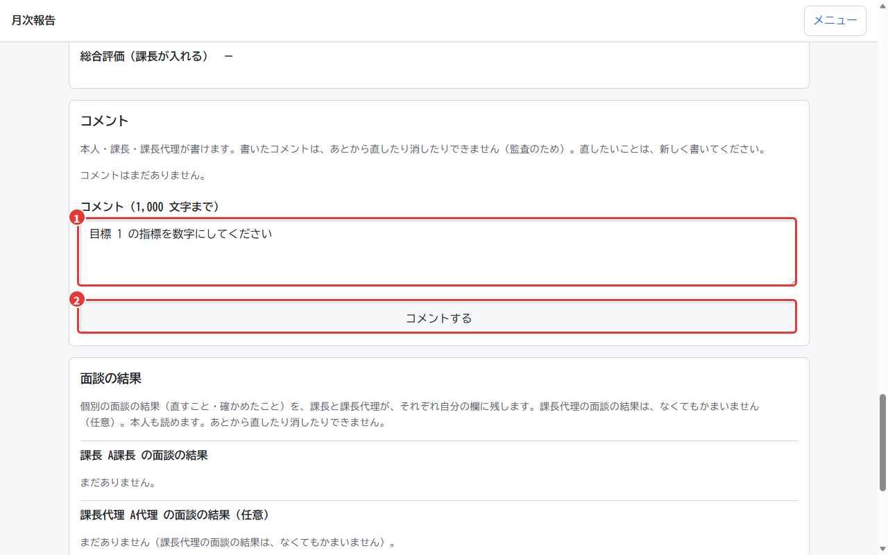

- シートの下の「コメント」（図の 1）に書いて「コメントする」（図の 2）を押すと、課長・課長代理が読めます。

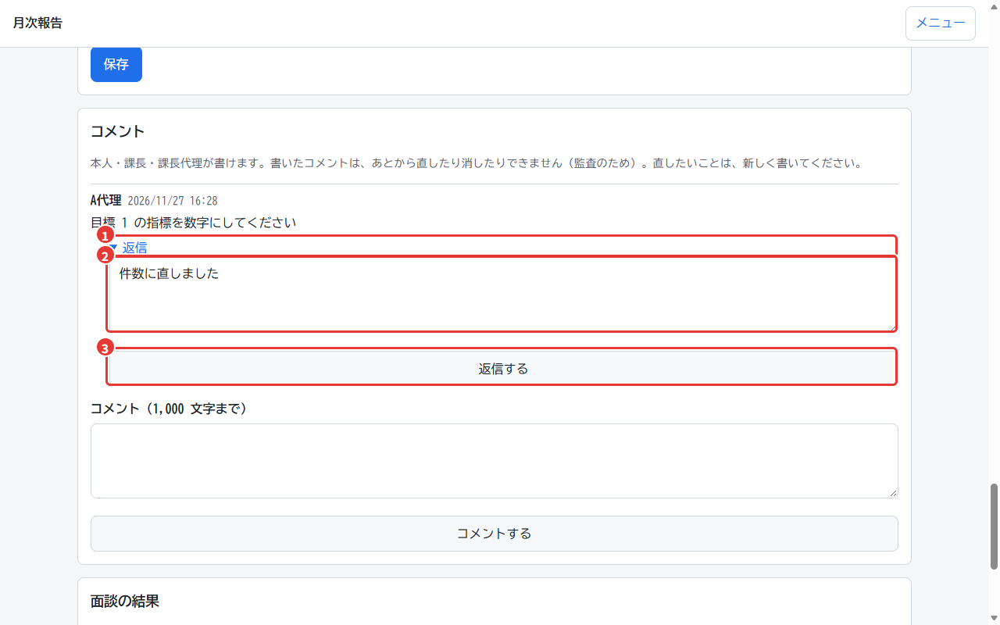

- コメントに答えるときは、「返信」（図の 1）を押し、文（図の 2）を書いて「返信する」（図の 3）を押します。
- 課長・課長代理が書いた面談の結果も、シートで読めます。
