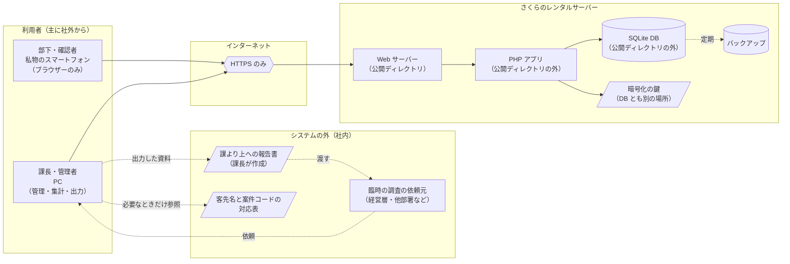
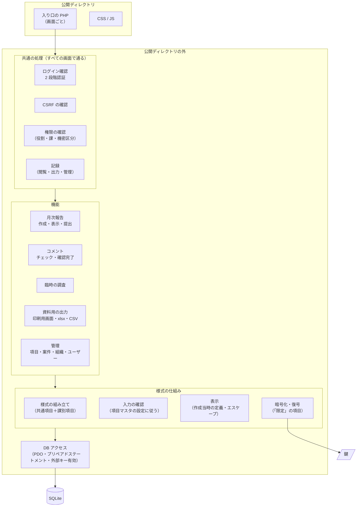
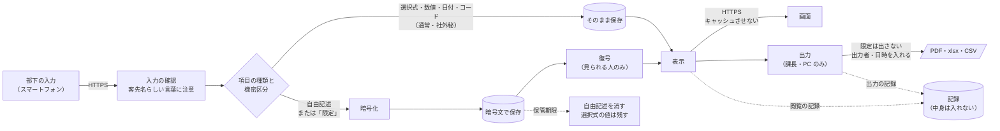
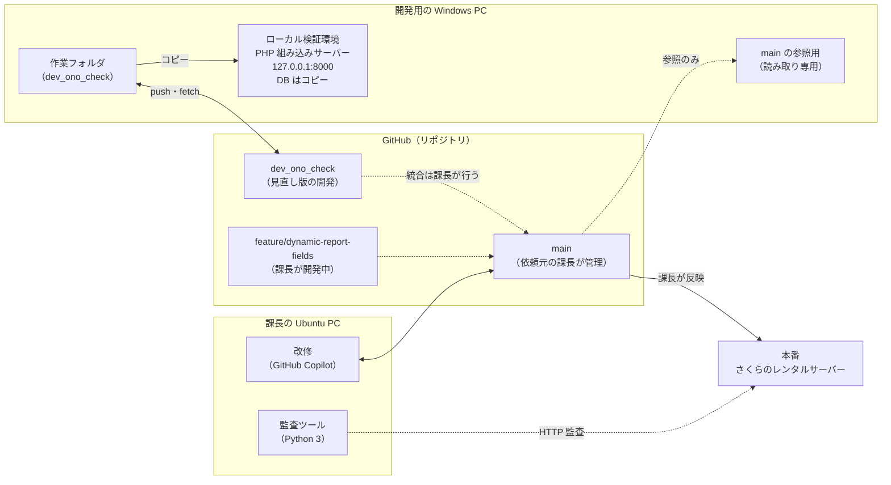

# システム構成図

月次報告システム（見直し版）

| 項目 | 内容 |
|---|---|
| 版 | 0.1（たたき台） |
| 作成日 | 2026-11-12 |
| 関連文書 | [基本設計書](basic_design.md)、[見直し計画](redesign_plan.md) |

図は Mermaid 記法で書いている（GitHub ではそのまま図として表示される）。

---

## 1. 全体構成



| 要素 | 役割 | 守り方 |
|---|---|---|
| 私物のスマートフォン | 部下の入力、確認者のチェック、コメント | ブラウザーだけで使う。画面の内容を端末に保存させない。出力はさせない |
| PC | 課長・管理者の管理、集計、出力 | 出力は PC からだけ。出力物に出力者・日時を入れる |
| HTTPS | 通信の暗号化 | HTTP は HTTPS に転送する。接続元の IP では制限しない（社外から使うため） |
| 公開ディレクトリ | 画面の入り口だけを置く | DB・設定・鍵・ライブラリを置かない |
| PHP アプリ | 画面・処理・権限の確認 | 公開ディレクトリの外に置き、直接呼べないようにする |
| SQLite DB | 報告・項目マスタ・記録 | 公開ディレクトリの外。自由記述と「限定」の項目は暗号化して保存。リポジトリには入れない |
| 暗号化の鍵 | 「限定」の項目の暗号化 | DB とは別の場所。DB だけが漏れても読めない |
| 対応表（システムの外） | 案件コードから客先を引く | このシステムには入れない。漏えい時の影響の特定だけに使う |

---

## 2. サーバーの中の配置

さくらのレンタルサーバーでは、`~/www/` の下だけが Web に公開される。**公開するのは画面の入り口だけ**にし、それ以外は `~/www/` の外に置く。

```text
~/                                   （サーバーのホーム）
├── www/                             ← Web に公開される
│   └── report-system/               ← 公開する入り口だけ
│       ├── index.php                  各画面の入り口（中身は app/ を読み込むだけ）
│       ├── ...
│       ├── css/  js/                  画面の見た目と最小限の JavaScript
│       └── .htaccess                  HTTPS への転送、セキュリティヘッダー、一覧表示の禁止
│
└── report-system-app/               ← 公開されない
    ├── app/                           画面の処理（権限の確認、入力の確認）
    ├── lib/                           共通部品（認証、CSRF、様式の組み立て、暗号化、出力）
    ├── config/                        設定（DB の場所、鍵の場所）
    ├── data/
    │   └── reports.sqlite             DB
    ├── keys/
    │   └── field.key                  「限定」の項目の暗号化の鍵（権限 600）
    ├── backups/                       DB のバックアップ（保管期限で削除）
    └── logs/                          エラーの記録（画面には詳細を出さない）
```

- 公開ディレクトリの外に置けば、`.htaccess` の設定を誤っても DB や鍵は Web から取得できない（既存の Web 版では DB が公開ディレクトリの中にあり、取得できる状態になっている）。
- 念のため、`report-system-app/` の各ディレクトリにも、Web からのアクセスを拒否する `.htaccess` を置く。
- 鍵ファイルとバックアップは、ファイルの権限を所有者だけが読める設定にする。

---

## 3. アプリの構成



- すべての画面は、**ログイン確認 → CSRF の確認 → 権限の確認 → 記録**の共通の処理を通ってから、機能の処理に入る。
- 項目の追加・変更は項目マスタで行い、画面・入力の確認・表示・出力はすべて「様式の仕組み」を通す。項目の一覧をファイルごとに直書きしない。
- 外部のライブラリは使わない。xlsx は PHP で組み立て、PDF はブラウザーの印刷機能で作る。

---

## 4. データの流れと守り方



### 4.1 漏れたときに何が分かるか

| 漏れたもの | 分かってしまうこと | 分からないこと |
|---|---|---|
| DB ファイルだけ | 案件コード、選択式の値（フェーズ・進捗・継続見込みなど）、数値・日付 | 客先名（対応表はシステムの外）、**自由記述のすべて**と「限定」の項目（暗号化）、期限を過ぎた自由記述（削除済み） |
| DB と鍵（サーバーごと） | 上に加えて、保管期限内の自由記述と「限定」の項目 | 客先名（対応表はシステムの外。ただし自由記述に書かれていれば分かる → 入力時に注意を出して減らす） |
| リポジトリ（GitHub） | ソースと設計書 | DB・鍵・バックアップ・ログ（リポジトリに入れない） |
| 出力したファイル | 出力した範囲の値（「限定」は含まない） | 出力の範囲外。出力者と日時はファイルに書かれている |
| 1 人のアカウント | その人が見られる範囲 | 見られた範囲は記録から特定できる |

---

## 5. 環境



| 環境 | 場所 | 用途 | データ |
|---|---|---|---|
| 本番 | さくらのレンタルサーバー | 利用者が使う | 実データ（11.4 の対策が終わるまでテストデータのみ） |
| ローカル検証 | 開発用 PC の `127.0.0.1:8000` | 改修の動作確認 | DB のコピー。外部からは接続できない |
| リポジトリ | GitHub | ソースと設計書 | **DB の実データ・鍵・パスワードは入れない** |

- `main` への統合と本番への反映は、依頼元の課長が行う。
- 本番での動作確認（監査ツールの HTTP 監査など）は、実施する時期を課長と決めてから行う。

---

## 6. バックアップと復旧

| 対象 | 方法 | 保管 |
|---|---|---|
| DB | 定期的にコピー（サーバー上の `backups/`） | 保管期限を過ぎたものは削除。暗号化の鍵とは別に保管 |
| 暗号化の鍵 | 作成時に安全な場所へ控えを取る | 鍵をなくすと「限定」の項目が読めなくなる |
| ソース | GitHub | — |

復旧の手順は、詳細設計書の運用編（今後作成）で決める。
